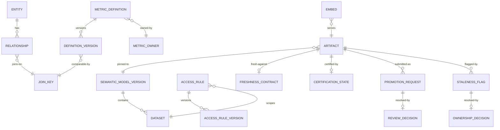

# 03 · Domain Model

> ⚠️ ASSUMPTION — bounded contexts, aggregates and invariants are pack design.
> No external standard is cited for this decomposition.

## Bounded contexts

| Context | Responsibility | Owns |
|---|---|---|
| **Semantic model** | Datasets, entities, relationships, and the metrics built on them | Dataset, Entity, Relationship, SemanticModelVersion |
| **Metrics** | Definitions, versions, owners, the join key | MetricDefinition, DefinitionVersion, MetricOwner, JoinKey |
| **Access** | RLS/CLS rules evaluated in the query context | AccessRule, RuleVersion, AccessDecision |
| **Authoring** | Exploration and user content | Query, SavedQuery, Exploration |
| **Certified artifacts** | The trustworthy surface | Artifact, FreshnessContract, CertificationState |
| **Promotion** | The boundary crossing | PromotionRequest, ReviewDecision |
| **Serving** | Rendering, embeds, distribution | RenderJob, Embed, Subscription, Export |
| **Governance** | Inventory, staleness, ownership | ArtifactRecord, StalenessFlag, OwnershipDecision |

The Metrics context is the spine: certified artifacts, governance and promotion
all reference a **definition version**, never a name.

## Core aggregates & invariants

### MetricDefinition / DefinitionVersion (metrics)
```
MetricDefinition: id, name, ownerRef (a PERSON), currentVersion
DefinitionVersion: id, metricRef, version, grain, aggregation, timeSemantics,
  joinKeyRef, filters[], supersededBy?, publishedTs
└── invariants
    • an owner is a named person, not a team (BR-01)
    • a version is immutable once published; a change is a new version
    • comparability requires one declared join key — never a name match
      (BR-01, FR-002)
    • prior versions are retained so pinned artifacts stay interpretable
      (BR-06, FR-003)
```

### JoinKey (metrics)
```
JoinKey: id, definitionRef, entityRef, keyExpression
└── invariants
    • two metrics are comparable ⇔ they share a join key on the same key
      expression (BR-01)
    • a pair with the same name and different semantics is a defect (NFR-002)
```

### Entity / Relationship (semantic model)
```
Entity: id, name, datasetRef
Relationship: id, fromEntityRef, toEntityRef, cardinality, joinKeyRef
└── invariants
    • a relationship must be DECLARED before a join uses it (BR-02, FR-004)
    • an undeclared relationship discovered at query time is a defect
```

### AccessRule / RuleVersion (access)
```
AccessRule: id, kind (row|column), scopeRef, expression, target (dataset|entity|metric)
AccessRuleVersion: id, ruleRef, version, effectiveFrom
AccessDecision: id, queryId, ruleVersions[], outcome
└── invariants
    • the rule lives in the SEMANTIC MODEL, not on a dashboard (BR-03, FR-005)
    • evaluation uses identity context passed into the query, never
      presentation-time filtering (BR-04, FR-008)
    • every query surface evaluates the same rules — interactive, embedded,
      exported, admin, sandbox (BR-10, FR-006, FR-009)
    • a rule can be tested in isolation and audited as a definition (FR-007)
```

### Artifact (certified artifacts)
```
Artifact: id, kind (dashboard|report|saved-query), state (user|certified),
  modelVersionRef, ownerRef?, freshnessContractRef, certificationStateRef
FreshnessContract: id, modelRef, window, source
CertificationState: id, computedFrom (contract state + pipeline state + owner +
  artifact version), computedTs
└── invariants
    • state ∈ {user, certified} — no third state (BR-05, FR-014)
    • an artifact pins a model version; a new version does not silently change it
      (BR-06, FR-010)
    • certification is COMPUTED, never hand-labelled (BR-07, FR-013)
    • freshness is relative to the model's contract, not the last DB write
      (BR-07, FR-012)
    • becoming certified requires an owner, a pinned version and a freshness
      contract (FR-016)
```

### PromotionRequest / ReviewDecision (promotion)
```
PromotionRequest: id, artifactRef, submitterRef, submittedTs, intendedAudience
ReviewDecision: id, requestRef, decision (publish|reject), reason?, reviewerRef, ts
└── invariants
    • a rejection records a reason; a rejection without one is indistinguishable
      from no review (BR-05, FR-015)
    • crossing the boundary is an explicit reviewed act (BR-05)
```

### StalenessFlag / OwnershipDecision (governance)
```
StalenessFlag: id, artifactRef, reason (pinned model superseded), raisedTs
OwnershipDecision: id, flagRef, decision (assign owner | decommission), actor, ts
└── invariants
    • a flag is never resolved by silent deletion (BR-09, FR-018)
    • every flag ends with an ownership decision, never with silence (BR-09)
```

## Relationships (logical)



## The four aggregates that carry the pack's weight

| Aggregate | The invariant that matters most | What it prevents |
|---|---|---|
| **JoinKey** | comparability requires one declared key | a semantic layer that is a shared vocabulary for people who already agree |
| **AccessRule** | lives in the semantic model, evaluated with identity context | permission logic duplicated per artifact, bypassed per new consumer, and untestable |
| **Artifact** | pins a model version, and certification is computed | an artifact silently changing when the model moves, and a trust label that drifts from reality |
| **StalenessFlag** | ends with an ownership decision, never silence | an unowned artefact that will be trusted |

> The second is where the access-control design either holds or becomes
> decoration, and the third is where "certified" either means something or stops.