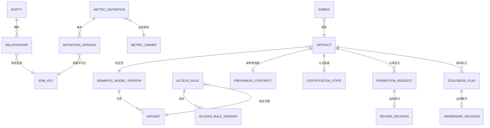

# 03 · 领域模型

> ⚠️ ASSUMPTION — 限界上下文、聚合与不变量属于方案包设计。没有为这一分解引用
> 任何外部标准。

## 限界上下文

| 上下文 | 职责 | 拥有的类型 |
|---|---|---|
| **语义模型** | 数据集、实体、关系，以及建立其上的指标 | Dataset、Entity、Relationship、SemanticModelVersion |
| **指标** | 定义、版本、负责人、连接键 | MetricDefinition、DefinitionVersion、MetricOwner、JoinKey |
| **访问** | 在查询上下文中求值的 RLS/CLS 规则 | AccessRule、RuleVersion、AccessDecision |
| **编写** | 探查与用户内容 | Query、SavedQuery、Exploration |
| **已认证制品** | 可信的那一面 | Artifact、FreshnessContract、CertificationState |
| **晋升** | 边界跨越 | PromotionRequest、ReviewDecision |
| **服务** | 渲染、嵌入、分发 | RenderJob、Embed、Subscription、Export |
| **治理** | 清单、陈旧度、归属 | ArtifactRecord、StalenessFlag、OwnershipDecision |

指标上下文是主干：已认证制品、治理与晋升都引用一个**定义版本**，而不是一个
名字。

## 核心聚合与不变量

### MetricDefinition / DefinitionVersion（指标）
```
MetricDefinition: id, name, ownerRef (a PERSON), currentVersion
DefinitionVersion: id, metricRef, version, grain, aggregation, timeSemantics,
  joinKeyRef, filters[], supersededBy?, publishedTs
└── invariants
    • 负责人是具名的人，而不是团队（BR-01）
    • 版本发布后即不可变；一次变更就是一个新版本
    • 可比性需要一个已声明的连接键——绝不是名字匹配
      (BR-01, FR-002)
    • 先前版本被保留，使固定的制品保持可解释
      (BR-06, FR-003)
```

### JoinKey（指标）
```
JoinKey: id, definitionRef, entityRef, keyExpression
└── invariants
    • 两个指标可比 ⇔ 它们在同一个键表达式上共享一个连接键（BR-01）
    • 同名而语义不同的一对是缺陷（NFR-002）
```

### Entity / Relationship（语义模型）
```
Entity: id, name, datasetRef
Relationship: id, fromEntityRef, toEntityRef, cardinality, joinKeyRef
└── invariants
    • 关系必须先被声明，连接才能使用它（BR-02、FR-004）
    • 在查询时才发现的未声明关系是缺陷
```

### AccessRule / RuleVersion（访问）
```
AccessRule: id, kind (row|column), scopeRef, expression, target (dataset|entity|metric)
AccessRuleVersion: id, ruleRef, version, effectiveFrom
AccessDecision: id, queryId, ruleVersions[], outcome
└── invariants
    • 规则存在于语义模型中，而不在仪表盘上（BR-03、FR-005）
    • 求值使用传入查询的身份上下文，绝不是呈现时过滤
      (BR-04, FR-008)
    • 每个查询界面都求值同一套规则——交互式、嵌入式、导出的、管理端、沙箱
      (BR-10, FR-006, FR-009)
    • 规则可以被单独测试并作为定义被审计（FR-007）
```

### Artifact（已认证制品）
```
Artifact: id, kind (dashboard|report|saved-query), state (user|certified),
  modelVersionRef, ownerRef?, freshnessContractRef, certificationStateRef
FreshnessContract: id, modelRef, window, source
CertificationState: id, computedFrom (contract state + pipeline state + owner +
  artifact version), computedTs
└── invariants
    • state ∈ {user, certified} —— 不存在第三种状态（BR-05、FR-014）
    • 制品固定一个模型版本；新版本不会静默改变它
      (BR-06, FR-010)
    • 认证是被计算出来的，绝不手工标注（BR-07、FR-013）
    • 新鲜度相对于模型的契约，而不是数据库最后一次写入
      (BR-07, FR-012)
    • 成为已认证需要一个负责人、一个固定的版本与一条新鲜度契约（FR-016）
```

### PromotionRequest / ReviewDecision（晋升）
```
PromotionRequest: id, artifactRef, submitterRef, submittedTs, intendedAudience
ReviewDecision: id, requestRef, decision (publish|reject), reason?, reviewerRef, ts
└── invariants
    • 拒绝必须记录理由；没有理由的拒绝与没有评审无法区分
      (BR-05, FR-015)
    • 跨越边界是一个明确的、经评审的动作（BR-05）
```

### StalenessFlag / OwnershipDecision（治理）
```
StalenessFlag: id, artifactRef, reason (pinned model superseded), raisedTs
OwnershipDecision: id, flagRef, decision (assign owner | decommission), actor, ts
└── invariants
    • 一个标记绝不被静默删除所消解（BR-09、FR-018）
    • 每个标记都以一个归属决定收尾，绝不以沉默收尾（BR-09）
```

## 关系（逻辑）



## 承载本方案包重量的四个聚合

| 聚合 | 最要紧的那条不变量 | 它防止什么 |
|---|---|---|
| **JoinKey** | 可比性需要一个已声明的键 | 一个只是给已经达成一致的人提供共同词汇的语义层 |
| **AccessRule** | 存在于语义模型中，带着身份上下文被求值 | 权限逻辑按制品复制、被新消费方绕过、且无法测试 |
| **Artifact** | 固定一个模型版本，且认证被计算得出 | 制品在模型前进时静默改变，以及一个与现实漂移的信任标签 |
| **StalenessFlag** | 以一个归属决定收尾，绝不以沉默收尾 | 一个无人拥有、却会被信任的制品 |

> 第二个是访问控制设计要么成立、要么沦为装饰的分界；第三个是「已认证」要么
> 有意义、要么名存实亡的分界。
