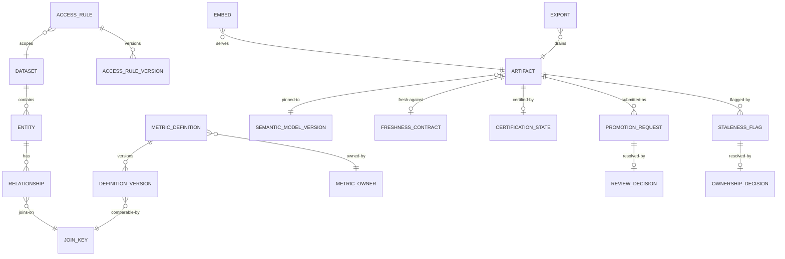

# 05 · Logical Data Model

> Logical model for the core entities. Physical modelling is a deployment
> concern; this file fixes the shape and the invariants.
>
> ⚠️ ASSUMPTION — the model is pack design.

## Entities

```
DATASET (semantic model)
  dataset_id        PK, name, sourceRef, freshnessContractRef?

ENTITY (semantic model)
  entity_id         PK, dataset_id FK → DATASET, name

RELATIONSHIP (semantic model)                    -- BR-02
  relationship_id   PK
  from_entity_ref   FK → ENTITY NOT NULL
  to_entity_ref     FK → ENTITY NOT NULL
  cardinality, join_key_ref FK → JOIN_KEY NOT NULL
  -- DECLARED before a join may use it (constraint 1)

JOIN_KEY (metrics)                              -- BR-01, ADR-0001
  join_key_id       PK
  entity_ref        FK → ENTITY
  key_expression
  -- comparability mechanism; a same-name pair with different semantics is a
  -- defect (NFR-002)

METRIC_DEFINITION (metrics)                      -- BR-01
  metric_definition_id PK, name, ownerRef NOT NULL (a PERSON), current_version
  -- an owner is a named person, never a team alias (constraint 2)

DEFINITION_VERSION (metrics)                    -- BR-01, BR-06, ADR-0003
  definition_version_id PK
  metric_definition_ref FK → METRIC_DEFINITION NOT NULL
  version, grain, aggregation, time_semantics
  join_key_ref       FK → JOIN_KEY
  filters[]
  superseded_by?     , published_ts
  -- immutable once published (constraint 3)

ACCESS_RULE (access)                            -- BR-03, ADR-0002
  access_rule_id     PK
  kind               row | column
  target             dataset | entity | metric
  expression         NOT NULL
  scope_ref

ACCESS_RULE_VERSION (access)                     -- BR-03
  rule_version_id    PK
  access_rule_ref    FK → ACCESS_RULE NOT NULL
  version, effective_from
  -- immutable once published (constraint 3)

ACCESS_DECISION (access)                          -- BR-04, BR-10
  decision_id        PK
  query_id, access_rule_versions[], outcome, identity_context_ref
  -- outcome is recorded so "which rows could this user see" is answerable

ARTIFACT (certified artifacts)                    -- BR-05, BR-06, BR-07
  artifact_id        PK
  kind               dashboard | report | saved_query
  state              user | certified      -- EXACTLY two states (constraint 4)
  model_version_ref  FK → SEMANTIC_MODEL_VERSION NOT NULL (constraint 5)
  owner_ref?         -- required when state = certified (constraint 6)
  freshness_contract_ref  FK → FRESHNESS_CONTRACT
  certification_state_ref FK → CERTIFICATION_STATE

FRESHNESS_CONTRACT (certified artifacts)         -- BR-07, ADR-0004
  contract_id        PK, model_ref, window, source

CERTIFICATION_STATE (certified artifacts)        -- BR-07, ADR-0004
  state_id           PK
  computed_from      (contract state + pipeline state + owner + artifact version)
  computed_ts
  -- COMPUTED, never hand-labelled (constraint 7)

PROMOTION_REQUEST / REVIEW_DECISION (promotion)   -- BR-05, ADR-0005
  promotion_request_id PK, artifact_ref, submitter_ref, submitted_ts,
    intended_audience
  review_decision_id   PK
  promotion_request_ref FK → PROMOTION_REQUEST NOT NULL
  decision            publish | reject          NOT NULL
  reason?             -- NOT NULL when decision = reject (constraint 8)
  reviewer_ref        NOT NULL, ts

STALENESS_FLAG / OWNERSHIP_DECISION (governance)  -- BR-09
  staleness_flag_id  PK, artifact_ref, reason, raised_ts
  ownership_decision_id PK
  flag_ref           FK → STALENESS_FLAG NOT NULL
  decision           assign_owner | decommission  NOT NULL
  actor, ts          -- every flag ends with a decision, never silence

SEMANTIC_MODEL_VERSION (semantic model)
  model_version_id   PK, published_ts, published_by, impact_report_ref
  -- an impact report accompanies every publish (constraint 9)

EMBED / EXPORT (serving)
  embed_id           PK, artifact_ref, host_ref, identity_mode
  export_id          PK, artifact_ref, consumer_ref
  -- both are consumers under the same layer evaluation (constraint 10)
```

## Keys and cardinalities



## Integrity constraints the model must enforce

| # | Constraint | Enforces |
|---|---|---|
| 1 | A join must use a **declared** `RELATIONSHIP`; undeclared joins are rejected at model time | BR-02, FR-004 |
| 2 | `METRIC_DEFINITION.ownerRef` is NOT NULL and is a person reference, never a team alias | BR-01, FR-001 |
| 3 | `DEFINITION_VERSION` and `ACCESS_RULE_VERSION` are append-only; no UPDATE grant | BR-01, BR-03, FR-003 |
| 4 | `ARTIFACT.state` ∈ {user, certified}; no third state exists | BR-05, FR-014 |
| 5 | `ARTIFACT.model_version_ref` is NOT NULL | BR-06, FR-010, NFR-010 |
| 6 | `ARTIFACT.owner_ref` is NOT NULL when `state = 'certified'` | BR-05, FR-016 |
| 7 | `CERTIFICATION_STATE` is computed; there is no `certified_by` field to write | BR-07, FR-013 |
| 8 | `REVIEW_DECISION.reason` is NOT NULL when the decision is reject | BR-05, FR-015 |
| 9 | `SEMANTIC_MODEL_VERSION` publish requires an `impact_report_ref` | BR-06, FR-011, NFR-010 |
| 10 | `EMBED` and `EXPORT` have no direct data read; they resolve through the semantic layer | BR-08, BR-10, FR-017 |

> Constraints 3, 4, 5, 7, 8 and 10 are **enforced in the store**, not in
> application code. A third artifact state, an unpinned artifact, a
> writable certification field, or an embed with a direct read is a defect
> regardless of what application discipline promises — and each is a sev-1 signal
> in `04-architecture/observability.md`.