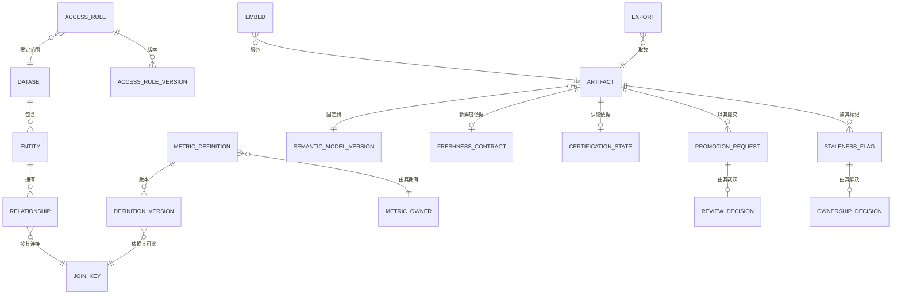

# 05 · 逻辑数据模型

> 核心实体的逻辑模型。物理建模是部署关注点；本文件固定形态与不变量。
>
> ⚠️ ASSUMPTION — 该模型属于方案包设计。

## 实体

```
DATASET（语义模型）
  dataset_id        PK, name, sourceRef, freshnessContractRef?

ENTITY（语义模型）
  entity_id         PK, dataset_id FK → DATASET, name

RELATIONSHIP（语义模型）                    -- BR-02
  relationship_id   PK
  from_entity_ref   FK → ENTITY NOT NULL
  to_entity_ref     FK → ENTITY NOT NULL
  cardinality, join_key_ref FK → JOIN_KEY NOT NULL
  -- 连接使用它之前必须先被声明（约束 1）

JOIN_KEY（指标）                              -- BR-01, ADR-0001
  join_key_id       PK
  entity_ref        FK → ENTITY
  key_expression
  -- 可比性机制；同名但语义不同的一对是缺陷（NFR-002）

METRIC_DEFINITION（指标）                      -- BR-01
  metric_definition_id PK, name, ownerRef NOT NULL (a PERSON), current_version
  -- 负责人是具名的人，绝不是团队别名（约束 2）

DEFINITION_VERSION（指标）                    -- BR-01, BR-06, ADR-0003
  definition_version_id PK
  metric_definition_ref FK → METRIC_DEFINITION NOT NULL
  version, grain, aggregation, time_semantics
  join_key_ref       FK → JOIN_KEY
  filters[]
  superseded_by?     , published_ts
  -- 发布后不可变（约束 3）

ACCESS_RULE（访问）                            -- BR-03, ADR-0002
  access_rule_id     PK
  kind               row | column
  target             dataset | entity | metric
  expression         NOT NULL
  scope_ref

ACCESS_RULE_VERSION（访问）                     -- BR-03
  rule_version_id    PK
  access_rule_ref    FK → ACCESS_RULE NOT NULL
  version, effective_from
  -- 发布后不可变（约束 3）

ACCESS_DECISION（访问）                          -- BR-04, BR-10
  decision_id        PK
  query_id, access_rule_versions[], outcome, identity_context_ref
  -- 结果被记录，因此「这个用户本可以看到哪些行」可被回答

ARTIFACT（已认证制品）                    -- BR-05, BR-06, BR-07
  artifact_id        PK
  kind               dashboard | report | saved_query
  state              user | certified      -- 恰好两种状态（约束 4）
  model_version_ref  FK → SEMANTIC_MODEL_VERSION NOT NULL (constraint 5)
  owner_ref?         -- 当 state = certified 时必填（约束 6）
  freshness_contract_ref  FK → FRESHNESS_CONTRACT
  certification_state_ref FK → CERTIFICATION_STATE

FRESHNESS_CONTRACT（已认证制品）         -- BR-07, ADR-0004
  contract_id        PK, model_ref, window, source

CERTIFICATION_STATE（已认证制品）        -- BR-07, ADR-0004
  state_id           PK
  computed_from      (contract state + pipeline state + owner + artifact version)
  computed_ts
  -- 被计算得出，绝不手工标注（约束 7）

PROMOTION_REQUEST / REVIEW_DECISION（晋升）   -- BR-05, ADR-0005
  promotion_request_id PK, artifact_ref, submitter_ref, submitted_ts,
    intended_audience
  review_decision_id   PK
  promotion_request_ref FK → PROMOTION_REQUEST NOT NULL
  decision            publish | reject          NOT NULL
  reason?             -- 当 decision = reject 时 NOT NULL（约束 8）
  reviewer_ref        NOT NULL, ts

STALENESS_FLAG / OWNERSHIP_DECISION（治理）  -- BR-09
  staleness_flag_id  PK, artifact_ref, reason, raised_ts
  ownership_decision_id PK
  flag_ref           FK → STALENESS_FLAG NOT NULL
  decision           assign_owner | decommission  NOT NULL
  actor, ts          -- 每个标记都以一个决定收尾，绝不以沉默收尾

SEMANTIC_MODEL_VERSION（语义模型）
  model_version_id   PK, published_ts, published_by, impact_report_ref
  -- 每次发布都附带一份影响报告（约束 9）

EMBED / EXPORT（服务）
  embed_id           PK, artifact_ref, host_ref, identity_mode
  export_id          PK, artifact_ref, consumer_ref
  -- 两者都是在同样层求值下的消费方（约束 10）
```

## 键与基数



## 模型必须强制执行的完整性约束

| # | 约束 | 强制执行 |
|---|---|---|
| 1 | 一次连接必须使用一条**已声明的** `RELATIONSHIP`；未声明的连接在建模时即被拒绝 | BR-02、FR-004 |
| 2 | `METRIC_DEFINITION.ownerRef` 为 NOT NULL 且是一个人引用，绝不是团队别名 | BR-01、FR-001 |
| 3 | `DEFINITION_VERSION` 与 `ACCESS_RULE_VERSION` 仅可追加；没有 UPDATE 授权 | BR-01、BR-03、FR-003 |
| 4 | `ARTIFACT.state` ∈ {user, certified}；不存在第三种状态 | BR-05、FR-014 |
| 5 | `ARTIFACT.model_version_ref` 为 NOT NULL | BR-06、FR-010、NFR-010 |
| 6 | `state = 'certified'` 时 `ARTIFACT.owner_ref` 为 NOT NULL | BR-05、FR-016 |
| 7 | `CERTIFICATION_STATE` 是被计算得出的；不存在可写的 `certified_by` 字段 | BR-07、FR-013 |
| 8 | 决策为拒绝时 `REVIEW_DECISION.reason` 为 NOT NULL | BR-05、FR-015 |
| 9 | `SEMANTIC_MODEL_VERSION` 的发布要求一个 `impact_report_ref` | BR-06、FR-011、NFR-010 |
| 10 | `EMBED` 与 `EXPORT` 没有直接的数据读取；它们经由语义层解析 | BR-08、BR-10、FR-017 |

> 约束 3、4、5、7、8 和 10 是**在存储层强制执行**的，而不是在应用代码中。
> 第三种制品状态、一件未固定的制品、一个可写的认证字段，或一个带直接读取的
> 嵌入，无论应用纪律作出何种承诺都是缺陷——而每一个都是
> `04-architecture/observability.md` 中的 sev-1 信号。
