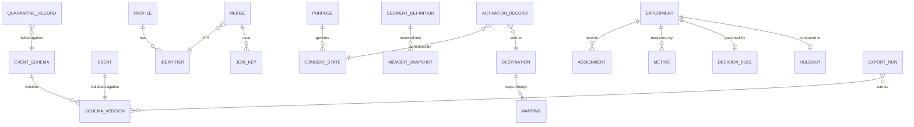

# 03 · Domain Model

> ⚠️ ASSUMPTION — bounded contexts, aggregates and invariants are pack design.
> No external standard is cited for this decomposition.

## Bounded contexts

| Context | Responsibility | Owns |
|---|---|---|
| **Schema registry** | The spine: declares, validates, versions | EventSchema, SchemaVersion, ValidationResult, QuarantineRecord |
| **Identity** | Resolution, merge, unmerge, deletion | Profile, Identifier, Merge, JoinKey |
| **Collection & activation** | The consent boundary at both points | ConsentState, Purpose, ActivationRecord |
| **Analysis** | Descriptive computation | Funnel, Cohort, RetentionCurve, AttributionModel, Path |
| **Experimentation** | Randomisation and causal measurement | Experiment, Assignment, Metric, GuardrailMetric, Holdout, DecisionRule |
| **Segments** | Point-in-time membership | SegmentDefinition, MemberSnapshot |
| **Destinations** | The abstraction over messaging and ad platforms | Destination, Mapping, DestinationReport |
| **Export** | Schema-versioned handoff | ExportRun, ExportSchemaVersion |

Schema registry is the spine: analysis, experimentation and export all read
schema versions, and none may accept an event whose schema is undeclared.

## Core aggregates & invariants

### EventSchema / SchemaVersion (schema registry)
```
EventSchema: id, name, owner, properties[]
SchemaVersion: id, schemaRef, version, effectiveFrom, supersededBy?
└── invariants
    • declare-before-emit: an event whose schema version is not registered
      cannot be ingested (BR-01, FR-001, FR-002)
    • a malformed event is quarantined WITH a reason (BR-02, FR-003)
    • exports carry the schema version (BR-02, FR-004)
```

### Identifier / Merge / JoinKey (identity)
```
Identifier: id, kind (anonymous|device|session|known), value
Merge: id, fromRef, toRef, ruleId, performedTs, reversedTs?
JoinKey: id, mergeRef, identifierRef
Profile: id, identifiers[], history
└── invariants
    • every merge is recorded; unmerge restores pre-merge identities AND
      propagates to derived facts (BR-03, FR-005, FR-006)
    • a deletion removes profile, join keys AND derived facts (BR-04, FR-007)
      — leaving the join keys permits re-identification from residue
    • match confidence is visible, not hidden behind a boolean
```

### ConsentState / Purpose (collection & activation)
```
Purpose: id, name, lawfulBasis?, sensitive?
ConsentState: id, profileRef, purposeRef, state, version, grantedTs, revokedTs?
ActivationRecord: id, purposeRef, destinationRef, consentStateRef, memberSnapshotRef
└── invariants
    • collection checks consent for the collecting purpose (BR-11, FR-017)
    • activation checks consent for the USING purpose, separately (BR-11, FR-018)
    • revocation takes effect immediately at BOTH points (FR-019)
    • NFR-009 reports the two checks as separate ratios
```

### Experiment / Assignment (experimentation)
```
Experiment: id, hypothesis, unitOfAnalysis, decisionRuleRef,
  effectSizeDeclared, sampleSizeRequired, state
Assignment: id, experimentRef, unitRef, treatment, ts   -- NOT in the flag system
Metric: id, experimentRef, kind (primary|guardrail), value
Holdout: id, experimentRef, populationRef, delta
DecisionRule: id, rule, declaredAt   -- declared BEFORE results visible
└── invariants
    • assignment lives in the experiment engine (BR-05, FR-008)
    • ratio verification is mandatory; an unhandled SRM signal is a defect
      (BR-07, FR-009)
    • the decision rule is recorded before results are visible (BR-08, FR-014)
    • guardrails are declared alongside the primary (BR-07, FR-012)
```

### SegmentDefinition / MemberSnapshot (segments)
```
SegmentDefinition: id, conditions[], purposeRef
MemberSnapshot: id, segmentRef, resolvedAtTs, memberRef[]
└── invariants
    • a segment resolves to a SNAPSHOT at a point in time, never a live view
      (BR-12, FR-020)
    • the snapshot references the purpose it is used for (BR-11)
```

### Destination / Mapping (destinations)
```
Destination: id, kind (messaging|ad), transferProperty, schemaVersion
Mapping: id, destinationRef, platformField, destinationField, transformRef
DestinationReport: id, destinationRef, period, figures
└── invariants
    • the platform owns the event model and assignment (BR-09, BR-10, FR-015)
    • a destination's report is a reconciliation INPUT, never source of truth
      (BR-10, FR-016)
    • schema mapping lives in the abstraction, not in stored events (BR-13)
```

## Relationships (logical)



## The four aggregates that carry the pack's weight

| Aggregate | The invariant that matters most | What it prevents |
|---|---|---|
| **SchemaVersion** | declare-before-emit, and version on export | a number whose meaning moved underneath it — unrepeatable and undetectable |
| **Merge / JoinKey** | unmerge propagates, and deletion covers join keys | an uncorrectable decision about a person, and an identity reformed from residue |
| **Experiment / Assignment** | assignment in the engine, with SRM | a comparison that looks like a result and is an assignment bug |
| **ConsentState** | enforced at both points, measured separately | a purpose set that grows by accretion, or a single check used as a general licence |

> The second and the fourth are where the growth-analytics pattern's real costs
> sit, and both are usually implemented as configuration rather than invariants.