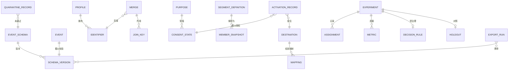

# 03 · 领域模型

> ⚠️ ASSUMPTION — 限界上下文、聚合与不变量属于方案包设计。没有为这一分解引用
> 任何外部标准。

## 限界上下文

| 上下文 | 职责 | 拥有的类型 |
|---|---|---|
| **Schema 注册中心** | 主干：声明、校验、版本化 | EventSchema、SchemaVersion、ValidationResult、QuarantineRecord |
| **身份** | 解析、合并、撤销、删除 | Profile、Identifier、Merge、JoinKey |
| **采集与激活** | 两个点上的同意边界 | ConsentState、Purpose、ActivationRecord |
| **分析** | 描述性计算 | Funnel、Cohort、RetentionCurve、AttributionModel、Path |
| **实验** | 随机化与因果度量 | Experiment、Assignment、Metric、GuardrailMetric、Holdout、DecisionRule |
| **分群** | 某时刻的成员资格 | SegmentDefinition、MemberSnapshot |
| **目的地** | 消息与广告平台之上的抽象层 | Destination、Mapping、DestinationReport |
| **导出** | 带 schema 版本的交接 | ExportRun、ExportSchemaVersion |

Schema 注册中心是主干：分析、实验与导出都读取 schema 版本，而它们无一可以
接受 schema 未被声明的事件。

## 核心聚合与不变量

### EventSchema / SchemaVersion（schema 注册中心）
```
EventSchema: id, name, owner, properties[]
SchemaVersion: id, schemaRef, version, effectiveFrom, supersededBy?
└── invariants
    • 先声明后发出：schema 版本未注册的事件
      无法被接入（BR-01、FR-001、FR-002）
    • 畸形事件被带着理由隔离（BR-02、FR-003）
    • 导出携带 schema 版本（BR-02、FR-004）
```

### Identifier / Merge / JoinKey（身份）
```
Identifier: id, kind (anonymous|device|session|known), value
Merge: id, fromRef, toRef, ruleId, performedTs, reversedTs?
JoinKey: id, mergeRef, identifierRef
Profile: id, identifiers[], history
└── invariants
    • 每次合并都被记录；撤销恢复合并前的身份**并且**
      传播到派生事实（BR-03、FR-005、FR-006）
    • 一次删除移除档案、连接键**与**派生事实（BR-04、FR-007）
      —— 留下连接键就允许从残留中重新识别
    • 匹配置信度是可见的，不是藏在一个布尔值后面
```

### ConsentState / Purpose（采集与激活）
```
Purpose: id, name, lawfulBasis?, sensitive?
ConsentState: id, profileRef, purposeRef, state, version, grantedTs, revokedTs?
ActivationRecord: id, purposeRef, destinationRef, consentStateRef, memberSnapshotRef
└── invariants
    • 采集检查采集目的的同意（BR-11、FR-017）
    • 激活另行检查**使用**目的的同意（BR-11、FR-018）
    • 撤回在**两个**点上立即生效（FR-019）
    • NFR-009 把两项检查作为分开的比率上报
```

### Experiment / Assignment（实验）
```
Experiment: id, hypothesis, unitOfAnalysis, decisionRuleRef,
  effectSizeDeclared, sampleSizeRequired, state
Assignment: id, experimentRef, unitRef, treatment, ts   -- NOT in the flag system
Metric: id, experimentRef, kind (primary|guardrail), value
Holdout: id, experimentRef, populationRef, delta
DecisionRule: id, rule, declaredAt   -- declared BEFORE results visible
└── invariants
    • 分配住在实验引擎中（BR-05、FR-008）
    • 比例核查是强制的；一个未处理的 SRM 信号是缺陷
      （BR-07、FR-009）
    • 决策规则在结果可见之前被记录（BR-08、FR-014）
    • 护栏与主指标一起声明（BR-07、FR-012）
```

### SegmentDefinition / MemberSnapshot（分群）
```
SegmentDefinition: id, conditions[], purposeRef
MemberSnapshot: id, segmentRef, resolvedAtTs, memberRef[]
└── invariants
    • 分群解析为某一时点的**快照**，绝不是实时视图
      （BR-12、FR-020）
    • 快照引用它被使用时的目的（BR-11）
```

### Destination / Mapping（目的地）
```
Destination: id, kind (messaging|ad), transferProperty, schemaVersion
Mapping: id, destinationRef, platformField, destinationField, transformRef
DestinationReport: id, destinationRef, period, figures
└── invariants
    • 平台拥有事件模型与分配（BR-09、BR-10、FR-015）
    • 目的地的报表是对账**输入**，绝不是真相来源
      （BR-10、FR-016）
    • schema 映射住在抽象层里，而不在被存储的事件中（BR-13）
```

## 关系（逻辑）



## 承载本方案包重量的四个聚合

| 聚合 | 最要紧的那条不变量 | 它防止什么 |
|---|---|---|
| **SchemaVersion** | 先声明后发出，导出带版本 | 一个含义在它脚下移动的数字——既不可复现也不可察觉 |
| **Merge / JoinKey** | 撤销会传播，删除覆盖连接键 | 关于某个人的一个无法更正的决定，以及一个从残留中重新形成的身份 |
| **Experiment / Assignment** | 分配在引擎中，并带 SRM | 一个看起来像结果、实则是分配缺陷的比较 |
| **ConsentState** | 在两个点强制，分别度量 | 一个靠积累增长的目的集合，或一次被当作通用许可证的检查 |

> 第二个和第四个是增长分析模式真正的成本所在，而两者通常都被实现为配置而不是
> 不变量。
