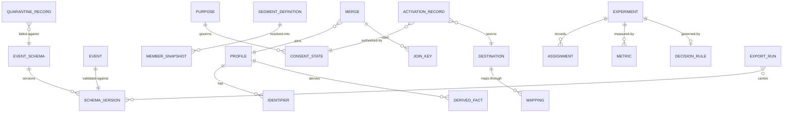

# 05 · Logical Data Model

> Logical model for the core entities. Physical modelling is a deployment
> concern; this file fixes the shape and the invariants.
>
> ⚠️ ASSUMPTION — the model is pack design.

## Entities

```
EVENT_SCHEMA / SCHEMA_VERSION (schema registry)   -- BR-01, BR-02
  event_schema_id   PK, name, owner
  schema_version_id PK
  event_schema_id   FK → EVENT_SCHEMA
  version, properties[], effectiveFrom, supersededBy?
  -- declared BEFORE first emission (constraint 1)

EVENT (schema registry)                            -- BR-01, BR-02
  event_id          PK
  schema_version_id FK → EVENT_SCHEMA   NOT NULL (constraint 2)
  event_name, ts, identity_ref, payload

QUARANTINE_RECORD (schema registry)                -- BR-02
  quarantine_id     PK
  event_payload_ref (raw)
  schema_version_id FK → EVENT_SCHEMA (nullable: unknown)
  reason            NOT NULL          -- missing field | wrong type | unknown
                                     --   property | version mismatch (constraint 3)
  quarantined_ts

IDENTIFIER (identity)                              -- BR-03, BR-04
  identifier_id     PK
  kind              anonymous | device | session | known
  value, profile_ref

MERGE (identity)                                   -- BR-03
  merge_id          PK
  from_profile_ref  FK → PROFILE
  to_profile_ref    FK → PROFILE
  rule_id, performed_ts, reversed_ts?
  -- recorded; reversal propagates to derived facts (constraint 4)

JOIN_KEY (identity)                                -- BR-04
  join_key_id       PK
  merge_id          FK → MERGE
  identifier_id     FK → IDENTIFIER
  -- the key a deletion MUST cover (constraint 5)

PROFILE (identity)
  profile_id        PK, identifiers[], history
  deleted_ts? -- set only when all three parts removed (constraint 5)

DERIVED_FACT (identity)                            -- BR-04
  derived_fact_id   PK, profile_ref, kind, payload
  -- cohort membership, funnel step, attribution credit

PURPOSE / CONSENT_STATE (consent)                  -- BR-11
  purpose_id        PK, name, sensitive?, lawfulBasis?
  consent_state_id  PK
  profile_ref       FK → PROFILE
  purpose_ref       FK → PURPOSE
  state, version, granted_ts, revoked_ts?

ACTIVATION_RECORD (activation)                    -- BR-11
  activation_id     PK
  purpose_ref       FK → PURPOSE            NOT NULL
  consent_state_ref FK → CONSENT_STATE      NOT NULL (constraint 6)
  destination_ref   FK → DESTINATION
  member_snapshot_ref FK → MEMBER_SNAPSHOT

EXPERIMENT / ASSIGNMENT (experimentation)         -- BR-05, BR-07, BR-08
  experiment_id     PK
  hypothesis, unit_of_analysis, state
  decision_rule_ref FK → DECISION_RULE      NOT NULL (constraint 7)
  effect_size_declared, sample_size_required
  assignment_id     PK
  experiment_id     FK → EXPERIMENT
  unit_ref, treatment, ts
  -- recorded HERE, not in the delivery/flag system (constraint 8)

METRIC / GUARDRAIL_METRIC (experimentation)        -- BR-07
  metric_id         PK, experiment_id FK, kind primary|guardrail, value
  srm_signal_id     PK, experiment_id FK, observed_ratio, expected_ratio, handled?
  -- unhandled SRM is a defect (constraint 9)

HOLDOUT (experimentation)                         -- BR-07
  holdout_id        PK, experiment_id FK, population_ref, delta

SEGMENT_DEFINITION / MEMBER_SNAPSHOT (segments)   -- BR-12
  segment_definition_id PK, conditions[], purpose_ref
  member_snapshot_id    PK
  segment_definition_id FK, resolvedAtTs, memberRef[]
  -- a SNAPSHOT, never a live view (constraint 10)

DESTINATION / MAPPING (destinations)               -- BR-09, BR-10, BR-13
  destination_id    PK, kind messaging|ad, transferProperty, schemaVersion
  mapping_id        PK, destination_ref, platformField, destinationField,
    transformRef
  -- mapping lives in the abstraction, NOT in stored events (constraint 11)

EXPORT_RUN (export)                                -- BR-02
  export_run_id     PK
  -- carries the schema version of exported events (constraint 12)
```

## Keys and cardinalities



## Integrity constraints the model must enforce

| # | Constraint | Enforces |
|---|---|---|
| 1 | An `EVENT_SCHEMA` version must be registered before the first emission referencing it | BR-01, FR-001, NFR-001 |
| 2 | `EVENT.schema_version_id` is NOT NULL | BR-01, BR-02 |
| 3 | `QUARANTINE_RECORD.reason` is NOT NULL | BR-02, FR-003, NFR-002 |
| 4 | A `MERGE` reversal propagates to all `DERIVED_FACT` rows referencing either profile | BR-03, FR-006 |
| 5 | A `PROFILE.deleted_ts` may only be set when its `JOIN_KEY` rows and `DERIVED_FACT` rows are removed | BR-04, FR-007, NFR-004 |
| 6 | `ACTIVATION_RECORD.consent_state_ref` is NOT NULL, and the state must permit the purpose | BR-11, FR-018, NFR-009 |
| 7 | `EXPERIMENT.decision_rule_ref` is NOT NULL at creation, before results are visible | BR-08, FR-014, NFR-008 |
| 8 | `ASSIGNMENT` rows are written by the experiment engine; delivery/flag systems have no write path | BR-05, FR-008 |
| 9 | An `SRM_SIGNAL` with `handled = false` blocks the experiment being read | BR-07, FR-009, NFR-005 |
| 10 | `MEMBER_SNAPSHOT.resolvedAtTs` is set at resolution; no live view may be substituted | BR-12, FR-020, NFR-010 |
| 11 | Destination field names may only appear in `MAPPING`, never in stored `EVENT` rows | BR-13, BR-09 |
| 12 | `EXPORT_RUN` carries the schema version of what it exported | BR-02, FR-004, NFR-012 |

> Constraints 2, 3, 5, 6, 7, 8, 10, 11 and 12 are **enforced in the store**, not
> in application code. An undeclared event, a deletion leaving join keys, an
> activation without a consent reference, or a destination field in a stored event
> is a defect regardless of what application discipline promises — and each is a
> sev-1 or sev-2 signal in `04-architecture/observability.md`.