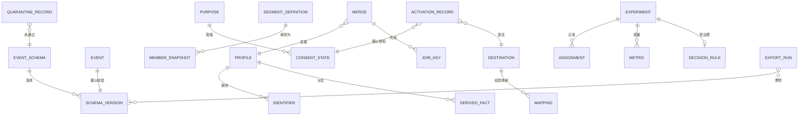

# 05 · 逻辑数据模型

> 核心实体的逻辑模型。物理建模是部署关注点；本文件固定形态与不变量。
>
> ⚠️ ASSUMPTION — 该模型属于方案包设计。

## 实体

```
EVENT_SCHEMA / SCHEMA_VERSION（schema 注册中心）   -- BR-01, BR-02
  event_schema_id   PK, name, owner
  schema_version_id PK
  event_schema_id   FK → EVENT_SCHEMA
  version, properties[], effectiveFrom, supersededBy?
  -- 在首次发出之前被声明（约束 1）

EVENT（schema 注册中心）                            -- BR-01, BR-02
  event_id          PK
  schema_version_id FK → EVENT_SCHEMA   NOT NULL (constraint 2)
  event_name, ts, identity_ref, payload

QUARANTINE_RECORD（schema 注册中心）                -- BR-02
  quarantine_id     PK
  event_payload_ref (raw)
  schema_version_id FK → EVENT_SCHEMA (nullable: unknown)
  reason            NOT NULL          -- 缺字段 | 类型错误 | 未知
                                     --   属性 | 版本不匹配（约束 3）
  quarantined_ts

IDENTIFIER（身份）                              -- BR-03, BR-04
  identifier_id     PK
  kind              anonymous | device | session | known
  value, profile_ref

MERGE（身份）                                   -- BR-03
  merge_id          PK
  from_profile_ref  FK → PROFILE
  to_profile_ref    FK → PROFILE
  rule_id, performed_ts, reversed_ts?
  -- 被记录；撤销会传播到派生事实（约束 4）

JOIN_KEY（身份）                                -- BR-04
  join_key_id       PK
  merge_id          FK → MERGE
  identifier_id     FK → IDENTIFIER
  -- 删除**必须**覆盖的那个键（约束 5）

PROFILE（身份）
  profile_id        PK, identifiers[], history
  deleted_ts? -- 仅在三部分全部被移除时置位（约束 5）

DERIVED_FACT（身份）                            -- BR-04
  derived_fact_id   PK, profile_ref, kind, payload
  -- 人群成员资格、漏斗步骤、归因信用

PURPOSE / CONSENT_STATE（同意）                  -- BR-11
  purpose_id        PK, name, sensitive?, lawfulBasis?
  consent_state_id  PK
  profile_ref       FK → PROFILE
  purpose_ref       FK → PURPOSE
  state, version, granted_ts, revoked_ts?

ACTIVATION_RECORD（激活）                    -- BR-11
  activation_id     PK
  purpose_ref       FK → PURPOSE            NOT NULL
  consent_state_ref FK → CONSENT_STATE      NOT NULL (constraint 6)
  destination_ref   FK → DESTINATION
  member_snapshot_ref FK → MEMBER_SNAPSHOT

EXPERIMENT / ASSIGNMENT（实验）         -- BR-05, BR-07, BR-08
  experiment_id     PK
  hypothesis, unit_of_analysis, state
  decision_rule_ref FK → DECISION_RULE      NOT NULL (constraint 7)
  effect_size_declared, sample_size_required
  assignment_id     PK
  experiment_id     FK → EXPERIMENT
  unit_ref, treatment, ts
  -- 记录在这里，而不是交付/开关系统里（约束 8）

METRIC / GUARDRAIL_METRIC（实验）        -- BR-07
  metric_id         PK, experiment_id FK, kind primary|guardrail, value
  srm_signal_id     PK, experiment_id FK, observed_ratio, expected_ratio, handled?
  -- 未处理的 SRM 是缺陷（约束 9）

HOLDOUT（实验）                         -- BR-07
  holdout_id        PK, experiment_id FK, population_ref, delta

SEGMENT_DEFINITION / MEMBER_SNAPSHOT（分群）   -- BR-12
  segment_definition_id PK, conditions[], purpose_ref
  member_snapshot_id    PK
  segment_definition_id FK, resolvedAtTs, memberRef[]
  -- 是**快照**，绝不是实时视图（约束 10）

DESTINATION / MAPPING（目的地）               -- BR-09, BR-10, BR-13
  destination_id    PK, kind messaging|ad, transferProperty, schemaVersion
  mapping_id        PK, destination_ref, platformField, destinationField,
    transformRef
  -- 映射住在抽象层里，而不在被存储的事件中（约束 11）

EXPORT_RUN（导出）                                -- BR-02
  export_run_id     PK
  -- 携带所导出事件的 schema 版本（约束 12）
```

## 键与基数



## 模型必须强制执行的完整性约束

| # | 约束 | 强制执行 |
|---|---|---|
| 1 | 一个 `EVENT_SCHEMA` 版本必须在首次引用它的发出之前被注册 | BR-01、FR-001、NFR-001 |
| 2 | `EVENT.schema_version_id` 为 NOT NULL | BR-01、BR-02 |
| 3 | `QUARANTINE_RECORD.reason` 为 NOT NULL | BR-02、FR-003、NFR-002 |
| 4 | 一次 `MERGE` 撤销会传播到所有引用两个档案中任一个的 `DERIVED_FACT` 行 | BR-03、FR-006 |
| 5 | `PROFILE.deleted_ts` 只有在其 `JOIN_KEY` 行与 `DERIVED_FACT` 行都被移除时才能被置位 | BR-04、FR-007、NFR-004 |
| 6 | `ACTIVATION_RECORD.consent_state_ref` 为 NOT NULL，且该状态必须允许这个目的 | BR-11、FR-018、NFR-009 |
| 7 | `EXPERIMENT.decision_rule_ref` 在创建时即为 NOT NULL，在结果可见之前 | BR-08、FR-014、NFR-008 |
| 8 | `ASSIGNMENT` 行由实验引擎写入；交付/开关系统没有写入路径 | BR-05、FR-008 |
| 9 | 一个 `handled = false` 的 `SRM_SIGNAL` 阻止该实验被读出 | BR-07、FR-009、NFR-005 |
| 10 | `MEMBER_SNAPSHOT.resolvedAtTs` 在解析时置位；不得用实时视图替代 | BR-12、FR-020、NFR-010 |
| 11 | 目的地字段名只能出现在 `MAPPING` 中，绝不出现在被存储的 `EVENT` 行中 | BR-13、BR-09 |
| 12 | `EXPORT_RUN` 携带它所导出的 schema 版本 | BR-02、FR-004、NFR-012 |

> 约束 2、3、5、6、7、8、10、11 和 12 是**在存储层强制执行**的，而不是
> 在应用代码中。一个未声明的事件、一个留下连接键的删除、一次没有同意引用的
> 激活，或一个被存储事件里的目的地字段，无论应用纪律作出何种承诺都是缺陷
> ——而每一个都是 `04-architecture/observability.md` 中的 sev-1 或 sev-2 信号。
