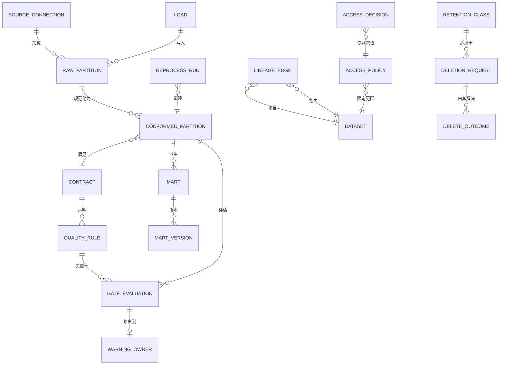

# 03 · 领域模型

> ⚠️ ASSUMPTION — 限界上下文、聚合与不变量属于方案包设计。没有为这一分解引用
> 任何外部标准。

## 限界上下文

| 上下文 | 职责 | 拥有的类型 |
|---|---|---|
| **接入** | 原始落地、仅追加、按加载作键 | Load、RawPartition、SourceConnection |
| **规范化** | 解决源头混乱的唯一地方 | ConformedPartition、CanonicalKey、Contract |
| **策展** | 集市，派生的、可丢弃的、可重建的 | Mart、MartDefinition、MartVersion |
| **质量** | 阻断/告警的区分 | QualityRule、RuleCatalogue、GateEvaluation、WarningOwner |
| **目录与分类** | schema、归属、分类、新鲜度 | Dataset、Classification、FreshnessContract |
| **血缘** | 带规则版本的字段级边 | LineageEdge、FieldVersion |
| **访问** | 由分类派生的强制执行 | AccessPolicy、AccessDecision |
| **生命周期** | 删除、留存、重处理 | DeletionRequest、DeleteOutcome、RetentionClass、ReprocessRun |

规范化是主干：集市由它派生、绝不由原始派生，血缘边也穿过它。

## 核心聚合与不变量

### RawPartition（接入）
```
RawPartition: id, sourceRef, loadId, partitionKey, landedTs, rowCount
└── invariants
    • 不可变且仅追加；不做就地编辑（BR-02、约束 2）
    • 以 load id 作键，因此被重试的加载可被察觉（BR-05、FR-003）
    • 一次读取是一个快照，不受并发写入影响（BR-02、FR-004）
```

### ConformedPartition（规范化）
```
ConformedPartition: id, rawPartitionRef, contractRef, contractVersion, builtTs
Contract: id, inputs[], outputs[], freshnessWindow, qualityRuleRefs[]
└── invariants
    • 规范键**只在这里**解析（BR-03、FR-005）
    • 源头特有的混乱**只在这里**解决；集市绝不读原始
      (BR-04, FR-006)
    • 每次构建都是幂等的——同一输入，同一分区（BR-05、NFR-001）
    • 契约版本被记录，因此一个集市的含义有日期（BR-01）
```

### QualityRule / RuleCatalogue / GateEvaluation（质量）
```
QualityRule: id, datasetRef, expression, severity (blocking|warning), version
RuleCatalogue: id, datasetRef, rules[], declaredTs
GateEvaluation: id, partitionRef, ruleVersions[], failures[], outcome
WarningOwner: id, warningRef, ownerRef (a person), actionTs?
└── invariants
    • 一次阻断性失败**停止**流水线并扣留该分区（BR-06）
    • 一次告警性失败被记录并路由，且不停止流水线
      (BR-06)
    • 严重级别的变更是显式且有归属的（BR-06、FR-010、约束 6）
    • 一条告警有一名具名负责人；没有负责人的告警是缺陷（BR-07）
```

### Mart（策展）
```
Mart: id, definedFrom (conformed partitions + contract versions), transform,
  version, state (active|superseded)
└── invariants
    • 只由规范化派生；绝不由原始派生（BR-04、FR-006）
    • 可从其记录的输入复现——不存在任何只存在于该集市之中的
      转换（BR-08、NFR-007）
    • 可丢弃：一次完整重建是受支持的操作，而不是一次事故
```

### LineageEdge（血缘）
```
LineageEdge: id, from (dataset.field), to (dataset.field), ruleRef,
  ruleVersion, effectiveFrom
└── invariants
    • 字段级：源字段 → 规范化字段 → 集市列（BR-10）
    • 规则**及其版本**被记录在每一条边上（BR-10、约束 7）
    • 影响分析在这些边上运行（FR-016）
```

### AccessPolicy / AccessDecision（访问）
```
AccessPolicy: id, datasetRef, classificationGrade, expression
AccessDecision: id, consumerRef, consumerKind, datasetRef, outcome, ts
└── invariants
    • 对**每一种**消费方都被强制——BI、notebook、导出、市场数据
      馈送、数据科学工作区（BR-09、FR-014、NFR-009）
    • 没有消费方拥有绕过路径；一个绕过界面就是缺陷
```

### DeletionRequest / DeleteOutcome / RetentionClass（生命周期）
```
DeletionRequest: id, subjectRef, receivedTs, scope
DeleteOutcome: id, requestRef, destination (layer|export|cache|snapshot|ML),
  state (completed|degraded), completedTs?
RetentionClass: id, dataClass, declaredWindow
ReprocessRun: id, partitionRange, idempotencyKey, cost, ts
└── invariants
    • 每个请求在每个目的地都有一个 DeleteOutcome；缺一个就不算
      「已删除」（BR-12、FR-020）
    • 降级状态被记录，绝不静默（BR-12、FR-021、约束 8）
    • 留存按类别，带一个已声明的窗口；没有全局设置
      (BR-13, FR-022)
    • 一次重处理只触及它的分区范围（BR-11、FR-017）
```

## 关系（逻辑）



## 承载本方案包重量的四个聚合

| 聚合 | 最要紧的那条不变量 | 它防止什么 |
|---|---|---|
| **RawPartition** | 不可变且仅追加 | 重算变得不可能——正是使从逻辑缺陷中恢复有界的那条性质 |
| **ConformedPartition** | 解决源头混乱的唯一地方 | 同一个怪癖被两个集市以两种方式各解决一次 |
| **GateEvaluation** | 阻断即停止，告警即路由——绝不混淆 | 一个什么都阻断的平台（于是闸门被关掉），或什么都不阻断的平台（于是坏数据静默流出） |
| **LineageEdge** | 字段级，且每条边上带规则**版本** | 「哪个仪表盘数字错了？」无法回答，以及重处理范围只能是「全部重建」 |

> 第一条是无法事后补救的：一份被编辑过的原始层会在多年之后才被发现，而那时
> 每个下游数字都已是一段不复存在的历史的函数。
