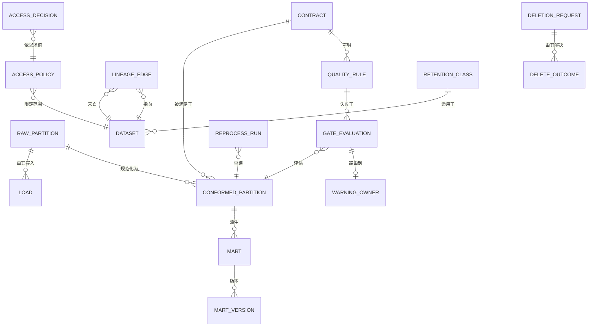

# 05 · 逻辑数据模型

> 核心实体的逻辑模型。物理建模是部署关注点；本文件固定形态与不变量。
>
> ⚠️ ASSUMPTION — 该模型属于方案包设计。

## 实体

```
RAW_PARTITION（接入）                      -- BR-02, ADR-0001
  raw_partition_id  PK
  source_ref        NOT NULL
  load_id           NOT NULL, unique per (source, window)
  partition_key     NOT NULL
  landed_ts, row_count
  -- 不可变：没有 UPDATE 或 DELETE 授权（约束 2）

LOAD（接入）                               -- BR-02, FR-002
  load_id           PK
  source_ref, extraction_ts, partition_key, row_count, outcome
  -- 对同一 (source, window) 的重试复用该加载的窗口键，
  -- 因此重复分区在写入之前就能被察觉（约束 3）

CONTRACT（规范化）                         -- BR-01, ADR-0001
  contract_id       PK
  inputs[], outputs[], freshness_window, quality_rule_refs[]
  version           -- 是一个契约版本，不是一个名字

CONFORMED_PARTITION（规范化）              -- BR-03..BR-05
  conformed_partition_id PK
  raw_partition_ref FK → RAW_PARTITION  NOT NULL
  contract_id       FK → CONTRACT        NOT NULL
  contract_version  NOT NULL
  built_ts
  -- 只从原始构建；没有集市可以从原始指向这里（约束 4）
  -- 写入在 (contract_version, partition_key) 上幂等（约束 5）

QUALITY_RULE（质量）                        -- BR-06, ADR-0003
  quality_rule_id   PK
  dataset_ref, expression
  severity          blocking | warning      NOT NULL
  version
  -- 严重级别变更需要一次显式且有归属的动作（约束 6）

RULE_CATALOGUE（质量）                      -- BR-06
  catalogue_id      PK, dataset_ref, rules[], declared_ts
  -- 按数据集声明阻断/告警（BR-06、FR-007）

GATE_EVALUATION（质量）                      -- BR-06
  evaluation_id     PK
  conformed_partition_ref FK → CONFORMED_PARTITION
  rule_versions[]   NOT NULL
  failures[], outcome (passed | blocked | warned)

WARNING_OWNER（质量）                        -- BR-07
  warning_owner_id  PK
  evaluation_id     FK → GATE_EVALUATION
  owner_ref         NOT NULL  -- 一个人，绝不是团队别名
  action_ts?

MART（策展）                                -- BR-08
  mart_id           PK
  defined_from      (conformed partitions + contract versions)  NOT NULL
  transform_ref     NOT NULL
  version, state    active | superseded
  -- 可从 defined_from 复现；没有任何转换只活在这里
  -- （约束 7）

LINEAGE_EDGE（血缘）                         -- BR-10, ADR-0005
  lineage_edge_id   PK
  from_dataset.field    NOT NULL
  to_dataset.field      NOT NULL
  rule_ref          NOT NULL
  rule_version      NOT NULL   -- 在发出时记录（约束 8）
  effective_from

DATASET / CLASSIFICATION / FRESHNESS_CONTRACT（目录）
  dataset_id        PK, classification_grade NOT NULL, freshness_contract_ref
  -- 分类驱动访问策略（BR-09、FR-013）

ACCESS_POLICY / ACCESS_DECISION（访问）       -- BR-09, ADR-0004
  access_policy_id  PK, dataset_id, classification_grade, expression
  access_decision_id PK, consumer_ref, consumer_kind, dataset_ref, outcome, ts
  -- 每个数据集一份策略；每一种消费方都求值它（FR-014）

DELETION_REQUEST / DELETE_OUTCOME（生命周期）  -- BR-12, ADR-0006
  deletion_request_id PK, subject_ref, received_ts, scope
  delete_outcome_id  PK
  request_ref       FK → DELETION_REQUEST  NOT NULL
  destination       raw | conformed | marts | exports | caches | snapshots | ml
  state             completed | degraded         NOT NULL
  completed_ts?
  -- 每个目的地一行；没有行的目的地**没有**被删除
  -- （约束 9）

RETENTION_CLASS（生命周期）                   -- BR-13
  retention_class_id  PK, data_class, declared_window NOT NULL
  -- 按类别；没有全局设置（约束 10）

REPROCESS_RUN（生命周期）                     -- BR-05, BR-11, ADR-0002
  reprocess_run_id  PK
  partition_range   NOT NULL
  idempotency_key   NOT NULL
  derived_from      LINEAGE_EDGEs  -- 受影响范围，是算出的而不是估的
  cost              per-partition
```

## 键与基数



## 模型必须强制执行的完整性约束

| # | 约束 | 强制执行 |
|---|---|---|
| 1 | 每个数据集在接入时就带有一个分类级别 | BR-09、CTL-03 |
| 2 | `RAW_PARTITION` 没有 UPDATE 或 DELETE 授权 | BR-02、NFR-002 |
| 3 | 一次对同一 (source, window) 的 `LOAD` 重试在写入重复原始分区之前即被拒绝 | BR-05、NFR-001 |
| 4 | 没有 `MART` 可以引用 `RAW_PARTITION`——只能引用 `CONFORMED_PARTITION` | BR-04、FR-006 |
| 5 | `CONFORMED_PARTITION` 的写入在 (contract_version, partition_key) 上幂等 | BR-05、NFR-001 |
| 6 | 一次 `QUALITY_RULE` 的严重级别变更是归属事件；`severity` 不做就地更新 | BR-06、FR-010 |
| 7 | 一个 `MART` 的 `transform_ref` 必须独立于该集市行而存在——只活在集市里的转换是缺陷 | BR-08、NFR-007 |
| 8 | `LINEAGE_EDGE.rule_version` 为 NOT NULL | BR-10、NFR-008 |
| 9 | 每个 `DELETION_REQUEST` 对每个已声明目的地都有一个 `DELETE_OUTCOME` 行，且 `degraded` 状态绝不被写成 `completed` | BR-12、FR-021、NFR-010 |
| 10 | `RETENTION_CLASS.declared_window` 按类别为 NOT NULL；不存在全局行 | BR-13、FR-022 |

> 约束 2、4、6、8、9 和 10 是**在存储层强制执行**的，而不是在应用代码
> 中。一条被修改的原始行、一个指向原始的集市、一次就地的严重级别变更、一条
> 没有规则版本的血缘边、一个缺失的删除结果，或一行全局留存记录，无论应用
> 纪律作出何种承诺都是缺陷——而每一个都是
> `04-architecture/observability.md` 中的 sev-1 信号。
