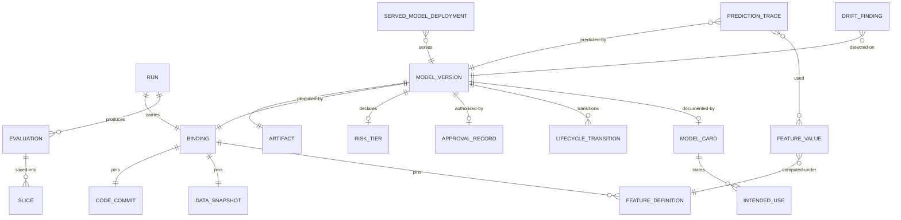

# 03 · Domain Model

> ⚠️ ASSUMPTION — bounded contexts, aggregates and invariants are pack design.
> No external standard is cited for this decomposition.

## Bounded contexts

| Context | Responsibility | Owns |
|---|---|---|
| **Feature** | Point-in-time-correct feature values and their definitions | FeatureDefinition, FeatureValue, FeatureVersion |
| **Experiment** | Runs and the binding they carry | Run, Binding, Evaluation, Slice |
| **Registry** | The single gate: artefacts, bindings, tiers, approvals, lifecycle | ModelVersion, Artifact, RiskTier, ApprovalRecord, LifecycleState |
| **Serving** | Pinned versions, canary, shadow, rollback | ServedModelDeployment, TrafficSplit |
| **Monitoring** | Live-traffic drift, auditable findings | DriftFinding, Monitor |
| **Lineage** | The query that answers "why this prediction" | PredictionTrace, FeatureProvenance |
| **Governance** | Model cards, intended use, limitations, retirement | ModelCard, IntendedUse, RetirementRecord |

Registry is the spine: every other context either writes into it (Experiment,
Monitoring, Governance) or reads from it (Serving, Lineage).

## Core aggregates & invariants

### Binding (value object, in Experiment)
```
Binding: id, codeCommit, dataSnapshotRef, featureDefinitionsRef,
  hyperparameters {…}, frameworkVersion, environmentRef, randomSeed
└── invariants
    • recorded as a UNIT, never assembled from loose metadata (BR-01, FR-001)
    • each component still retrievable (NFR-001, NFR-010)
    • immutable once recorded (a correction is a new binding, not an edit)
    • triple is the MINIMUM; the other fields are pack-declared, not defaults
```

### ModelVersion (aggregate root, in Registry)
```
ModelVersion: id, artifactRef, bindingRef, registeredBy, registeredTs,
  riskTier, lifecycleState (registered|approved|serving|superseded|retired),
  approvalRecordRef?
└── invariants
    • lifecycleState transitions only via explicit acts; retirement is recorded
      with a basis and a named party (BR-10, FR-013)
    • a tier is required at registration and never inferred later (BR-03)
    • registered ⇒ binding resolves (BR-01)
    • serving ⇒ approvalRecordRef is non-null (BR-04)
```

### ApprovalRecord (in Registry)
```
ApprovalRecord: id, modelVersionRef, approver (named party), evidenceRefs[],
  decision (approve|reject), basis, ts
└── invariants
    • a CI run's success is not an approval record (BR-04, FR-006)
    • evidence includes the sliced evaluation, not only the aggregate (BR-02)
    • immutable once recorded
```

### FeatureDefinition / FeatureValue (in Feature)
```
FeatureDefinition: id, version, transformationRef, pointInTimeSemantics
FeatureValue: id, definitionRef, entityKey, observationTs, availableAtTs, value
└── invariants
    • definition version is part of the binding (BR-01)
    • a value uses only data available at `availableAtTs` (BR-13)
    • the same definition and semantics compute the value at training, replay
      and serving ⇒ replay equals training (FR-018, NFR-005)
    • a definition change is a new version; historical values are not recomputed
      in place
```

### ServedModelDeployment (in Serving)
```
ServedModelDeployment: id, modelVersionRef, trafficSplit{canaryPct, shadowPct},
  previousVersionRef?
└── invariants
    • production reads modelVersionRef FROM THE REGISTRY ONLY (BR-05, FR-007)
    • rollback sets modelVersionRef to a previously served binding — never a
      rebuild (BR-06, FR-009)
    • a deployment on an unregistered version is a defect and is flagged (FR-008)
```

### DriftFinding (in Monitoring)
```
DriftFinding: id, modelVersionRef, kind, detectedTs, evidence, responseRef?
└── invariants
    • kind ∈ {data, concept, prediction, label} — no unclassified findings
      (BR-08, NFR-008)
    • measured on LIVE traffic, not an offline holdout set (BR-07)
    • retained, so a response decision cites it (FR-011)
```

### PredictionTrace (in Lineage)
```
PredictionTrace: id, modelVersionRef, featureValuesUsed[], upstreamRows[],
  sourceSystems[], prediction, ts
└── invariants
    • must answer "why this prediction" as a query, not a diagram (BR-09)
    • featureValuesUsed are the values actually served, with their definition
      versions
```

## Relationships (logical)



## The four aggregates that carry the pack's weight

| Aggregate | The invariant that matters most | What it prevents |
|---|---|---|
| **Binding** | recorded as a unit, and queryable | an artefact that cannot be reproduced, retrained, audited or defended |
| **ApprovalRecord** | a named party's act with cited evidence | "who authorised this" being answered by a CI job |
| **FeatureDefinition** | point-in-time semantics identical at training, replay and serving | the silent failure where the model runs, looks plausible, and is wrong |
| **ServedModelDeployment** | production reads the registry only | an unregistered artefact whose version binding is unqueryable, making rollback impossible |

> The third is the one most often implemented as a cache with documentation.
> `AGENTS.md` states the feature store exists for point-in-time correctness, not
> caching — and NFR-005 makes replay-equals-training the test for it.