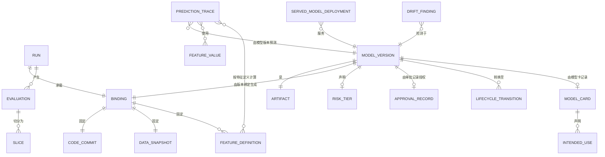

# 03 · 领域模型

> ⚠️ ASSUMPTION — 限界上下文、聚合和不变量属于方案包设计。
> 本分解未引用任何外部标准。

## 限界上下文

| 上下文 | 职责 | 所拥有 |
|---|---|---|
| **特征** | 满足时间点正确性的特征值及其定义 | FeatureDefinition, FeatureValue, FeatureVersion |
| **实验** | 运行及其所承载的版本绑定 | Run, Binding, Evaluation, Slice |
| **模型注册中心** | 唯一准入门禁：制品、版本绑定、风险等级、审批、生命周期 | ModelVersion, Artifact, RiskTier, ApprovalRecord, LifecycleState |
| **服务** | 固定版本、灰度发布、影子发布、回滚 | ServedModelDeployment, TrafficSplit |
| **监控** | 线上流量漂移、可审计的发现 | DriftFinding, Monitor |
| **血缘** | 回答“为什么会有这一预测”的查询 | PredictionTrace, FeatureProvenance |
| **治理** | 模型卡、用途声明、局限、下线退役 | ModelCard, IntendedUse, RetirementRecord |

模型注册中心是主干：其他每个上下文要么向其写入（实验、
监控、治理），要么从中读取（服务、血缘）。

## 核心聚合与不变量

### 版本绑定（值对象，位于实验上下文中）

```
Binding: id, codeCommit, dataSnapshotRef, featureDefinitionsRef,
  hyperparameters {…}, frameworkVersion, environmentRef, randomSeed
└── 不变量
    • 作为一个整体记录，绝不由松散元数据拼装 (BR-01, FR-001)
    • 每个组件仍可检索 (NFR-001, NFR-010)
    • 记录后不可变（更正应创建新的版本绑定，而不是编辑原记录）
    • 三元组是最低要求；其他字段由方案包声明，而不是默认值
```

### 模型版本（聚合根，位于模型注册中心中）

```
ModelVersion: id, artifactRef, bindingRef, registeredBy, registeredTs,
  riskTier, lifecycleState (registered|approved|serving|superseded|retired),
  approvalRecordRef?
└── 不变量
    • lifecycleState 仅可通过显式操作转换；下线退役必须记录
      依据及具名主体 (BR-10, FR-013)
    • 注册时必须指定风险等级，之后不得推断 (BR-03)
    • registered ⇒ 版本绑定可解析 (BR-01)
    • serving ⇒ approvalRecordRef 不得为空 (BR-04)
```

### 审批记录（位于模型注册中心中）

```
ApprovalRecord: id, modelVersionRef, approver (具名主体), evidenceRefs[],
  decision (approve|reject), basis, ts
└── 不变量
    • CI 作业成功不等于审批记录 (BR-04, FR-006)
    • 证据包括分片评估，而不只是总体评估 (BR-02)
    • 记录后不可变
```

### 特征定义/特征值（位于特征上下文中）

```
FeatureDefinition: id, version, transformationRef, pointInTimeSemantics
FeatureValue: id, definitionRef, entityKey, observationTs, availableAtTs, value
└── 不变量
    • 定义版本是版本绑定的一部分 (BR-01)
    • 值仅使用 `availableAtTs` 时可用的数据 (BR-13)
    • 使用相同的定义和语义在训练、回放和服务时计算该值
      ⇒ 回放等于训练 (FR-018, NFR-005)
    • 定义变更即为新版本；历史值不会
      就地重新计算
```

### 已服务模型部署（位于服务上下文中）

```
ServedModelDeployment: id, modelVersionRef, trafficSplit{canaryPct, shadowPct},
  previousVersionRef?
└── 不变量
    • 生产环境只能从模型注册中心读取 modelVersionRef (BR-05, FR-007)
    • 回滚将 modelVersionRef 设置为此前已提供服务的版本绑定——绝不
      重新构建 (BR-06, FR-009)
    • 基于未注册版本的部署属于缺陷，并会予以标记 (FR-008)
```

### 漂移发现（位于监控上下文中）

```
DriftFinding: id, modelVersionRef, kind, detectedTs, evidence, responseRef?
└── 不变量
    • kind ∈ {data, concept, prediction, label} — 不允许未分类的发现
      (BR-08, NFR-008)
    • 在线上流量上测量，而非离线留出集 (BR-07)
    • 予以保留，以便响应决策引用它 (FR-011)
```

### 预测追溯（位于血缘上下文中）

```
PredictionTrace: id, modelVersionRef, featureValuesUsed[], upstreamRows[],
  sourceSystems[], prediction, ts
└── 不变量
    • 必须能以查询而非图示方式回答“为什么会有这一预测” (BR-09)
    • featureValuesUsed 是实际提供服务的值，并带有其
      定义版本
```

## 关系（逻辑）



## 支撑本方案包的四个聚合

| 聚合 | 最关键的不变量 | 可防止的问题 |
|---|---|---|
| **版本绑定** | 作为一个整体记录，并且可查询 | 无法复现、重新训练、审计或辩护的制品 |
| **审批记录** | 由具名主体实施并引用证据的行为 | 由 CI 作业回答“谁授权了它” |
| **特征定义** | 训练、回放和服务时的时间点语义完全一致 | 模型正常运行、看似合理却实际错误的静默故障 |
| **已服务模型部署** | 生产环境只读取模型注册中心 | 版本绑定不可查询、因而无法回滚的未注册制品 |

> 第三项最常被实现为带治理文档的缓存。
> `AGENTS.md` 指出，特征存储的存在是为了时间点正确性，而非
> 缓存——并且 NFR-005 将“回放等于训练”作为其检验标准。