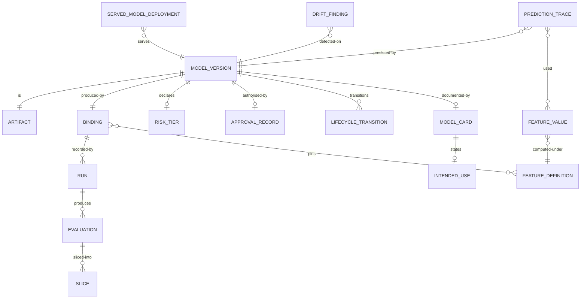

# 05 · Logical Data Model

> Logical model for the core entities. Physical modelling is a deployment
> concern; this file fixes the shape and the invariants.
>
> ⚠️ ASSUMPTION — the model is pack design.

## Entities

```
BINDING (experiment)                     -- BR-01, ADR-0001
  binding_id        PK
  code_commit_ref   NOT NULL
  data_snapshot_ref NOT NULL
  feature_definitions_ref NOT NULL
  hyperparameters_ref
  framework_version_ref
  environment_ref
  random_seed
  -- recorded as a UNIT; immutable once recorded (constraint 1)
  -- the triple is the MINIMUM; the extra fields are declared, not defaults

MODEL_VERSION (registry)                 -- BR-01, BR-03, BR-04
  model_version_id  PK
  artifact_ref      NOT NULL
  binding_ref       FK → BINDING  NOT NULL (BR-01)
  risk_tier         NOT NULL        (BR-03 — a required field, not inferred)
  lifecycle_state   registered | approved | serving | superseded | retired
  registered_by, registered_ts
  -- retires with a recorded basis; approval never lapses silently (BR-10)

APPROVAL_RECORD (registry)              -- BR-04, ADR-0002
  approval_record_id  PK
  model_version_ref   FK → MODEL_VERSION NOT NULL
  approver            NOT NULL           -- a named party, never a CI ref
  evidence_refs[]     NOT NULL           -- includes the sliced evaluation
  decision            approve | reject
  basis               NOT NULL
  ts
  -- immutable once recorded (constraint 3)

FEATURE_DEFINITION (feature)            -- BR-13, CTL
  feature_definition_id  PK
  version               NOT NULL
  transformation_ref
  point_in_time_semantics  NOT NULL -- as-of observation time; only data
                                   -- available then
  -- a change creates a new version; historical values are not recomputed

FEATURE_VALUE (feature)
  feature_value_id   PK
  feature_definition_ref FK → FEATURE_DEFINITION (with its version)
  entity_key
  observation_ts     NOT NULL
  available_at_ts    NOT NULL
  value
  -- `value` uses only data available at `available_at_ts`

RUN / EVALUATION / SLICE (experiment)   -- BR-01, BR-02, ADR-0004
  run_id             PK
  binding_id         FK → BINDING NOT NULL
  evaluation_id      PK
  metric, value, aggregate_or_slice    -- slice rows exist for every declared
                                       -- segment (constraint 4)
  slice_predicate    -- declared at evaluation time, by predicate

SERVED_MODEL_DEPLOYMENT (serving)      -- BR-05, BR-06
  deployment_id      PK
  model_version_ref  FK → MODEL_VERSION  -- resolved via the REGISTRY (BR-05)
  previous_version_ref FK → MODEL_VERSION (for rollback)
  traffic_split{canaryPct, shadowPct}
  -- rollback sets model_version_ref to a previously served binding (BR-06)

DRIFT_FINDING (monitoring)              -- BR-07, BR-08
  drift_finding_id   PK
  model_version_ref  FK → MODEL_VERSION
  kind               data | concept | prediction | label   -- NOT NULL (constraint 5)
  detected_ts
  evidence_ref
  response_ref       -- the recorded response decision citing this finding

MODEL_CARD / INTENDED_USE / RETIREMENT_RECORD (governance)  -- BR-10, BR-12
  model_card_id      PK
  model_version_ref  FK → MODEL_VERSION NOT NULL
  intended_use, limitations, evaluation_summary_ref
  retirement: retirement_record_id PK, model_version_ref, basis, namedParty, ts

PREDICTION_TRACE (lineage)              -- BR-09, ADR-0003
  prediction_trace_id  PK
  model_version_ref    FK → MODEL_VERSION
  feature_values_used[]  -- with their definition versions
  upstream_rows[]
  source_systems[]
  prediction
  ts
  -- answers "why this prediction" as a query (constraint 6)
```

## Keys and cardinalities



## Integrity constraints the model must enforce

| # | Constraint | Enforces |
|---|---|---|
| 1 | `BINDING` has no UPDATE grant once recorded; a correction is a new binding | BR-01, ADR-0001 |
| 2 | `MODEL_VERSION.binding_ref`, `risk_tier` are NOT NULL at registration | BR-01, BR-03, NFR-001 |
| 3 | `APPROVAL_RECORD` is append-only, and `approver` is a person reference — **not** a build reference | BR-04, FR-006, NFR-002 |
| 4 | every declared segment has a slice row for each approved version's evaluation | BR-02, FR-003, FR-004, NFR-003 |
| 5 | `DRIFT_FINDING.kind` is NOT NULL and in the four-value set | BR-08, NFR-008 |
| 6 | `PREDICTION_TRACE` resolves model version, feature values with definition versions, and upstream rows | BR-09, FR-012, NFR-009 |
| 7 | `SERVED_MODEL_DEPLOYMENT.model_version_ref` must resolve to a registry entry | BR-05, FR-007, NFR-011 |
| 8 | lifecycle state `serving` requires an approval record | BR-04, NFR-002 |
| 9 | `FEATURE_VALUE.available_at_ts <= observation_ts` — no hindsight | BR-13, NFR-005 |
| 10 | `FEATURE_DEFINITION` is versioned; historical feature values are not recomputed in place | BR-01, BR-13 |

> Constraints 1, 3, 7, 8, 9 and 10 are **enforced in the store**, not in
> application code. An editable binding, a build-as-approver, or an unregistered
> serving version is a defect regardless of what application discipline
> promises — and each is a sev-1 signal in `04-architecture/observability.md`.