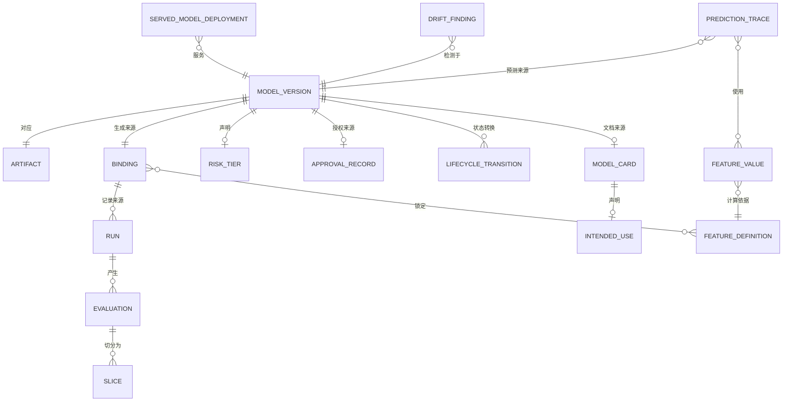

# 05 · 逻辑数据模型

> 核心实体的逻辑模型。物理建模是部署层面的关注事项；
> 本文件确定模型的结构和不变量。
>
> ⚠️ ASSUMPTION — 该模型属于方案包设计。

## 实体

```
BINDING (实验)                           -- BR-01, ADR-0001
  binding_id        PK
  code_commit_ref   NOT NULL
  data_snapshot_ref NOT NULL
  feature_definitions_ref NOT NULL
  hyperparameters_ref
  framework_version_ref
  environment_ref
  random_seed
  -- 作为一个单元记录；记录后不可变（约束 1）
  -- 版本绑定三元组是最低要求；额外字段均为显式声明，而非默认字段

MODEL_VERSION (注册中心)                 -- BR-01, BR-03, BR-04
  model_version_id  PK
  artifact_ref      NOT NULL
  binding_ref       FK → BINDING  NOT NULL (BR-01)
  risk_tier         NOT NULL        (BR-03 — 必填字段，而非推断所得)
  lifecycle_state   registered | approved | serving | superseded | retired
  registered_by, registered_ts
  -- 下线退役须有记录依据；审批绝不静默失效（BR-10）

APPROVAL_RECORD (注册中心)               -- BR-04, ADR-0002
  approval_record_id  PK
  model_version_ref   FK → MODEL_VERSION NOT NULL
  approver            NOT NULL           -- 具名主体，绝不是 CI 引用
  evidence_refs[]     NOT NULL           -- 包含分片评估
  decision            approve | reject
  basis               NOT NULL
  ts
  -- 记录后不可变（约束 3）

FEATURE_DEFINITION (特征)                -- BR-13, CTL
  feature_definition_id  PK
  version               NOT NULL
  transformation_ref
  point_in_time_semantics  NOT NULL -- 以观察时点为准；仅使用
                                   -- 当时可用的数据
  -- 变更会创建新版本；不会重新计算历史值

FEATURE_VALUE (特征)
  feature_value_id   PK
  feature_definition_ref FK → FEATURE_DEFINITION（含相应版本）
  entity_key
  observation_ts     NOT NULL
  available_at_ts    NOT NULL
  value
  -- `value` 仅使用 `available_at_ts` 时可用的数据

RUN / EVALUATION / SLICE (实验)           -- BR-01, BR-02, ADR-0004
  run_id             PK
  binding_id         FK → BINDING NOT NULL
  evaluation_id      PK
  metric, value, aggregate_or_slice    -- 每个已声明分片均存在
                                       -- 分片行（约束 4）
  slice_predicate    -- 在评估时按谓词声明

SERVED_MODEL_DEPLOYMENT (服务)           -- BR-05, BR-06
  deployment_id      PK
  model_version_ref  FK → MODEL_VERSION  -- 通过模型注册中心解析（BR-05）
  previous_version_ref FK → MODEL_VERSION（用于回滚）
  traffic_split{canaryPct, shadowPct}
  -- 回滚会将 model_version_ref 设置为此前提供服务的版本绑定（BR-06）

DRIFT_FINDING (监控)                     -- BR-07, BR-08
  drift_finding_id   PK
  model_version_ref  FK → MODEL_VERSION
  kind               data | concept | prediction | label   -- NOT NULL（约束 5）
  detected_ts
  evidence_ref
  response_ref       -- 引用此发现的已记录响应决策

MODEL_CARD / INTENDED_USE / RETIREMENT_RECORD (治理)  -- BR-10, BR-12
  model_card_id      PK
  model_version_ref  FK → MODEL_VERSION NOT NULL
  intended_use, limitations, evaluation_summary_ref
  retirement: retirement_record_id PK, model_version_ref, basis, namedParty, ts

PREDICTION_TRACE (血缘)                  -- BR-09, ADR-0003
  prediction_trace_id  PK
  model_version_ref    FK → MODEL_VERSION
  feature_values_used[]  -- 带有相应的定义版本
  upstream_rows[]
  source_systems[]
  prediction
  ts
  -- 可通过查询回答“为什么会有这一预测”（约束 6）
```

## 键与基数



## 模型必须强制执行的完整性约束

| # | 约束 | 强制依据 |
|---|---|---|
| 1 | 记录后，`BINDING` 不再具有 `UPDATE` 授权；更正应创建新的版本绑定 | BR-01, ADR-0001 |
| 2 | 注册时，`MODEL_VERSION.binding_ref` 和 `risk_tier` 均为 `NOT NULL` | BR-01, BR-03, NFR-001 |
| 3 | `APPROVAL_RECORD` 仅可追加，且 `approver` 是人员引用——**而不是**构建引用 | BR-04, FR-006, NFR-002 |
| 4 | 每个已声明分片在每个已审批版本的每项评估中均有一行分片记录 | BR-02, FR-003, FR-004, NFR-003 |
| 5 | `DRIFT_FINDING.kind` 均为 `NOT NULL`，且必须属于四值集合 | BR-08, NFR-008 |
| 6 | `PREDICTION_TRACE` 可解析模型版本、带有定义版本的特征值和上游数据行 | BR-09, FR-012, NFR-009 |
| 7 | `SERVED_MODEL_DEPLOYMENT.model_version_ref` 必须解析到模型注册中心条目 | BR-05, FR-007, NFR-011 |
| 8 | 生命周期状态 `serving` 必须有审批记录 | BR-04, NFR-002 |
| 9 | `FEATURE_VALUE.available_at_ts <= observation_ts`——不得使用事后信息 | BR-13, NFR-005 |
| 10 | `FEATURE_DEFINITION` 采用版本管理；不得就地重新计算历史特征值 | BR-01, BR-13 |

> 约束 1、3、7、8、9 和 10 **在存储层强制执行**，而不是在
> 应用代码中强制执行。无论应用规范作出何种承诺，可编辑的版本绑定、把构建
> 用作审批人的做法，或未注册的服务版本都属于缺陷——而且每一项都是
> `04-architecture/observability.md` 中的 sev-1 信号。