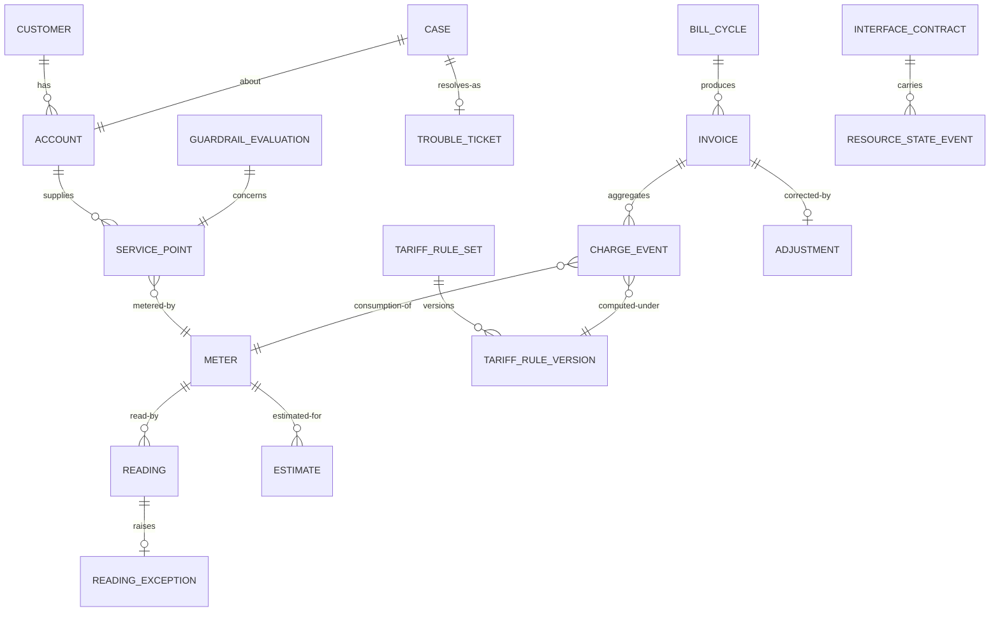

# 03 · Domain Model

> ⚠️ ASSUMPTION — bounded contexts, aggregates and invariants are pack design.
> No external standard is cited for this decomposition.

## Bounded contexts

| Context | Responsibility | Owns |
|---|---|---|
| **Party** | Who is the commercial counterparty | Customer, Party, Agreement, CustomerClass |
| **Account & service point** | The billing relationship and the physical point of supply | Account, ServicePoint, Meter |
| **Metering** | Reading, exception, and the 估抄 boundary | Reading, ReadingException, Estimate |
| **Tariff** | Effective-dated, versioned governed arithmetic | TariffRuleSet, TariffRuleVersion |
| **Charging** | Immutable money assertions | ChargeEvent |
| **Billing** | Invoices, adjustments, receivables | Invoice, BillCycle, Adjustment, Receivable |
| **Care** | 95598 cases tied to the service instance | Case, TroubleTicket, WorkOrder |
| **Interface** | The seam to distribution — interface-only | InterfaceContract, ResourceStateEvent |
| **Guardrail** | Regulated disconnection policy | GuardrailPolicy, GuardrailEvaluation |

Tariff is separate from Billing for the same reason as the telecom sibling pack:
a tariff change inside billing code is indistinguishable from a bug fix in a
release (BR-08).

## Core aggregates & invariants

### Meter / Reading / Estimate (metering)
```
Reading: id, meterRef, value, collectionMethod, readTs, source
ReadingException: id, readingRef?, kind, raisedTs, reason, resolutionRef?
Estimate: id, meterRef, value, ruleRef, estimateFlag = true, appliedTs,
  reconciledAt?, actualValue?
└── invariants
    • an exception is resolved through a defined path, never smoothed (BR-04)
    • an estimate is only ever produced by a declared rule (BR-05)
    • estimateFlag is ALWAYS true for an Estimate — the value is never
      presented as a measurement (BR-05, FR-003)
    • reconciliation against the next actual reading is a defined process,
      not a housekeeping job
```

### TariffRuleVersion (tariff)
```
TariffRuleSet: id, purpose, versions[], activeVersion
TariffRuleVersion: id, effectiveFrom, effectiveTo?, effectiveDate,
  publishedBy, publishedTs, status
└── invariants
    • effective-dated: a cycle straddling effectiveDate splits by evaluation
      (BR-08, FR-009, NFR-006)
    • a version change never restates an emitted charge (BR-09)
    • the engine is a separate governed component from billing code (BR-08)
```

### ChargeEvent (charging)
```
ChargeEvent: id, kind, amount, currency, ts, ruleVersionRef NOT NULL,
  orderRef, meterRef
└── invariants
    • immutable once emitted (BR-09, NFR-001)
    • carries the rule version applied — the reproducibility anchor (BR-08)
    • corrections are new approved events; the original remains (BR-10)
```

### Invoice (billing)
```
Invoice: id, accountRef, cycleRef, lines[], ruleVersionsUsed[], total
BillCycle: id, periodFrom, periodTo, closedTs
Adjustment: id, invoiceRef, amount, reason, approvedBy, approvedTs
└── invariants
    • ruleVersionsUsed[] is required — regeneration uses these, not the live
      version (BR-11, FR-014)
    • an adjustment is an approved act; the original remains (BR-10)
```

### Case / TroubleTicket (care)
```
Case: id, customerRef, accountRef, meterRef, contextSnapshotRef, state
TroubleTicket: id, serviceInstanceRef, workOrderRef
└── invariants
    • intake presents account, meter, reading history, payment and affecting
      outage in one view (BR-06, NFR-010)
    • dispatch goes through the interface; care never changes network state
      directly (BR-07)
```

### GuardrailPolicy / GuardrailEvaluation (guardrail)
```
GuardrailPolicy: id, scope, eligibilityClasses[], noticePeriods[],
  restrictedPeriods[]
GuardrailEvaluation: id, disconnectionRef, inputs[], outcomes[],
  failedGuardrails[], evaluatedTs
└── invariants
    • a disconnection cannot be recorded without a persisted evaluation record
      (BR-15, NFR-009, constraint 9)
    • guardrails are evaluated by the process, never remembered by the operator
      (BR-15)
```

## Relationships (logical)



## The four aggregates that carry the pack's weight

| Aggregate | The invariant that matters most | What it prevents |
|---|---|---|
| **Estimate** | `estimateFlag` is always true, and only from a declared rule | a bill that is arithmetically correct and factually unfounded — unfalsifiable by the customer, unprovable by the utility |
| **TariffRuleVersion** | effective-dated, and the charge stores the version | a rule change silently restating issued money |
| **ChargeEvent** | immutable, reconciled two-way | a suite that bills correctly and is blind to leakage |
| **GuardrailEvaluation** | persisted before the act, not after | a disconnection executed against a failed guardrail, because the guardrail was configuration someone overlooked |

> The first and the fourth are the ones most often implemented as configuration
> rather than invariants, and both are exactly where this pack's regulated-
> arithmetic property either holds or quietly does not.