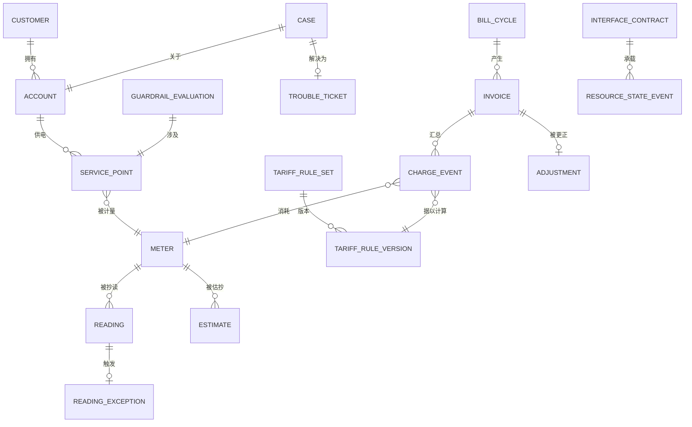

# 03 · 领域模型

> ⚠️ ASSUMPTION — 限界上下文、聚合与不变量属于方案包设计。没有为这一分解引用
> 任何外部标准。

## 限界上下文

| 上下文 | 职责 | 拥有的类型 |
|---|---|---|
| **当事方** | 商业对手方是谁 | Customer、Party、Agreement、CustomerClass |
| **账户与服务点** | 计费关系与物理供电点 | Account、ServicePoint、Meter |
| **计量** | 抄表、异常，以及估抄边界 | Reading、ReadingException、Estimate |
| **电价** | 带生效日、带版本的受治理算术 | TariffRuleSet、TariffRuleVersion |
| **计费** | 不可变的资金断言 | ChargeEvent |
| **出账** | 发票、调整、应收 | Invoice、BillCycle、Adjustment、Receivable |
| **客服** | 与服务实例关联的 95598 案件 | Case、TroubleTicket、WorkOrder |
| **接口** | 与配电的接缝——仅限接口 | InterfaceContract、ResourceStateEvent |
| **护栏** | 受监管的停电政策 | GuardrailPolicy、GuardrailEvaluation |

电价与出账分离，理由与电信兄弟方案包相同：计费代码内部的电价变更与一次发布中
的 bug 修复是无法区分的（BR-08）。

## 核心聚合与不变量

### Meter / Reading / Estimate（计量）
```
Reading: id, meterRef, value, collectionMethod, readTs, source
ReadingException: id, readingRef?, kind, raisedTs, reason, resolutionRef?
Estimate: id, meterRef, value, ruleRef, estimateFlag = true, appliedTs,
  reconciledAt?, actualValue?
└── invariants
    • 异常通过既定路径解决，绝不被抹平（BR-04）
    • 估算只由已声明的规则产生（BR-05）
    • 对一个 Estimate 而言 estimateFlag 始终为 true —— 该值绝不被
      呈现为实测（BR-05、FR-003）
    • 与下一次实际读数的对账是一个既定流程，不是例行杂务
```

### TariffRuleVersion（电价）
```
TariffRuleSet: id, purpose, versions[], activeVersion
TariffRuleVersion: id, effectiveFrom, effectiveTo?, effectiveDate,
  publishedBy, publishedTs, status
└── invariants
    • 带生效日：跨越 effectiveDate 的周期按求值拆分
      (BR-08, FR-009, NFR-006)
    • 一次版本变更绝不重述已发出的费用（BR-09）
    • 该引擎是独立于计费代码的受治理组件（BR-08）
```

### ChargeEvent（计费）
```
ChargeEvent: id, kind, amount, currency, ts, ruleVersionRef NOT NULL,
  orderRef, meterRef
└── invariants
    • 发出后不可变（BR-09、NFR-001）
    • 携带所应用的规则版本——可复现性锚点（BR-08）
    • 更正是新的经批准事件；原件保留（BR-10）
```

### Invoice（出账）
```
Invoice: id, accountRef, cycleRef, lines[], ruleVersionsUsed[], total
BillCycle: id, periodFrom, periodTo, closedTs
Adjustment: id, invoiceRef, amount, reason, approvedBy, approvedTs
└── invariants
    • ruleVersionsUsed[] 为必需 —— 重新生成使用它们，而非实时
      版本（BR-11、FR-014）
    • 调整是一个经批准的动作；原件保留（BR-10）
```

### Case / TroubleTicket（客服）
```
Case: id, customerRef, accountRef, meterRef, contextSnapshotRef, state
TroubleTicket: id, serviceInstanceRef, workOrderRef
└── invariants
    • 接入在一个视图里展示账户、电表、读数历史、缴费与相关
      停电（BR-06、NFR-010）
    • 派工经由接口；客服从不直接改变网络状态（BR-07）
```

### GuardrailPolicy / GuardrailEvaluation（护栏）
```
GuardrailPolicy: id, scope, eligibilityClasses[], noticePeriods[],
  restrictedPeriods[]
GuardrailEvaluation: id, disconnectionRef, inputs[], outcomes[],
  failedGuardrails[], evaluatedTs
└── invariants
    • 没有持久化的求值记录，一次停电就不能被记录
      (BR-15, NFR-009, constraint 9)
    • 护栏由流程求值，绝不由操作员记住（BR-15）
```

## 关系（逻辑）



## 承载本方案包重量的四个聚合

| 聚合 | 最要紧的那条不变量 | 它防止什么 |
|---|---|---|
| **Estimate** | `estimateFlag` 始终为 true，且只由已声明规则产生 | 一张算术正确而事实无据的账单——客户无法证伪，供公司无法举证 |
| **TariffRuleVersion** | 带生效日，且费用存储版本 | 一次规则变更静默地重述已发出的钱 |
| **ChargeEvent** | 不可变，且双向对账 | 一个计费正确却对泄露完全失明的系统 |
| **GuardrailEvaluation** | 在行为之前持久化，而不是之后 | 一次在护栏未通过的情况下执行的停电——因为护栏是某个人忽略掉的配置 |

> 第一个和第四个最常被实现为配置而非不变量，而这两处恰恰是本方案包「受监管
> 的数学」这一属性要么成立、要么悄悄不成立的地方。
