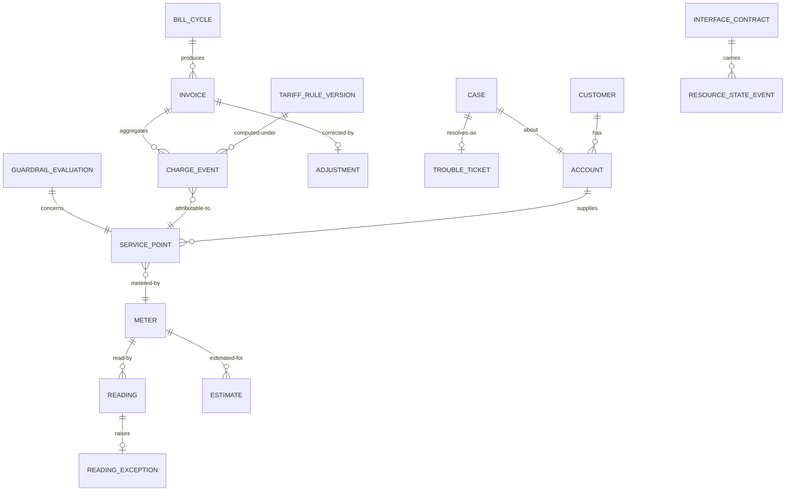

# 05 · Logical Data Model

> Logical model for the core entities. Physical modelling is a deployment
> concern; this file fixes the shape and the invariants.
>
> ⚠️ ASSUMPTION — the model is pack design.

## Entities

```
CUSTOMER (party)                      -- BR-01
  customer_id       PK
  party_type        natural | legal
  customer_class    residential | industrial | commercial | agricultural | large

ACCOUNT (party)                       -- BR-01
  account_id        PK
  customer_id       FK → CUSTOMER
  billing_type, opened_ts, closed_ts?
  -- a SEPARATE object with its own lifecycle; a service-point change is not
  -- applied here

SERVICE_POINT (party)                 -- BR-01
  service_point_id  PK
  account_id        FK → ACCOUNT
  meter_id          FK → METER
  tariff_assignment_ref

METER (party)
  meter_id          PK
  meter_ref (asset), type, installed_ts, removed_ts?

READING (metering)                    -- BR-04
  reading_id        PK
  meter_id          FK → SERVICE_POINT
  value, read_ts, collection_method   -- NOT NULL (BR-04)
  source            ami | field

READING_EXCEPTION (metering)          -- BR-04
  reading_exception_id PK
  reading_id        FK → READING (nullable: never collected)
  kind, raised_ts, reason, resolution_ref?

ESTIMATE (metering)                   -- BR-05
  estimate_id       PK
  meter_id          FK → SERVICE_POINT
  value
  rule_ref          NOT NULL           -- only from a declared rule
  estimate_flag     NOT NULL, = true   -- structural; never a measurement
  applied_ts, reconciled_at?, actual_value?

TARIFF_RULE_SET / TARIFF_RULE_VERSION (tariff)   -- BR-08, ADR-0001
  rule_set_id       PK
  rule_version_ref  PK
  effective_from    NOT NULL
  effective_to                     -- null while current
  effective_date                   -- the split boundary for cycles (FR-009)
  published_by, published_ts
  status            draft | published | superseded | retired

CHARGE_EVENT (charging)               -- BR-09, ADR-0002
  charge_event_id   PK
  kind, amount, currency, ts
  rule_version_ref  FK → TARIFF_RULE_VERSION NOT NULL (BR-08)
  order_ref         FK → SERVICE_POINT     NOT NULL (BR-12, order side)
  meter_id          FK → SERVICE_POINT     NOT NULL (BR-12, inventory side)
  -- APPEND-ONLY: no UPDATE or DELETE grant (BR-09, constraint 2)

INVOICE / BILL_CYCLE / ADJUSTMENT (billing)   -- BR-10, BR-11, ADR-0002
  bill_cycle_id     PK, period_from, period_to, closed_ts
  invoice_id        PK, account_ref, bill_cycle_ref, rule_versions_used[], total
  -- rule_versions_used[] NOT NULL: regeneration uses recorded versions (constraint 5)
  adjustment_id     PK, invoice_ref, amount, reason, approved_by, approved_ts
  -- approved_by NOT NULL before it takes effect (constraint 7)

CASE / TROUBLE_TICKET / WORK_ORDER (care)  -- BR-06, BR-07
  case_id           PK, customer_ref, account_ref, meter_ref, context_snapshot_ref, state
  trouble_ticket_id PK, service_instance_ref, work_order_ref

GUARDRAIL_POLICY / GUARDRAIL_EVALUATION (guardrail)  -- BR-15, ADR-0004
  guardrail_policy_id PK, scope, eligibility_classes[], notice_periods[],
    restricted_periods[]
  guardrail_evaluation_id PK, disconnection_ref, inputs[], outcomes[],
    failed_guardrails[], evaluated_ts
  -- a disconnection cannot be recorded without a persisted evaluation (constraint 9)

INTERFACE_CONTRACT / RESOURCE_STATE_EVENT (interface)  -- BR-02
  contract_id, payload_shapes, state_vocabulary, timing, ownership, failure_semantics
  state_event_id, contract_id, resource_ref, state, ts   -- *unknown* is a value
```

## Keys and cardinalities



## Integrity constraints the model must enforce

| # | Constraint | Enforces |
|---|---|---|
| 1 | `CUSTOMER`, `ACCOUNT` and `SERVICE_POINT` are separate objects; no service-point change edits a customer record | BR-01 |
| 2 | `CHARGE_EVENT` has no UPDATE or DELETE grant | BR-09, NFR-001 |
| 3 | `CHARGE_EVENT.rule_version_ref`, `order_ref`, `meter_id` are NOT NULL | BR-08, BR-12 |
| 4 | `READING.collection_method` is NOT NULL | BR-04, FR-004 |
| 5 | `INVOICE.rule_versions_used[]` is NOT NULL | BR-11, FR-014, NFR-004 |
| 6 | No charge event is emitted for a period under a version not effective in that period | BR-08, FR-009, NFR-006 |
| 7 | `ADJUSTMENT.approved_by` is NOT NULL before it takes effect | BR-10 |
| 8 | `ESTIMATE.estimate_flag` is TRUE and `rule_ref` is NOT NULL on insert | BR-05, FR-003, NFR-003 |
| 9 | A disconnection cannot be recorded without a persisted `GUARDRAIL_EVALUATION_REF` | BR-15, FR-022, NFR-009 |
| 10 | `RESOURCE_STATE_EVENT` traverses only a declared `INTERFACE_CONTRACT`; no direct network-state access | BR-02, CTL-06 |

> Constraints 2, 4, 8, 9 and 10 are **enforced in the store**, not in application
> code. A mutable charge event, an unlabelled estimate, a disconnection without a
> persisted evaluation, or a direct network-state read is a defect regardless of
> what application discipline promises — and each is a sev-1 signal in
> `04-architecture/observability.md`.