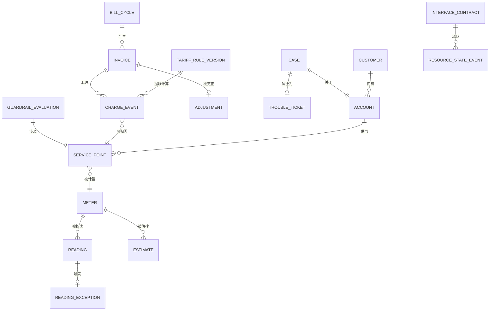

# 05 · 逻辑数据模型

> 核心实体的逻辑模型。物理建模是部署关注点；本文件固定形态与不变量。
>
> ⚠️ ASSUMPTION — 该模型属于方案包设计。

## 实体

```
CUSTOMER（当事方）                      -- BR-01
  customer_id       PK
  party_type        natural | legal
  customer_class    residential | industrial | commercial | agricultural | large

ACCOUNT（当事方）                       -- BR-01
  account_id        PK
  customer_id       FK → CUSTOMER
  billing_type, opened_ts, closed_ts?
  -- 一个拥有自己生命周期的独立对象；服务点变更不在此应用

SERVICE_POINT（当事方）                 -- BR-01
  service_point_id  PK
  account_id        FK → ACCOUNT
  meter_id          FK → METER
  tariff_assignment_ref

METER（当事方）
  meter_id          PK
  meter_ref (asset), type, installed_ts, removed_ts?

READING（计量）                    -- BR-04
  reading_id        PK
  meter_id          FK → SERVICE_POINT
  value, read_ts, collection_method   -- NOT NULL (BR-04)
  source            ami | field

READING_EXCEPTION（计量）          -- BR-04
  reading_exception_id PK
  reading_id        FK → READING (nullable: never collected)
  kind, raised_ts, reason, resolution_ref?

ESTIMATE（计量）                   -- BR-05
  estimate_id       PK
  meter_id          FK → SERVICE_POINT
  value
  rule_ref          NOT NULL           -- 只来自已声明的规则
  estimate_flag     NOT NULL, = true   -- 结构性；绝不是实测
  applied_ts, reconciled_at?, actual_value?

TARIFF_RULE_SET / TARIFF_RULE_VERSION（电价）   -- BR-08, ADR-0001
  rule_set_id       PK
  rule_version_ref  PK
  effective_from    NOT NULL
  effective_to                     -- 当前版本时为 null
  effective_date                   -- 周期的拆分边界（FR-009）
  published_by, published_ts
  status            draft | published | superseded | retired

CHARGE_EVENT（计费）               -- BR-09, ADR-0002
  charge_event_id   PK
  kind, amount, currency, ts
  rule_version_ref  FK → TARIFF_RULE_VERSION NOT NULL (BR-08)
  order_ref         FK → SERVICE_POINT     NOT NULL (BR-12, 订单侧)
  meter_id          FK → SERVICE_POINT     NOT NULL (BR-12, 库存侧)
  -- 仅追加：没有 UPDATE 或 DELETE 授权（BR-09，约束 2）

INVOICE / BILL_CYCLE / ADJUSTMENT（出账）   -- BR-10, BR-11, ADR-0002
  bill_cycle_id     PK, period_from, period_to, closed_ts
  invoice_id        PK, account_ref, bill_cycle_ref, rule_versions_used[], total
  -- rule_versions_used[] NOT NULL：重新生成使用所记录的版本（约束 5）
  adjustment_id     PK, invoice_ref, amount, reason, approved_by, approved_ts
  -- 生效前 approved_by NOT NULL（约束 7）

CASE / TROUBLE_TICKET / WORK_ORDER（客服）  -- BR-06, BR-07
  case_id           PK, customer_ref, account_ref, meter_ref, context_snapshot_ref, state
  trouble_ticket_id PK, service_instance_ref, work_order_ref

GUARDRAIL_POLICY / GUARDRAIL_EVALUATION（护栏）  -- BR-15, ADR-0004
  guardrail_policy_id PK, scope, eligibility_classes[], notice_periods[],
    restricted_periods[]
  guardrail_evaluation_id PK, disconnection_ref, inputs[], outcomes[],
    failed_guardrails[], evaluated_ts
  -- 没有持久化的求值，一次停电就不能被记录（约束 9）

INTERFACE_CONTRACT / RESOURCE_STATE_EVENT（接口）  -- BR-02
  contract_id, payload_shapes, state_vocabulary, timing, ownership, failure_semantics
  state_event_id, contract_id, resource_ref, state, ts   -- *unknown* 是一个取值
```

## 键与基数



## 模型必须强制执行的完整性约束

| # | 约束 | 强制执行 |
|---|---|---|
| 1 | `CUSTOMER`、`ACCOUNT` 与 `SERVICE_POINT` 是彼此独立的对象；服务点变更不编辑客户记录 | BR-01 |
| 2 | `CHARGE_EVENT` 没有 UPDATE 或 DELETE 授权 | BR-09、NFR-001 |
| 3 | `CHARGE_EVENT.rule_version_ref`、`order_ref`、`meter_id` 均为 NOT NULL | BR-08、BR-12 |
| 4 | `READING.collection_method` 为 NOT NULL | BR-04、FR-004 |
| 5 | `INVOICE.rule_versions_used[]` 为 NOT NULL | BR-11、FR-014、NFR-004 |
| 6 | 任何期间都不发出使用该期间未生效版本的费用事件 | BR-08、FR-009、NFR-006 |
| 7 | `ADJUSTMENT.approved_by` 在生效前为 NOT NULL | BR-10 |
| 8 | 插入时 `ESTIMATE.estimate_flag` 为 TRUE 且 `rule_ref` 为 NOT NULL | BR-05、FR-003、NFR-003 |
| 9 | 没有持久化的 `GUARDRAIL_EVALUATION_REF`，一次停电就不能被记录 | BR-15、FR-022、NFR-009 |
| 10 | `RESOURCE_STATE_EVENT` 只经由已声明的 `INTERFACE_CONTRACT` 流转；没有直接的网络状态访问 | BR-02、CTL-06 |

> 约束 2、4、8、9 和 10 是**在存储层强制执行**的，而不是在应用代码中。一个
> 可变的费用事件、一个未标注的估算、一次没有持久化求值的停电，或一次直接
> 的网络状态读取，无论应用纪律作出何种承诺都是缺陷——而每一个都是
> `04-architecture/observability.md` 中的 sev-1 信号。
