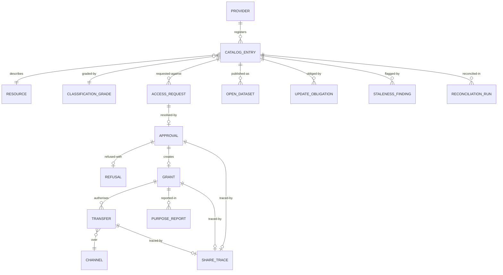

# 03 · Domain Model

> ⚠️ ASSUMPTION — bounded contexts, aggregates and invariants are pack design.
> 国发〔2016〕51号 supplies the share-type definitions, not this decomposition.

## Bounded contexts

| Context | Responsibility | Owns |
|---|---|---|
| **Catalog** | The root object | CatalogEntry, Resource, Provider, UpdateObligation |
| **Classification** | Grade-driven policy | ClassificationGrade, MaskingRule, AccessRule |
| **Authorization** | Requests, approvals, grants | AccessRequest, Approval, Grant, Refusal |
| **Exchange** | The channels | Channel, Transfer, TransferRecord |
| **Lineage** | Closing the loop | LineageEdge, ShareTrace |
| **Open data** | A different regime | OpenDataset, Distribution, DcatMetadata |
| **Governance** | Currency, consistency, purpose conformance | StalenessFinding, ReconciliationRun, PurposeReport |
| **Interface** | The boundary to other platforms | InterfaceContract, CrossPlatformRecord |

Catalog is the root context: authorization references a **catalog entry**, never
a source system (BR-01, constraint 1), and a resource outside the catalog is
invisible to the process that governs sharing.

## Core aggregates & invariants

### CatalogEntry (catalog)
```
CatalogEntry: id, providerRef, resourceRef, classificationGrade,
  shareType (unconditional | conditional | not-shareable), ownerRef,
  updateObligationRef, status
Refusal: id, entryRef, basis?            -- required for not-shareable
└── invariants
    • a resource cannot be shared without an entry (BR-01, constraint 1)
    • shareType ∈ the three types (BR-13)
    • a not-shareable entry REQUIRES a recorded legal basis (BR-03, FR-006,
      constraint 2)
    • the update obligation is recorded, and staleness is raised against it
      (BR-02, constraint 3)
    • authorization references the entry, never the source system (constraint 1)
```

### ClassificationGrade / MaskingRule / AccessRule (classification)
```
ClassificationGrade: id, grade, methodRef, assignedBy, assignedTs
MaskingRule: id, gradeRef, expression          -- derived, per grade (not dataset)
AccessRule:  id, gradeRef, expression
└── invariants
    • rules are DERIVED from the grade and stated per class (BR-04, FR-007)
    • a dataset inherits from its grade; no hand-granted dataset rule (FR-008)
    • a grade change re-derives; no patching of individual dataset rules
      (FR-009, constraint 4)
    • masking is applied by the platform at exchange, not by the consumer
      (FR-010)
    • enforcement covers EVERY consumer path, including notebooks, exports and
      feeds (FR-011, constraint 5)
```

### AccessRequest / Approval / Grant / Refusal (authorization)
```
AccessRequest: id, entryRef, consumerRef, purpose (structured), scope, duration,
  state
Approval: id, requestRef, approverRef, decision, basis?, ts
Grant: id, approvalRef, consumerRef, entryRef, purposeRef, scope, validFrom,
  validTo?, revokedTs?, revokedBy?
└── invariants
    • purpose is STRUCTURED and checkable, never free text (BR-05, FR-013,
      constraint 6)
    • a grant is revocable; an irrevocable one is illegal (BR-07, FR-015)
    • revocation's value is the LEAD TIME until access is removed (FR-016,
      NFR-003)
    • an unconditional entry grants without per-consumer negotiation (BR-06)
    • no transfer without a live, purpose-matching grant (BR-08, FR-017)
    • a refusal records its basis (BR-03, FR-005)
```

### Channel / Transfer / TransferRecord (exchange)
```
Channel: id, kind (table-to-table | file | interface), auditability
Transfer: id, grantRef, channelRef, payloadRef, ts
└── invariants
    • a channel outside the declared set is illegal (BR-09, FR-019)
    • every channel produces the same grant and lineage record (BR-09, NFR-011)
    • a transfer resolves to a grant, and a grant to an approval (BR-08)
```

### ShareTrace / LineageEdge (lineage)
```
ShareTrace: id, transferRef, grantRef, approvalRef, requestRef, artefactRef
LineageEdge: id, fromEntryRef, toConsumerRef, transferRef?
└── invariants
    • a share walks back to its approval (FR-018, constraint 7)
    • the loop is a CYCLE: share → grant → approval, and lineage closing to the
      source entry (BR-08)
    • an ungranted read is illegal on every channel (constraint 5)
```

### OpenDataset / Distribution (open data)
```
OpenDataset: id, entryRef?, dcatMetadataRef, themeRef, publisherRef
Distribution: id, datasetRef, form (download|api), dcatRef
└── invariants
    • open data is a different regime, not a subset of sharing (BR-11)
    • every published distribution carries DCAT metadata (FR-022, constraint 8)
    • publication basis is distinct from a sharing grant (BR-11)
```

### UpdateObligation / StalenessFinding / ReconciliationRun (governance)
```
UpdateObligation: id, entryRef, period, triggerEvents[]
StalenessFinding: id, entryRef, raisedTs, providerRef, resolvedTs?
ReconciliationRun: id, entryRef, providerHeld, delivered, gap, ts
PurposeReport: id, grantRef, usageRef, conformance
└── invariants
    • a staleness finding routes to a provider owner (BR-10, constraint 9)
    • reconciliation compares provider-held and delivered data (BR-12)
    • purpose conformance is reported, so 第十四条 is auditable (FR-024)
```

## Relationships (logical)



## The four aggregates that carry the pack's weight

| Aggregate | The invariant that matters most | What it prevents |
|---|---|---|
| **CatalogEntry** | the root object, and authorization references it | a share invisible to the very process that governs it |
| **ClassificationGrade** | rules **derived** and stated per grade, never per dataset | a grade that is documentation rather than control, and control that must be hand-granted per dataset until one is missed |
| **Grant** | structured purpose, revocable, lead-time measured | an unaccountable transfer, and a revocation in name only |
| **ShareTrace** | share → grant → approval, lineage closing to the entry | the loop being a sequence rather than a cycle, so an ungranted read is invisible |

> The third and the fourth are where the closed loop is either real or nominal. A
> grant recording only *who* and *what* cannot answer "did the consumer stay within
> the declared purpose?", which is the question that makes the loop auditable
> rather than merely lawful-looking.