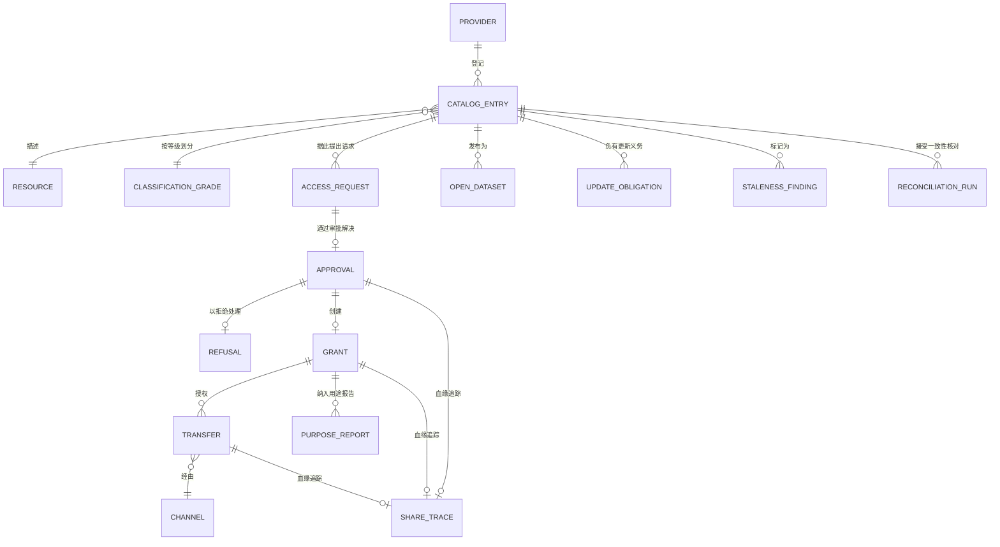

# 03 · 领域模型

> ⚠️ ASSUMPTION — 限界上下文、聚合和不变量属于方案包设计。
> 国发〔2016〕51号 提供共享类型的定义，而不是这一分解方案。

## 限界上下文

| 上下文 | 职责 | 拥有 |
|---|---|---|
| **目录** | 根对象 | CatalogEntry, Resource, Provider, UpdateObligation |
| **分类分级** | 分级驱动策略 | ClassificationGrade, MaskingRule, AccessRule |
| **授权** | 请求、审批、授权 | AccessRequest, Approval, Grant, Refusal |
| **交换** | 通道 | Channel, Transfer, TransferRecord |
| **血缘** | 形成闭环 | LineageEdge, ShareTrace |
| **开放数据** | 不同的规则体系 | OpenDataset, Distribution, DcatMetadata |
| **治理** | 目录时效、一致性、用途符合性 | StalenessFinding, ReconciliationRun, PurposeReport |
| **接口** | 与其他平台之间的边界 | InterfaceContract, CrossPlatformRecord |

目录是根上下文：授权引用的是**目录项**，绝不引用源系统 (BR-01, constraint 1)；目录之外的资源对治理共享的流程不可见。

## 核心聚合与不变量

### CatalogEntry（目录）
```
CatalogEntry: id, providerRef, resourceRef, classificationGrade,
  shareType (unconditional | conditional | not-shareable), ownerRef,
  updateObligationRef, status
Refusal: id, entryRef, basis?            -- 不予共享时必填
└── 不变量
    • 没有目录项，资源不得共享 (BR-01, constraint 1)
    • shareType ∈ 三种类型之一 (BR-13)
    • 不予共享的目录项必须记录不予共享依据 (BR-03, FR-006,
      constraint 2)
    • 更新义务必须已记录，并针对该义务提出时效性问题
      (BR-02, constraint 3)
    • 授权引用目录项，绝不引用源系统 (constraint 1)
```

### ClassificationGrade / MaskingRule / AccessRule（分类分级）
```
ClassificationGrade: id, grade, methodRef, assignedBy, assignedTs
MaskingRule: id, gradeRef, expression          -- 由等级推导得出，按等级适用（而非数据集）
AccessRule:  id, gradeRef, expression
└── 不变量
    • 规则由等级推导得出，并按类别声明 (BR-04, FR-007)
    • 数据集继承其等级；不存在人工授予的数据集级规则 (FR-008)
    • 等级变更后重新推导；不得修补单个数据集规则
      (FR-009, constraint 4)
    • 脱敏由平台在交换时执行，而非由使用部门执行
      (FR-010)
    • 强制执行覆盖每一条使用部门路径，包括笔记本、导出和数据馈送
      (FR-011, constraint 5)
```

### AccessRequest / Approval / Grant / Refusal（授权）
```
AccessRequest: id, entryRef, consumerRef, purpose (结构化), scope, duration,
  state
Approval: id, requestRef, approverRef, decision, basis?, ts
Grant: id, approvalRef, consumerRef, entryRef, purposeRef, scope, validFrom,
  validTo?, revokedTs?, revokedBy?
└── 不变量
    • purpose 必须是结构化且可核验的，绝不能是自由文本 (BR-05, FR-013,
      constraint 6)
    • 授权必须可撤销；不可撤销的授权属于非法状态 (BR-07, FR-015)
    • 撤销授权的价值在于访问权限被移除之前的提前量 (FR-016,
      NFR-003)
    • 无条件目录项无需针对各使用部门逐一协商，即可产生授权 (BR-06)
    • 没有有效且用途匹配的授权，不得进行传输 (BR-08, FR-017)
    • 拒绝记录必须记录其不予共享依据 (BR-03, FR-005)
```

### Channel / Transfer / TransferRecord（交换）
```
Channel: id, kind (table-to-table | file | interface), auditability
Transfer: id, grantRef, channelRef, payloadRef, ts
└── 不变量
    • 使用声明的通道集合之外的通道属于非法行为 (BR-09, FR-019)
    • 每个通道都产生相同的授权记录和血缘记录 (BR-09, NFR-011)
    • 一次传输可解析到一项授权，一项授权可解析到一次审批 (BR-08)
```

### ShareTrace / LineageEdge（血缘）
```
ShareTrace: id, transferRef, grantRef, approvalRef, requestRef, artefactRef
LineageEdge: id, fromEntryRef, toConsumerRef, transferRef?
└── 不变量
    • 共享可一路回溯到审批 (FR-018, constraint 7)
    • 闭环是一个循环：共享 → 授权 → 审批，并由血缘回溯至
      源目录项 (BR-08)
    • 任何通道上的未获授权读取均属非法 (constraint 5)
```

### OpenDataset / Distribution（开放数据）
```
OpenDataset: id, entryRef?, dcatMetadataRef, themeRef, publisherRef
Distribution: id, datasetRef, form (download|api), dcatRef
└── 不变量
    • 开放数据适用不同的规则体系，并非共享的子集 (BR-11)
    • 每个已发布的分发物都带有 DCAT 元数据 (FR-022, constraint 8)
    • 开放依据不同于共享授权 (BR-11)
```

### UpdateObligation / StalenessFinding / ReconciliationRun（治理）
```
UpdateObligation: id, entryRef, period, triggerEvents[]
StalenessFinding: id, entryRef, raisedTs, providerRef, resolvedTs?
ReconciliationRun: id, entryRef, providerHeld, delivered, gap, ts
PurposeReport: id, grantRef, usageRef, conformance
└── 不变量
    • 时效性问题发现路由至提供部门负责人 (BR-10, constraint 9)
    • 一致性核对比较提供部门持有的数据与已交付数据 (BR-12)
    • 报告用途符合性，从而使第十四条可接受审计 (FR-024)
```

## 关系（逻辑）



## 支撑本方案包的四个聚合

| 聚合 | 最重要的不变量 | 所防止的问题 |
|---|---|---|
| **CatalogEntry** | 根对象，且授权引用它 | 共享对治理该共享的流程本身不可见 |
| **ClassificationGrade** | 规则经推导得出，并按等级声明，绝不按数据集声明 | 等级沦为文档而非控制，以及必须逐个数据集人工授予、容易漏掉某一数据集的控制 |
| **Grant** | 结构化用途、可撤销、提前量得到衡量 | 无法问责的传输，以及形同虚设的撤销 |
| **ShareTrace** | 共享 → 授权 → 审批，血缘闭环回目录项 | 闭环成为序列而非循环，导致未获授权的读取不可见 |

> 第三项和第四项决定了血缘闭环是实质成立还是仅具形式。授权如果只记录*谁*和*什么*，就无法回答
> “使用部门是否始终遵守声明的使用用途？”；而正是这个问题，使闭环能够接受审计，而不只是表面上看起来合规。