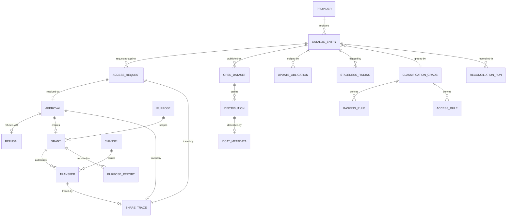

# 05 · Logical Data Model

> Logical model for the core entities. Physical modelling is a deployment concern;
> this file fixes the shape and the invariants.
>
> ⚠️ ASSUMPTION — the model is pack design. 国发〔2016〕51号 supplies the share-type
> definitions, not this decomposition.

## Entities

```
PROVIDER (catalog)
  provider_id       PK, department_ref, name

CATALOG_ENTRY (catalog)                       -- BR-01, ADR-0001
  entry_id          PK
  provider_ref      FK → PROVIDER NOT NULL
  resource_ref      NOT NULL             -- the resource description, not the system
  classification_grade NOT NULL
  share_type        unconditional | conditional | not-shareable   -- BR-06/BR-14
  owner_ref         NOT NULL
  update_obligation_ref FK → UPDATE_OBLIGATION NOT NULL
  -- authorization references the entry; NO grant may resolve a source system
  -- directly (constraint 1)

REFUSAL (catalog)                             -- BR-03, ADR-0003
  refusal_id        PK, entry_ref FK → CATALOG_ENTRY, basis?
  -- basis NOT NULL when share_type = not-shareable (constraint 2)

UPDATE_OBLIGATION (catalog)                   -- BR-02, ADR-0002
  obligation_id     PK, entry_ref, period, trigger_events[]

CLASSIFICATION_GRADE (classification)         -- BR-04, ADR-0004
  grade_id          PK, grade, method_ref, assigned_by, assigned_ts

MASKING_RULE / ACCESS_RULE (classification)   -- BR-04
  *_rule_id         PK
  grade_ref         FK → CLASSIFICATION_GRADE NOT NULL
  expression        NOT NULL
  -- DERIVED from the grade and stated per grade (constraint 4); no
  -- dataset-scoped override exists

ACCESS_REQUEST / APPROVAL / GRANT (authorization)   -- BR-05
  request_id        PK
  entry_ref         FK → CATALOG_ENTRY NOT NULL (constraint 1)
  consumer_ref      NOT NULL
  purpose_ref       FK → PURPOSE NOT NULL      -- structured (constraint 6)
  scope, duration
  state
  approval_id       PK
  request_ref       FK → ACCESS_REQUEST NOT NULL
  approver_ref      NOT NULL
  decision, basis?, ts
  grant_id          PK
  approval_ref      FK → APPROVAL NOT NULL
  consumer_ref, entry_ref, purpose_ref
  valid_from        NOT NULL
  valid_to?
  revoked_ts?, revoked_by?
  -- irrevocable grants are illegal (constraint 10)

PURPOSE (authorization)                       -- BR-05, ADR-0005
  purpose_id        PK, name, structure[]
  -- structured and checkable; free text is illegal (constraint 6)

CHANNEL / TRANSFER / TRANSFER_RECORD (exchange)  -- BR-08, BR-09
  channel_id        PK, kind table-to-table | file | interface
  transfer_id       PK
  grant_ref         FK → GRANT NOT NULL        -- live, purpose-matching
  channel_ref       FK → CHANNEL NOT NULL
  payload_ref
  masking_applied   NOT NULL
  ts
  -- a channel outside the declared set is illegal (constraint 11);
  -- every channel produces the same grant and lineage record (NFR-011)

SHARE_TRACE / LINEAGE_EDGE (lineage)          -- BR-08, ADR-0005
  share_trace_id    PK
  transfer_ref      FK → TRANSFER NOT NULL
  grant_ref         FK → GRANT NOT NULL
  approval_ref      FK → APPROVAL NOT NULL
  request_ref       FK → ACCESS_REQUEST NOT NULL
  artefact_ref
  -- the loop CLOSES: transfer → grant → approval → request → entry
  -- (constraint 7)

OPEN_DATASET / DISTRIBUTION (open data)       -- BR-11
  dataset_id        PK
  entry_ref?        -- an open dataset may differ in scope from the shared entry
  publication_basis_ref NOT NULL
  distribution_id   PK
  dataset_ref       FK → OPEN_DATASET NOT NULL
  form              download | api
  dcat_ref          FK → DCAT_METADATA NOT NULL (constraint 8)
DCAT_METADATA
  dcat_id           PK, dataset_meta, distribution_meta, publisher, theme

STALENESS_FINDING (governance)                -- BR-10
  finding_id        PK
  entry_ref         FK → CATALOG_ENTRY NOT NULL
  raised_ts, provider_ref, resolved_ts?
  -- routed to a provider owner; no unowned finding (constraint 9)

RECONCILIATION_RUN / PURPOSE_REPORT (governance)   -- BR-12, BR-05
  run_id            PK, entry_ref, provider_held, delivered, gap, ts
  report_id         PK, grant_ref, usage_ref, conformance
```

## Keys and cardinalities



## Integrity constraints the model must enforce

| # | Constraint | Enforces |
|---|---|---|
| 1 | Every `GRANT` and `ACCESS_REQUEST` references a `CATALOG_ENTRY`; no reference resolves a source system | BR-01, FR-002 |
| 2 | `REFUSAL.basis` is NOT NULL when `CATALOG_ENTRY.share_type = 'not-shareable'` | BR-03, FR-006 |
| 3 | `CATALOG_ENTRY.update_obligation_ref` is NOT NULL, and staleness is raised against it | BR-02, FR-003 |
| 4 | `MASKING_RULE` / `ACCESS_RULE` derive from a `CLASSIFICATION_GRADE`; a dataset-scoped rule not derived from a grade is illegal | BR-04, FR-007, FR-008 |
| 5 | Classification enforcement applies to every consumer path — BI, notebook, export, cross-platform and data-science — with no bypass row | BR-04, FR-011, NFR-005 |
| 6 | `GRANT.purpose_ref` is NOT NULL and resolves to a structured `PURPOSE`; free text is illegal | BR-05, FR-013, NFR-008 |
| 7 | A `SHARE_TRACE` requires a transfer, a grant, an approval **and** a request; a half-closed trace is illegal | BR-08, FR-018, NFR-002 |
| 8 | `DISTRIBUTION.dcat_ref` is NOT NULL; an undescribed distribution is illegal | BR-11, FR-022, NFR-012 |
| 9 | `STALENESS_FINDING.provider_ref` is NOT NULL; an unowned finding is illegal | BR-10, FR-020 |
| 10 | No grant may be created with `revoked` semantics absent; `GRANT.valid_to` is enforced automatically at expiry | BR-07, FR-015, NFR-009 |
| 11 | `TRANSFER.channel_ref` resolves to a declared `CHANNEL`; `TRANSFER.grant_ref` resolves to a live, purpose-matching grant | BR-08, BR-09, FR-017, FR-019, NFR-001 |
| 12 | `TRANSFER.masking_applied` is NOT NULL and true for any dataset with a classification grade requiring it | BR-04, FR-010 |

> Constraints 1, 2, 4, 6, 7, 9, 10, 11 and 12 are **enforced in the store**, not in
> application code. A grant against a source system, a not-shareable entry without a
> basis, a dataset-scoped rule, a grant without a structured purpose, a half-closed
> share trace, an unowned staleness finding, a transfer without a live grant, or an
> unmasked release is a defect regardless of what application discipline promises —
> and each is a sev-1 signal in `04-architecture/observability.md`.