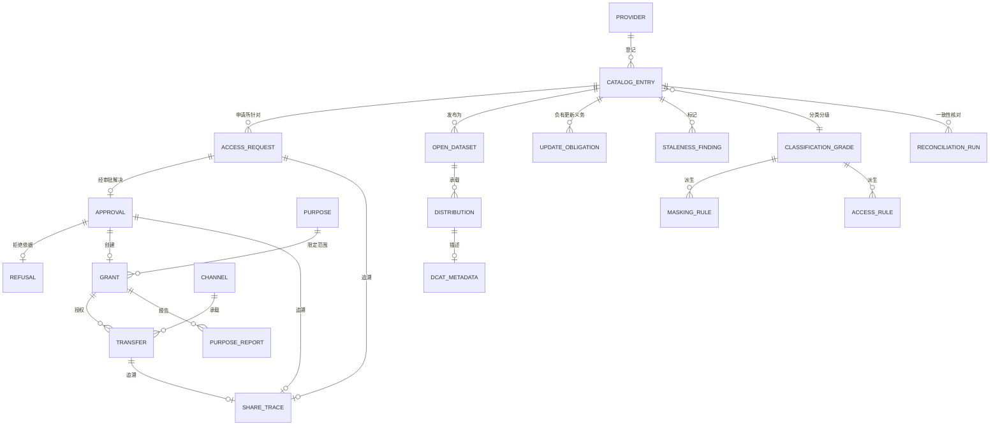

# 05 · 逻辑数据模型

> 核心实体的逻辑模型。物理建模属于部署层面的关注事项；
> 本文件确定模型形态和不变量。
>
> ⚠️ ASSUMPTION — 该模型属于方案包设计。国发〔2016〕51号规定了共享类型
> 定义，而非本文件中的实体分解。

## 实体

```
PROVIDER (catalog)
  provider_id       PK, department_ref, name

CATALOG_ENTRY (catalog)                       -- BR-01, ADR-0001
  entry_id          PK
  provider_ref      FK → PROVIDER NOT NULL
  resource_ref      NOT NULL             -- 资源描述，而非系统
  classification_grade NOT NULL
  share_type        unconditional | conditional | not-shareable   -- BR-06/BR-14
  owner_ref         NOT NULL
  update_obligation_ref FK → UPDATE_OBLIGATION NOT NULL
  -- 授权引用该目录项；任何授权都不得直接解析到源系统
  -- （约束 1）

REFUSAL (catalog)                             -- BR-03, ADR-0003
  refusal_id        PK, entry_ref FK → CATALOG_ENTRY, basis?
  -- 当 share_type = not-shareable 时，basis 必须为 NOT NULL（约束 2）

UPDATE_OBLIGATION (catalog)                   -- BR-02, ADR-0002
  obligation_id     PK, entry_ref, period, trigger_events[]

CLASSIFICATION_GRADE (classification)         -- BR-04, ADR-0004
  grade_id          PK, grade, method_ref, assigned_by, assigned_ts

MASKING_RULE / ACCESS_RULE (classification)   -- BR-04
  *_rule_id         PK
  grade_ref         FK → CLASSIFICATION_GRADE NOT NULL
  expression        NOT NULL
  -- 从等级派生，并按等级声明（约束 4）；不存在
  -- 数据集范围的覆盖规则

ACCESS_REQUEST / APPROVAL / GRANT (authorization)   -- BR-05
  request_id        PK
  entry_ref         FK → CATALOG_ENTRY NOT NULL (constraint 1)
  consumer_ref      NOT NULL
  purpose_ref       FK → PURPOSE NOT NULL      -- structured (constraint 6)
  scope, duration
  state
  approval_id       PK
  request_ref       FK → ACCESS_REQUEST NOT NULL
  approver_ref      NOT NULL
  decision, basis?, ts
  grant_id          PK
  approval_ref      FK → APPROVAL NOT NULL
  consumer_ref, entry_ref, purpose_ref
  valid_from        NOT NULL
  valid_to?
  revoked_ts?, revoked_by?
  -- 不可撤销的授权不允许（约束 10）

PURPOSE (authorization)                       -- BR-05, ADR-0005
  purpose_id        PK, name, structure[]
  -- 结构化且可校验；自由文本不允许（约束 6）

CHANNEL / TRANSFER / TRANSFER_RECORD (exchange)  -- BR-08, BR-09
  channel_id        PK, kind table-to-table | file | interface
  transfer_id       PK
  grant_ref         FK → GRANT NOT NULL        -- 有效且用途匹配
  channel_ref       FK → CHANNEL NOT NULL
  payload_ref
  masking_applied   NOT NULL
  ts
  -- 声明范围之外的通道不允许（约束 11）；
  -- 每个通道均产生相同的授权和血缘记录（NFR-011）

SHARE_TRACE / LINEAGE_EDGE (lineage)          -- BR-08, ADR-0005
  share_trace_id    PK
  transfer_ref      FK → TRANSFER NOT NULL
  grant_ref         FK → GRANT NOT NULL
  approval_ref      FK → APPROVAL NOT NULL
  request_ref       FK → ACCESS_REQUEST NOT NULL
  artefact_ref
  -- 闭环：传输 → 授权 → 审批 → 请求 → 目录项
  -- （约束 7）

OPEN_DATASET / DISTRIBUTION (open data)       -- BR-11
  dataset_id        PK
  entry_ref?        -- 开放数据集的范围可以不同于共享目录项
  publication_basis_ref NOT NULL
  distribution_id   PK
  dataset_ref       FK → OPEN_DATASET NOT NULL
  form              download | api
  dcat_ref          FK → DCAT_METADATA NOT NULL (constraint 8)
DCAT_METADATA
  dcat_id           PK, dataset_meta, distribution_meta, publisher, theme

STALENESS_FINDING (governance)                -- BR-10
  finding_id        PK
  entry_ref         FK → CATALOG_ENTRY NOT NULL
  raised_ts, provider_ref, resolved_ts?
  -- 路由至提供部门所有者；不允许无归属的发现项（约束 9）

RECONCILIATION_RUN / PURPOSE_REPORT (governance)   -- BR-12, BR-05
  run_id            PK, entry_ref, provider_held, delivered, gap, ts
  report_id         PK, grant_ref, usage_ref, conformance
```

## 键与基数



## 模型必须强制执行的完整性约束

| # | 约束 | 对应项 |
|---|---|---|
| 1 | 每个 `GRANT` 和 `ACCESS_REQUEST` 均引用一个 `CATALOG_ENTRY`；任何引用都不得解析到源系统 | BR-01, FR-002 |
| 2 | 当 `CATALOG_ENTRY.share_type = 'not-shareable'` 时，`REFUSAL.basis` 为 NOT NULL | BR-03, FR-006 |
| 3 | `CATALOG_ENTRY.update_obligation_ref` 为 NOT NULL，且时效性问题针对该引用提出 | BR-02, FR-003 |
| 4 | `MASKING_RULE` / `ACCESS_RULE` 派生自 `CLASSIFICATION_GRADE`；数据集范围且未从分类分级派生的规则不允许 | BR-04, FR-007, FR-008 |
| 5 | 分类分级强制执行适用于每一条使用部门路径——BI、notebook、导出、跨平台和数据科学——且不存在绕过行 | BR-04, FR-011, NFR-005 |
| 6 | `GRANT.purpose_ref` 为 NOT NULL，且解析到结构化的 `PURPOSE`；自由文本不允许 | BR-05, FR-013, NFR-008 |
| 7 | `SHARE_TRACE` 必须同时具备传输、授权、审批**和**请求；半闭环的共享追溯记录不允许 | BR-08, FR-018, NFR-002 |
| 8 | `DISTRIBUTION.dcat_ref` 为 NOT NULL；未描述的分发物不允许 | BR-11, FR-022, NFR-012 |
| 9 | `STALENESS_FINDING.provider_ref` 为 NOT NULL；无归属的时效性发现项不允许 | BR-10, FR-020 |
| 10 | 创建任何授权时都不得缺少 `revoked` 语义；`GRANT.valid_to` 在到期时自动强制执行 | BR-07, FR-015, NFR-009 |
| 11 | `TRANSFER.channel_ref` 解析到已声明的 `CHANNEL`；`TRANSFER.grant_ref` 解析到有效且用途匹配的授权 | BR-08, BR-09, FR-017, FR-019, NFR-001 |
| 12 | `TRANSFER.masking_applied` 为 NOT NULL，且对于任何具有要求执行脱敏的分类分级的数据集，该值必须为 true | BR-04, FR-010 |

> 约束 1、2、4、6、7、9、10、11 和 12 由**存储层**强制执行，而非
> 应用程序代码。针对源系统的授权、无依据的不予共享目录项、数据集范围的规则、
> 无结构化使用用途的授权、半闭环的共享追溯记录、无归属的时效性发现项、无有效授权
> 的传输或未脱敏的发布，无论应用规范作出何种承诺，均属于缺陷——并且每项缺陷都是
> `04-architecture/observability.md` 中的 sev-1 信号。