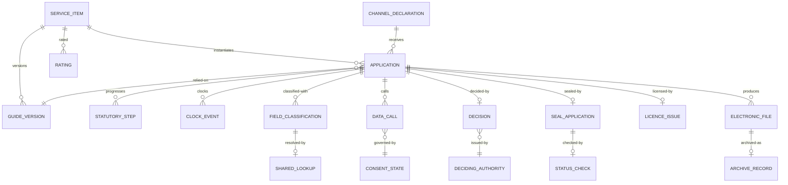

# 03 · Domain Model

> ⚠️ ASSUMPTION — bounded contexts, aggregates and invariants are pack design.
> 国令第716号 supplies the statutory vocabulary, not this decomposition.

## Bounded contexts

| Context | Responsibility | Owns |
|---|---|---|
| **Catalogue** | The 事项 root | ServiceItem, Guide, GuideVersion, Kind |
| **Identity** | National unified authentication | AuthenticatedSubject, Channel |
| **Sharing & verification** | The anti-double-submission rule | FieldClassification, SharedLookup, VerificationRecord |
| **Application** | The 办件 and its lifecycle | Application, StatutoryStep, ClockEvent |
| **Approval** | Statutory decisions | Decision, DecidingAuthority |
| **Seal & licence** | National service integration | SealApplication, LicenceIssue, StatusCheck |
| **Archive & records** | Electronic archiving | ElectronicFile, ArchiveRecord, RetentionClass |
| **Cross-department** | Consented, audited calls | DataCall, CallPurpose, CallAudit |
| **Feedback** | 好差评 | Rating, Response |
| **Variant (channel)** | Channel-specific configuration | ChannelDeclaration, ChannelAdapter |

Catalogue is the root: Application references a ServiceItem, and the item's Guide
is the published contract.

## Core aggregates & invariants

### ServiceItem / Guide / GuideVersion (catalogue)
```
ServiceItem: id, kind (administrative-power|public-service), status
GuideVersion: id, itemRef, acceptanceConditions[], materials[], processSteps[],
  version, publishedTs, publishedBy, effectiveFrom
└── invariants
    • kind ∈ the two statutory kinds; a third kind is illegal (BR-01, constraint 1)
    • all three mandatory elements present at publication (BR-02, constraint 2)
    • a guide is versioned; a change is dated and attributed (BR-02, constraint 2)
    • an application records the guide version relied on at submission (FR-005)
```

### Application / StatutoryStep / ClockEvent (application)
```
Application: id, itemRef, applicantRef, channelRef, guideVersionRef, state
StatutoryStep: id, applicationRef, kind (受理|审查|决定|出件), startedTs, endedTs?
ClockEvent: id, applicationRef, kind (start|pause|stop|breach), ts, reason?
└── invariants
    • the lifecycle uses the STATUTORY vocabulary; generic statuses are illegal
      (BR-06, constraint 3)
    • the clock starts at 受理 — the acceptance timestamp, never at submission
      (BR-09, FR-023, constraint 4)
    • 一次性告知 and 补正 are distinct steps (BR-07, constraint 5)
    • one 一次性告知 must be COMPLETE; partial notice is illegal (FR-018)
```

### FieldClassification / SharedLookup (sharing & verification)
```
FieldClassification: id, formFieldRef, obtainableBySharing, declaredTs
SharedLookup: id, fieldRef, sourceAuthority, outcome, ts
VerificationRecord: id, applicationRef, fieldRef, sourceRef, fieldsReturned[],
  consentStateRef
└── invariants
    • every form field carries a classification (BR-05, constraint 6)
    • an obtainable field is NEVER required as input or material (BR-05, FR-011)
    • a lookup failure resolves to a DEFINED permitted alternative, never to
      re-asking (BR-05, FR-013, constraint 7)
    • an exemption is recorded with a reason (FR-014, constraint 8)
```

### DataCall (cross-department)
```
DataCall: id, applicationRef, purposeRef, sourceAuthorityRef, consentStateRef,
  fieldsReturned[], ts
└── invariants
    • a call requires a consent state for its purpose (BR-08, FR-020, constraint 9)
    • the source authority, fields and purpose are recorded (FR-021)
    • a call with no establishable purpose is reported as over-collection (FR-022)
```

### SealApplication / LicenceIssue (seal & licence)
```
SealApplication: id, applicationRef, sealId, appliedTs, validAtTs,
  statusCheckRef
StatusCheck: id, sealId, checkedTs, validAtCheck
LicenceIssue: id, applicationRef, licenceRef, producedTs, templateRef
└── invariants
    • seals come from the national unified system; local minting is illegal
      (BR-10, FR-025, constraint 10)
    • validity is recorded AT SIGNING TIME, distinct from a status check now
      (CTL-04, constraint 10)
    • licences are produced through the national sharing service (FR-026)
    • the platform CONSUMES a seal status query service; it does not implement one
      (`integration.md`)
```

### ChannelDeclaration (variant)
```
ChannelDeclaration: id, kind (web|mini-program|pos|assisted), inputPath,
  paymentPath, identityModel, fulfilmentSources[], presentation[]
└── invariants
    • all five aspects declared before enabling (BR-04, constraint 11)
    • a channel never gains its own 事项, application or state model (FR-009)
    • business systems support compliant seal integration (BR-14, FR-027)
```

### ElectronicFile / ArchiveRecord / RetentionClass (archive)
```
ElectronicFile: id, applicationRef, formRef, completeness
ArchiveRecord: id, applicationRef, archivedTs, verified, retrievable
RetentionClass: id, dataClass, declaredWindow
└── invariants
    • archiving is electronic and verified complete and retrievable (BR-11,
      FR-028, FR-029, constraint 12)
    • attachment to a document management system is NOT archiving (FR-029)
    • retention per class; no global row (BR-12, constraint 13)
```

### Rating / Response (feedback)
```
Rating: id, applicationRef, score, comment?, submittedTs
Response: id, ratingRef, responderRef, ts
└── invariants
    • a rating is recorded; the pack does not require a response for every rating
      (a policy choice, not a citation)
```

## Relationships (logical)



## The four aggregates that carry the pack's weight

| Aggregate | The invariant that matters most | What it prevents |
|---|---|---|
| **ServiceItem / GuideVersion** | three mandatory elements, published and versioned | an applicant relying on a guide that changed silently, and a rework loop caused by an inaccurate guide |
| **Application / ClockEvent** | the statutory vocabulary, and the clock starting at 受理 | a generic workflow status mis-describing a legally defined act, and performance reported from the flattering end |
| **FieldClassification** | obtainable fields never required, and a defined permitted alternative on lookup failure | the platform's natural helpfulness violating 第七条 by asking |
| **SealApplication** | validity recorded **at signing time**, through the national system | a "sealed" document whose legal status is a rendering rather than a fact |

> The third is the pack's reason for existing. The failure mode is not a bug —
> it is a helpful platform that defaults to asking, and every field is a chance
> for it.