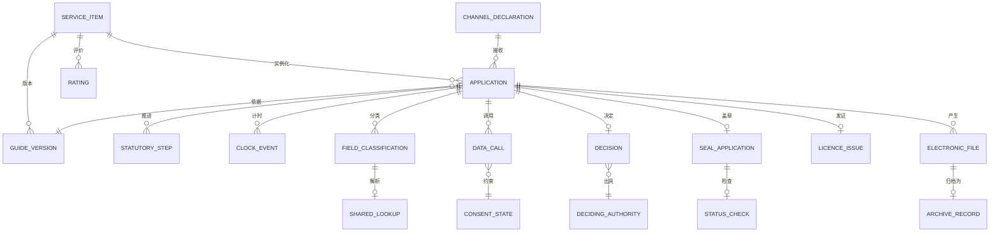

# 03 · 领域模型

> ⚠️ ASSUMPTION — 限界上下文、聚合和不变量属于方案包设计。
> 国务院令第716号提供法定术语，而非这一分解方式。

## 限界上下文

| 上下文 | 职责 | 拥有的模型 |
|---|---|---|
| **目录** | 事项根 | ServiceItem, Guide, GuideVersion, Kind |
| **身份** | 国家统一身份认证 | AuthenticatedSubject, Channel |
| **共享与核验** | 防止重复提交规则 | FieldClassification, SharedLookup, VerificationRecord |
| **办件** | 办件及其生命周期 | Application, StatutoryStep, ClockEvent |
| **决定** | 法定决定 | Decision, DecidingAuthority |
| **印章与证照** | 国家服务集成 | SealApplication, LicenceIssue, StatusCheck |
| **归档与记录** | 电子归档 | ElectronicFile, ArchiveRecord, RetentionClass |
| **跨部门** | 经同意、可审计的调用 | DataCall, CallPurpose, CallAudit |
| **反馈** | 好差评 | Rating, Response |
| **变体（渠道）** | 渠道专用配置 | ChannelDeclaration, ChannelAdapter |

目录是根：Application 引用 ServiceItem，而该事项的 Guide 是已发布的契约。

## 核心聚合与不变量

### ServiceItem / Guide / GuideVersion (目录)
```
ServiceItem: id, kind (administrative-power|public-service), status
GuideVersion: id, itemRef, acceptanceConditions[], materials[], processSteps[],
  version, publishedTs, publishedBy, effectiveFrom
└── invariants
    • kind 属于两种法定类别；第三种类别非法 (BR-01, constraint 1)
    • 三项强制要素在发布时均须齐备 (BR-02, constraint 2)
    • 办事指南须进行版本管理；变更须注明日期并标明责任人 (BR-02, constraint 2)
    • 办件须记录提交时所依据的办事指南版本 (FR-005)
```

### Application / StatutoryStep / ClockEvent (办件)
```
Application: id, itemRef, applicantRef, channelRef, guideVersionRef, state
StatutoryStep: id, applicationRef, kind (受理|审查|决定|出件), startedTs, endedTs?
ClockEvent: id, applicationRef, kind (start|pause|stop|breach), ts, reason?
└── invariants
    • 生命周期采用法定术语；通用状态非法
      (BR-06, constraint 3)
    • 办结时限从受理开始计时——即从受理时间戳开始，绝不从提交开始计时
      (BR-09, FR-023, constraint 4)
    • 一次性告知和补正是不同的步骤 (BR-07, constraint 5)
    • 一次性告知必须完整告知；部分告知非法 (FR-018)
```

### FieldClassification / SharedLookup (共享与核验)
```
FieldClassification: id, formFieldRef, obtainableBySharing, declaredTs
SharedLookup: id, fieldRef, sourceAuthority, outcome, ts
VerificationRecord: id, applicationRef, fieldRef, sourceRef, fieldsReturned[],
  consentStateRef
└── invariants
    • 每个表单字段都须具有分类 (BR-05, constraint 6)
    • 可共享获取的字段绝不得作为输入或材料要求提供 (BR-05, FR-011)
    • 查询失败必须解析为已定义的允许替代方案，绝不能转为
      重新要求提供 (BR-05, FR-013, constraint 7)
    • 豁免情况须连同理由一并记录 (FR-014, constraint 8)
```

### DataCall (跨部门)
```
DataCall: id, applicationRef, purposeRef, sourceAuthorityRef, consentStateRef,
  fieldsReturned[], ts
└── invariants
    • 调用须针对其目的具备同意状态 (BR-08, FR-020, constraint 9)
    • 来源机关、字段和调用目的均须记录 (FR-021)
    • 无法确定目的的调用须报告为过度收集 (FR-022)
```

### SealApplication / LicenceIssue (印章与证照)
```
SealApplication: id, applicationRef, sealId, appliedTs, validAtTs,
  statusCheckRef
StatusCheck: id, sealId, checkedTs, validAtCheck
LicenceIssue: id, applicationRef, licenceRef, producedTs, templateRef
└── invariants
    • 印章来自国家统一电子印章系统；本地生成印章非法
      (BR-10, FR-025, constraint 10)
    • 有效性须在签署时记录，与当前的状态检查相区分
      (CTL-04, constraint 10)
    • 证照须通过电子证照共享服务系统生成 (FR-026)
    • 平台仅使用印章状态查询服务；不实现该服务
      (`integration.md`)
```

### ChannelDeclaration (变体)
```
ChannelDeclaration: id, kind (web|mini-program|pos|assisted), inputPath,
  paymentPath, identityModel, fulfilmentSources[], presentation[]
└── invariants
    • 启用前须声明全部五个方面 (BR-04, constraint 11)
    • 渠道绝不得拥有自己的事项、办件或状态模型 (FR-009)
    • 业务系统须支持符合规范的印章集成 (BR-14, FR-027)
```

### ElectronicFile / ArchiveRecord / RetentionClass (归档)
```
ElectronicFile: id, applicationRef, formRef, completeness
ArchiveRecord: id, applicationRef, archivedTs, verified, retrievable
RetentionClass: id, dataClass, declaredWindow
└── invariants
    • 归档须采用电子方式，并经验证确认完整且可检索
      (BR-11, FR-028, FR-029, constraint 12)
    • 附加到文档管理系统不构成归档 (FR-029)
    • 按类别分别设定保留期；不得设置全局记录行 (BR-12, constraint 13)
```

### Rating / Response (反馈)
```
Rating: id, applicationRef, score, comment?, submittedTs
Response: id, ratingRef, responderRef, ts
└── invariants
    • 须记录好差评；本方案包不要求对每条好差评作出回应
      (这是政策选择，而非引用要求)
```

## 关系（逻辑）



## 支撑本方案包的四个聚合

| 聚合 | 最重要的不变量 | 所防止的问题 |
|---|---|---|
| **ServiceItem / GuideVersion** | 三项强制要素齐备，指南已发布并具有版本 | 申请人依赖悄然发生变化的指南，以及不准确的指南造成返工循环 |
| **Application / ClockEvent** | 采用法定术语，且办结时限从受理开始计时 | 通用工作流状态错误描述法定行为，以及从较有利的时间点起报告绩效 |
| **FieldClassification** | 可共享获取的字段绝不得要求提供，查询失败时须采用已定义的允许替代方案 | 平台出于惯有的“乐于助人”倾向而索要信息，从而违反第七条 |
| **SealApplication** | 通过国家统一电子印章系统在**签署时**记录有效性 | 一份“已盖章”文件，其法律状态只是呈现效果而非事实 |

> 第三个聚合是本方案包存在的理由。这种失败模式并非缺陷——
> 而是一个“乐于助人”的平台默认选择索要信息，每个字段都可能
> 成为触发这种情况的契机。