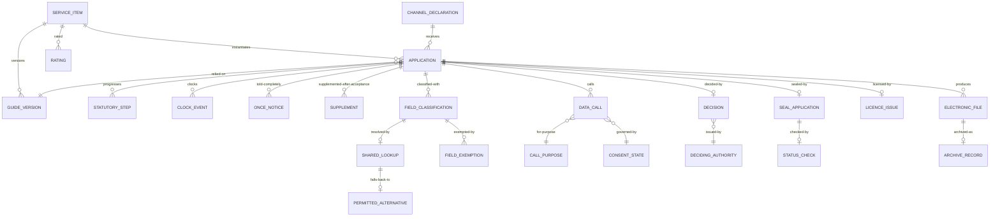

# 05 · Logical Data Model

> Logical model for the core entities. Physical modelling is a deployment concern;
> this file fixes the shape and the invariants.
>
> ⚠️ ASSUMPTION — the model is pack design. 国令第716号 supplies the statutory
> vocabulary, not this decomposition.

## Entities

```
SERVICE_ITEM (catalogue)                      -- BR-01, ADR-0001
  item_id           PK
  kind              administrative-power | public-service   -- constraint 1
  status

GUIDE_VERSION (catalogue)                     -- BR-02, ADR-0002
  guide_version_id  PK
  item_ref          FK → SERVICE_ITEM NOT NULL
  acceptance_conditions[] NOT NULL    -- 受理条件
  materials[]           NOT NULL    -- 办事材料
  process_steps[]       NOT NULL    -- 办理流程
  version            NOT NULL
  published_by       NOT NULL
  published_ts       NOT NULL
  effective_from     NOT NULL
  -- all three elements required at publication (constraint 2)

APPLICATION (application)                     -- BR-06, ADR-0006
  application_id     PK
  item_ref           FK → SERVICE_ITEM NOT NULL
  applicant_ref      NOT NULL
  channel_ref        FK → CHANNEL_DECLARATION NOT NULL
  guide_version_ref  FK → GUIDE_VERSION NOT NULL  -- relied on at submission
  state
  -- the lifecycle uses the STATUTORY vocabulary (constraint 3)

STATUTORY_STEP (application)                  -- BR-06
  step_id            PK
  application_ref    FK → APPLICATION NOT NULL
  kind               受理 | 审查 | 决定 | 出件
  started_ts, ended_ts?
  -- generic workflow statuses are illegal (constraint 3)

CLOCK_EVENT (application)                     -- BR-09, ADR-0006
  clock_event_id     PK
  application_ref    FK → APPLICATION NOT NULL
  kind               start | pause | stop | breach
  ts
  reason?
  -- the 'start' event is written at 受理, never at submission (constraint 4)

ONCE_NOTICE / SUPPLEMENT (application)       -- BR-07, ADR-0006
  once_notice_id     PK
  application_ref    FK → APPLICATION NOT NULL
  missing_items[]    NOT NULL      -- must be COMPLETE (constraint 5)
  issued_ts
  supplement_id      PK
  application_ref    FK → APPLICATION NOT NULL
  accepted_before    NOT NULL      -- true only after 受理 (constraint 5)
  missing_items[]

FIELD_CLASSIFICATION (sharing & verification) -- BR-05, ADR-0005
  field_classification_id PK
  form_field_ref     NOT NULL
  obtainable_by_sharing  NOT NULL
  declared_ts
  -- every form field carries one (constraint 6)

SHARED_LOOKUP (sharing & verification)        -- BR-05
  lookup_id          PK
  field_classification_ref FK → FIELD_CLASSIFICATION
  source_authority_ref NOT NULL
  outcome            prefilled | verified | failed
  fallback_ref       FK → PERMITTED_ALTERNATIVE
  -- a 'failed' outcome must resolve to a permitted alternative, never to
  -- re-asking (constraint 7)

PERMITTED_ALTERNATIVE (sharing)              -- BR-05
  permitted_alternative_id PK, description, defined_by, defined_ts
  -- the fallback that keeps a failure from becoming a violation (constraint 7)

FIELD_EXEMPTION (sharing)                    -- BR-05
  exemption_id       PK
  field_classification_ref FK → FIELD_CLASSIFICATION
  reason             NOT NULL      -- an undocumented exemption is illegal (constraint 8)

DATA_CALL (cross-department)                  -- BR-08
  data_call_id       PK
  application_ref    FK → APPLICATION NOT NULL
  purpose_ref        FK → CALL_PURPOSE NOT NULL
  source_authority_ref NOT NULL
  consent_state_ref  FK → CONSENT_STATE NOT NULL   -- constraint 9
  fields_returned[]
  ts
  -- a call with no consent state for its purpose is illegal (constraint 9)

CONSENT_STATE / CALL_PURPOSE (cross-department)
  consent_state_id   PK, profile_ref, purpose_ref, state, version
  call_purpose_id    PK, name, lawful_basis_ref?
  -- purpose-scoped and versioned; a changed purpose is a new version

DECISION (approval)                          -- BR-06, ADR-0006
  decision_id        PK
  application_ref    FK → APPLICATION NOT NULL
  outcome            approve | refuse | other
  authority_ref      NOT NULL      -- who holds the legal power
  basis              NOT NULL
  ts
  -- the deciding authority, not the platform, owns the outcome

SEAL_APPLICATION / STATUS_CHECK (seal & licence)  -- BR-10, ADR-0007
  seal_application_id PK
  application_ref    FK → APPLICATION NOT NULL
  seal_id            NOT NULL
  applied_ts         NOT NULL
  valid_at_ts        NOT NULL      -- validity AT SIGNING (constraint 10)
  status_check_ref   FK → STATUS_CHECK?
  status_check_id    PK, seal_id, checked_ts, valid_at_check
  -- seals through the national system only; no local minting (constraint 10)
  -- `valid_at_ts` is recorded and is never overwritten by a status check

LICENCE_ISSUE (seal & licence)               -- BR-10
  licence_issue_id   PK
  application_ref    FK → APPLICATION NOT NULL
  licence_ref        NOT NULL      -- via the national sharing service
  template_ref
  produced_ts

CHANNEL_DECLARATION (channel variant)         -- BR-04, ADR-0004
  channel_declaration_id PK
  kind               web | mini-program | pos | assisted
  input_path         NOT NULL
  payment_path       NOT NULL
  identity_model     NOT NULL      -- national service only (constraint 11)
  fulfilment_sources[] NOT NULL
  presentation[]     NOT NULL
  -- all five declared before enabling (constraint 11)

ELECTRONIC_FILE / ARCHIVE_RECORD (archive)   -- BR-11, ADR-0008
  electronic_file_id PK
  application_ref    FK → APPLICATION NOT NULL
  form_ref, completeness
  archive_record_id  PK
  application_ref    FK → APPLICATION NOT NULL
  archived_ts        NOT NULL
  verified           NOT NULL      -- verified complete AND retrievable (constraint 12)
  retrievable        NOT NULL
  -- attachment to a DMS is NOT archiving (constraint 12)

RETENTION_CLASS (archive)                     -- BR-12
  retention_class_id PK, data_class, declared_window NOT NULL
  -- no global row (constraint 13)

RATING / RESPONSE (feedback)
  rating_id          PK, application_ref, score, comment?, submitted_ts
  response_id        PK, rating_ref, responder_ref, ts
```

## Keys and cardinalities



## Integrity constraints the model must enforce

| # | Constraint | Enforces |
|---|---|---|
| 1 | `SERVICE_ITEM.kind` ∈ the two statutory kinds; no third value | BR-01, FR-001 |
| 2 | `GUIDE_VERSION` requires all three elements at publication, and is immutable | BR-02, FR-003 |
| 3 | `STATUTORY_STEP.kind` is constrained to the statutory vocabulary; no generic status | BR-06, FR-015 |
| 4 | `CLOCK_EVENT` of kind `start` may only be written at 受理; a start at submission is illegal | BR-09, FR-023 |
| 5 | `ONCE_NOTICE` must be issued before acceptance and be complete; `SUPPLEMENT` requires `accepted_before = true` | BR-07, FR-018, FR-019 |
| 6 | Every `FORM_FIELD` has a `FIELD_CLASSIFICATION` | BR-05, FR-010, NFR-002 |
| 7 | `SHARED_LOOKUP.outcome = 'failed'` requires a `PERMITTED_ALTERNATIVE`; a re-ask resolution is illegal | BR-05, FR-013, NFR-001 |
| 8 | `FIELD_EXEMPTION.reason` is NOT NULL | BR-05, FR-014, NFR-003 |
| 9 | `DATA_CALL.consent_state_ref` is NOT NULL and the state must permit the purpose | BR-08, FR-020, NFR-007 |
| 10 | `SEAL_APPLICATION.seal_id` resolves to the national system; `valid_at_ts` is NOT NULL and is never overwritten | BR-10, FR-025, CTL-04, NFR-013 |
| 11 | `CHANNEL_DECLARATION` requires all five aspects, and `identity_model` must be the national service | BR-04, BR-03, FR-008, NFR-006 |
| 12 | `ARCHIVE_RECORD.verified` and `.retrievable` are NOT NULL and true; attachment alone is not archiving | BR-11, FR-028, FR-029, NFR-014 |
| 13 | `RETENTION_CLASS.declared_window` is NOT NULL per class; there is no global row | BR-12, FR-030 |

> Constraints 1, 2, 3, 4, 5, 6, 7, 8, 9, 10, 12 and 13 are **enforced in the
> store**, not in application code. A third item kind, an incomplete guide, a generic
> status, a clock started at submission, an unclassified field, a re-ask on failure,
> a call with no consent state, a locally minted seal, a validity recorded as "now",
> or an unverified archive is a defect regardless of what application discipline
> promises — and each is a sev-1 signal in
> `04-architecture/observability.md`.