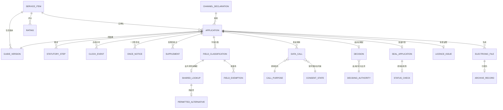

# 05 · 逻辑数据模型

> 核心实体的逻辑模型。物理建模属于部署层面的关注事项；
> 本文件确定其结构和各项不变量。
>
> ⚠️ ASSUMPTION — 本模型属于方案包设计。国令第716号提供的是法定
> 词汇，而非这一分解方式。

## 实体

```
SERVICE_ITEM (目录)                      -- BR-01, ADR-0001
  item_id           PK
  kind              administrative-power | public-service   -- 约束 1
  status

GUIDE_VERSION (目录)                     -- BR-02, ADR-0002
  guide_version_id  PK
  item_ref          FK → SERVICE_ITEM NOT NULL
  acceptance_conditions[] NOT NULL    -- 受理条件
  materials[]           NOT NULL    -- 办事材料
  process_steps[]       NOT NULL    -- 办理流程
  version            NOT NULL
  published_by       NOT NULL
  published_ts       NOT NULL
  effective_from     NOT NULL
  -- 发布时必须具备全部三个要素（约束 2）

APPLICATION (申请)                     -- BR-06, ADR-0006
  application_id     PK
  item_ref           FK → SERVICE_ITEM NOT NULL
  applicant_ref      NOT NULL
  channel_ref        FK → CHANNEL_DECLARATION NOT NULL
  guide_version_ref  FK → GUIDE_VERSION NOT NULL  -- 提交时依赖
  state
  -- 生命周期使用法定词汇（约束 3）

STATUTORY_STEP (申请)                  -- BR-06
  step_id            PK
  application_ref    FK → APPLICATION NOT NULL
  kind               受理 | 审查 | 决定 | 出件
  started_ts, ended_ts?
  -- 禁止使用通用工作流状态（约束 3）

CLOCK_EVENT (申请)                     -- BR-09, ADR-0006
  clock_event_id     PK
  application_ref    FK → APPLICATION NOT NULL
  kind               start | pause | stop | breach
  ts
  reason?
  -- 'start' 事件在受理时写入，绝不在提交时写入（约束 4）

ONCE_NOTICE / SUPPLEMENT (申请)       -- BR-07, ADR-0006
  once_notice_id     PK
  application_ref    FK → APPLICATION NOT NULL
  missing_items[]    NOT NULL      -- 必须内容完整（约束 5）
  issued_ts
  supplement_id      PK
  application_ref    FK → APPLICATION NOT NULL
  accepted_before    NOT NULL      -- 仅在受理后为 true（约束 5）
  missing_items[]

FIELD_CLASSIFICATION (共享与核验) -- BR-05, ADR-0005
  field_classification_id PK
  form_field_ref     NOT NULL
  obtainable_by_sharing  NOT NULL
  declared_ts
  -- 每个表单字段都带有其中一条（约束 6）

SHARED_LOOKUP (共享与核验)        -- BR-05
  lookup_id          PK
  field_classification_ref FK → FIELD_CLASSIFICATION
  source_authority_ref NOT NULL
  outcome            prefilled | verified | failed
  fallback_ref       FK → PERMITTED_ALTERNATIVE
  -- 'failed' 结果必须解析为允许的替代方案，绝不能
  -- 转为重新要求申请人提供（约束 7）

PERMITTED_ALTERNATIVE (共享)              -- BR-05
  permitted_alternative_id PK, description, defined_by, defined_ts
  -- 避免失败演变为违规的兜底方案（约束 7）

FIELD_EXEMPTION (共享)                    -- BR-05
  exemption_id       PK
  field_classification_ref FK → FIELD_CLASSIFICATION
  reason             NOT NULL      -- 未经说明的豁免属于违规（约束 8）

DATA_CALL (跨部门)                  -- BR-08
  data_call_id       PK
  application_ref    FK → APPLICATION NOT NULL
  purpose_ref        FK → CALL_PURPOSE NOT NULL
  source_authority_ref NOT NULL
  consent_state_ref  FK → CONSENT_STATE NOT NULL   -- 约束 9
  fields_returned[]
  ts
  -- 调用缺少与其目的对应的同意状态属于违规（约束 9）

CONSENT_STATE / CALL_PURPOSE (跨部门)
  consent_state_id   PK, profile_ref, purpose_ref, state, version
  call_purpose_id    PK, name, lawful_basis_ref?
  -- 按目的限定并实行版本管理；目的变更即为新版本

DECISION (决定)                          -- BR-06, ADR-0006
  decision_id        PK
  application_ref    FK → APPLICATION NOT NULL
  outcome            approve | refuse | other
  authority_ref      NOT NULL      -- 谁拥有法定权力
  basis              NOT NULL
  ts
  -- 结果由决定机关而非平台负责

SEAL_APPLICATION / STATUS_CHECK (印章与证照)  -- BR-10, ADR-0007
  seal_application_id PK
  application_ref    FK → APPLICATION NOT NULL
  seal_id            NOT NULL
  applied_ts         NOT NULL
  valid_at_ts        NOT NULL      -- 签署时的有效性（约束 10）
  status_check_ref   FK → STATUS_CHECK?
  status_check_id    PK, seal_id, checked_ts, valid_at_check
  -- 仅通过国家系统用印；不得在本地生成（约束 10）
  -- `valid_at_ts` 已记录，且绝不因状态检查而被覆盖

LICENCE_ISSUE (印章与证照)               -- BR-10
  licence_issue_id   PK
  application_ref    FK → APPLICATION NOT NULL
  licence_ref        NOT NULL      -- 通过国家共享服务获取
  template_ref
  produced_ts

CHANNEL_DECLARATION (渠道变体)         -- BR-04, ADR-0004
  channel_declaration_id PK
  kind               web | mini-program | pos | assisted
  input_path         NOT NULL
  payment_path       NOT NULL
  identity_model     NOT NULL      -- 仅限国家统一身份认证服务（约束 11）
  fulfilment_sources[] NOT NULL
  presentation[]     NOT NULL
  -- 启用前须声明全部五项（约束 11）

ELECTRONIC_FILE / ARCHIVE_RECORD (归档)   -- BR-11, ADR-0008
  electronic_file_id PK
  application_ref    FK → APPLICATION NOT NULL
  form_ref, completeness
  archive_record_id  PK
  application_ref    FK → APPLICATION NOT NULL
  archived_ts        NOT NULL
  verified           NOT NULL      -- 已验证完整且可检索（约束 12）
  retrievable        NOT NULL
  -- 附加到 DMS 不等于归档（约束 12）

RETENTION_CLASS (归档)                     -- BR-12
  retention_class_id PK, data_class, declared_window NOT NULL
  -- 不设全局行（约束 13）

RATING / RESPONSE (反馈)
  rating_id          PK, application_ref, score, comment?, submitted_ts
  response_id        PK, rating_ref, responder_ref, ts
```

## 键与基数



## 模型必须强制执行的完整性约束

| # | 约束 | 对应要求 |
|---|---|---|
| 1 | `SERVICE_ITEM.kind` 属于两种法定事项类型；不得有第三种值 | BR-01, FR-001 |
| 2 | `GUIDE_VERSION` 在发布时必须具备全部三个要素，且不可变 | BR-02, FR-003 |
| 3 | `STATUTORY_STEP.kind` 限定使用法定词汇；不得使用通用状态 | BR-06, FR-015 |
| 4 | `CLOCK_EVENT` 中 `kind` 为 `start` 的事件只能在受理时写入；在提交时启动属于违规 | BR-09, FR-023 |
| 5 | `ONCE_NOTICE` 必须在受理前发出且内容完整；`SUPPLEMENT` 要求 `accepted_before = true` | BR-07, FR-018, FR-019 |
| 6 | 每个 `FORM_FIELD` 都必须具有一条 `FIELD_CLASSIFICATION` | BR-05, FR-010, NFR-002 |
| 7 | `SHARED_LOOKUP.outcome = 'failed'` 时必须存在 `PERMITTED_ALTERNATIVE`；以重新要求提供的方式处理属于违规 | BR-05, FR-013, NFR-001 |
| 8 | `FIELD_EXEMPTION.reason` 不得为 NULL | BR-05, FR-014, NFR-003 |
| 9 | `DATA_CALL.consent_state_ref` 不得为 NULL，且该状态必须允许此目的 | BR-08, FR-020, NFR-007 |
| 10 | `SEAL_APPLICATION.seal_id` 必须解析到国家系统；`valid_at_ts` 不得为 NULL，且绝不覆盖 | BR-10, FR-025, CTL-04, NFR-013 |
| 11 | `CHANNEL_DECLARATION` 必须具备全部五个方面，且 `identity_model` 必须为国家统一身份认证服务 | BR-04, BR-03, FR-008, NFR-006 |
| 12 | `ARCHIVE_RECORD.verified` 和 `.retrievable` 不得为 NULL，且必须为 true；仅进行附加不构成归档 | BR-11, FR-028, FR-029, NFR-014 |
| 13 | `RETENTION_CLASS.declared_window` 对每个类别均不得为 NULL；不存在全局行 | BR-12, FR-030 |

> 约束 1、2、3、4、5、6、7、8、9、10、12 和 13 是**在存储层强制执行**的，而不是由应用代码强制执行。无论应用层作出何种承诺，第三种事项类型、不完整的办事指南、通用状态、在提交时启动的办结时限、未分类的字段、失败后重新要求申请人提供、没有同意状态的调用、在本地生成的印章、有效性被记录为 "now"，或未经验证的归档，均属于缺陷——且每一项都是
> `04-architecture/observability.md` 中的 sev-1 信号。