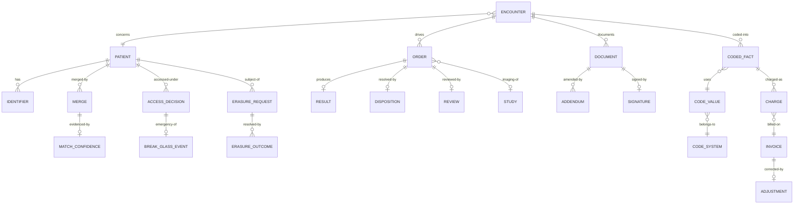

# 03 · Domain Model

> ⚠️ ASSUMPTION — bounded contexts, aggregates and invariants are pack design.
> No external standard is cited for this decomposition.

## Bounded contexts

| Context | Responsibility | Owns |
|---|---|---|
| **Party & identity** | Identity resolution, merge, unmerge | Patient, Identifier, Merge, MatchConfidence |
| **Encounter** | Care episodes and their context | Encounter, CareContext, Attending |
| **Clinical record** | The record of clinical truth | Observation, Condition, Procedure, Document, Addendum |
| **Orders & results** | Closed-loop orders | Order, Result, DiagnosticReport, Disposition |
| **Imaging** | The DICOM boundary | Study, Series, Instance, PACS reference |
| **Terminology** | Versioned code mapping | CodeSystem, CodeValue, Mapping, MappingVersion |
| **Coding & records** | Coded encounters for medical records and DRG/DIP | CodedFact, CaseFile |
| **Billing** | The separate money record | Charge, Invoice, Adjustment, Settlement |
| **Access** | Care-relationship permission and break-glass | AccessDecision, BreakGlassEvent, Review |
| **Retention** | Per-class retention and erasure | RetentionClass, ErasureRequest, ErasureOutcome |

Clinical record and Billing are **separate contexts with a one-way dependency**:
Billing reads from Clinical, and never writes to it (BR-12).

## Core aggregates & invariants

### Patient / Merge (party & identity)
```
Patient: id, identifiers[], demographics, state
Identifier: id, kind, value
Merge: id, fromRef, toRef, ruleId, ruleVersion, confidence, performedTs, reversedTs?
MatchConfidence: id, mergeRef, score, thresholdRef, decidedBy
└── invariants
    • a match below the confidence threshold is FLAGGED, never auto-merged
      (BR-04, FR-001, constraint 1)
    • every merge records its rule, rule version and confidence (BR-05, FR-002)
    • unmerge restores pre-merge identities AND propagates to clinical facts
      (BR-05, FR-004, constraint 2)
    • threshold change is attributed and never retroactive (BR-06, FR-005)
    • an unresolved duplicate flag is surfaced to the clinician, not resolved
      silently (FR-006)
```

### Document / Addendum (clinical record)
```
Document: id, encounterRef, kind, authorRef, authoredTs, state (draft|signed|retracted)
Signature: id, documentRef, signerRef, signedTs, attestation
Addendum: id, documentRef, authorRef, authoredTs, referencesOriginalRef
└── invariants
    • authorship and signature are SEPARATE properties (BR-07, FR-007)
    • a signed document is never edited in place; correction is an addendum
      (BR-07, FR-008, constraint 3)
    • a retracted document stays visible, marked never valid (BR-08, FR-009)
    • no UPDATE grant on Document once state = signed (constraint 3)
```

### Order / Result (orders & results)
```
Order: id, encounterRef, kind (medication|lab|imaging), placedTs
Result: id, orderRef, sourceRef, sourceVersion, resultedTs
Disposition: id, orderRef, kind, decidedBy, ts
Review: id, orderRef, reviewerRef, ts
└── invariants
    • an order is closed ⇔ it has a result, a disposition AND a review (BR-09,
      FR-010, constraint 4)
    • a result is filed against BOTH its order and its encounter (FR-012)
    • imaging results reference DICOM objects; the objects are never discarded
      (BR-10, FR-013, constraint 5)
```

### CodeValue / MappingVersion (terminology)
```
CodeSystem: id, name, version, effectiveFrom
CodeValue: id, systemRef, code, display
CodedFact: id, encounterRef, kind, codeValueRef, codedTs
Mapping: id, fromSystemRef, toSystemRef, version
└── invariants
    • a CodedFact records its code system AND version (BR-11, FR-015, constraint 6)
    • a Mapping change is a new MappingVersion, never an in-place edit, and never
      applied silently to stored CodedFacts (BR-11, FR-016)
    • historical CodedFacts remain interpretable under the version in force
      (CTL-02)
```

### Charge (billing)
```
Charge: id, encounterRef, codedFactRef, amount, currency, ts
Invoice: id, encounterRef, lines[], total, issuedTs
Adjustment: id, invoiceRef, amount, reason, approvedBy, approvedTs
└── invariants
    • a Charge derives from a CodedFact; no path modifies clinical content to
      obtain a payable code (BR-12, FR-017, constraint 7)
    • a clinical/billing divergence is REPORTED and routed, never resolved by
      editing (BR-12, FR-018)
    • billing corrections are billing-side adjustments; clinical corrections are
      addenda — the two never cross (BR-12, FR-019)
```

### AccessDecision / BreakGlassEvent (access)
```
AccessDecision: id, patientRef, accessorRef, basis (care relationship), outcome, ts
BreakGlassEvent: id, patientRef, accessorRef, justification, ts, reviewRef?
└── invariants
    • access requires a care-relationship basis and a declared reason (BR-13,
      FR-021)
    • break-glass is logged, justified and routed to review (BR-14, FR-022)
    • a rising break-glass rate is a normal-path defect signal (FR-023, NFR-011)
    • 100% of accesses are attributable (NFR-013)
```

### RetentionClass / ErasureOutcome (retention)
```
RetentionClass: id, dataClass, declaredWindow
ErasureRequest: id, subjectRef, receivedTs, scope
ErasureOutcome: id, requestRef, destination (record|cache|log|derived), state,
  completedTs?
└── invariants
    • retention is per class, with a declared window; no global row (BR-15,
      FR-024)
    • one ErasureOutcome row per destination (BR-16, FR-026, constraint 9)
    • a destination with no row, or an unreachable one, is recorded as a
      limitation, not as deleted (BR-16)
```

## Relationships (logical)



## The four aggregates that carry the pack's weight

| Aggregate | The invariant that matters most | What it prevents |
|---|---|---|
| **Patient / Merge** | unmerge exists and propagates | an irreversible decision about a person that nobody can correct |
| **Document / Signature** | authorship ≠ signature; addendum-only | destroying the evidence of what was thought, at the moment the record needs defending |
| **CodeValue** | code system **and version** on every coded fact | a historical encounter that becomes uninterpretable after a terminology change |
| **Charge** | one-way dependency on Clinical | clinical truth edited to satisfy billing — the pack's cardinal sin |

> The second and the fourth are the two boundaries most often crossed under
> pressure: a signed note is corrected in place to fix a chart, and a code is
> changed because a charge was disputed. Both are BR-level prohibitions precisely
> because both arrive with a good reason.