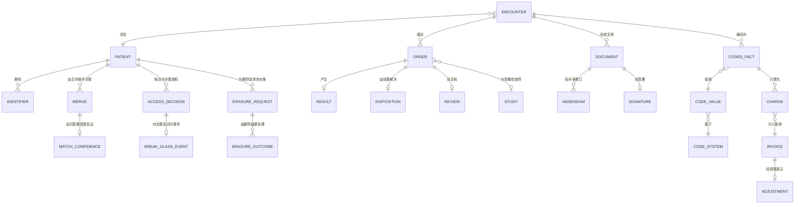

# 03 · 领域模型

> ⚠️ ASSUMPTION — 限界上下文、聚合和不变量属于方案包设计。
> 本分解未引用任何外部标准。

## 限界上下文

| 上下文 | 职责 | 拥有 |
|---|---|---|
| **主体与身份** | 身份解析、合并、拆分 | Patient、Identifier、Merge、MatchConfidence |
| **就诊/诊疗活动** | 诊疗阶段及其场景 | Encounter、CareContext、Attending |
| **临床病历** | 临床事实记录 | Observation、Condition、Procedure、Document、Addendum |
| **医嘱与结果** | 闭环医嘱 | Order、Result、DiagnosticReport、Disposition |
| **影像** | DICOM 边界 | Study、Series、Instance、PACS 引用 |
| **术语** | 版本化代码映射 | CodeSystem、CodeValue、Mapping、MappingVersion |
| **编码与病历** | 用于临床病历和 DRG/DIP 的已编码就诊 | CodedFact、CaseFile |
| **收费/结算** | 独立的资金记录 | Charge、Invoice、Adjustment、Settlement |
| **访问** | 诊疗关系权限与紧急访问 | AccessDecision、BreakGlassEvent、Review |
| **保留期** | 按类别设置保留期并删除 | RetentionClass、ErasureRequest、ErasureOutcome |

临床病历与收费/结算是**具有单向依赖关系的独立上下文**：
收费/结算从临床病历读取数据，且绝不向其写入 (BR-12)。

## 核心聚合与不变量

### Patient / Merge (主体与身份)
```
Patient: id, identifiers[], demographics, state
Identifier: id, kind, value
Merge: id, fromRef, toRef, ruleId, ruleVersion, confidence, performedTs, reversedTs?
MatchConfidence: id, mergeRef, score, thresholdRef, decidedBy
└── 不变量
    • 低于置信度阈值的匹配会被标记为 FLAGGED，绝不自动合并
      (BR-04, FR-001, constraint 1)
    • 每次合并都记录其规则、规则版本和置信度 (BR-05, FR-002)
    • 拆分恢复合并前的身份，并且将拆分传播至临床事实
      (BR-05, FR-004, constraint 2)
    • 阈值变更须明确归因且绝不追溯生效 (BR-06, FR-005)
    • 未解决的重复档案标记必须向医师展示，不得静默处理
      (FR-006)
```

### Document / Addendum (临床病历)
```
Document: id, encounterRef, kind, authorRef, authoredTs, state (draft|signed|retracted)
Signature: id, documentRef, signerRef, signedTs, attestation
Addendum: id, documentRef, authorRef, authoredTs, referencesOriginalRef
└── 不变量
    • 署名与签署是彼此独立的属性 (BR-07, FR-007)
    • 已签署文书绝不原地编辑；更正必须采用补录
      (BR-07, FR-008, constraint 3)
    • 作废文书仍保持可见，并标记为从未有效 (BR-08, FR-009)
    • 当 state = signed 时，Document 上不得授予 UPDATE 权限
      (constraint 3)
```

### Order / Result (医嘱与结果)
```
Order: id, encounterRef, kind (medication|lab|imaging), placedTs
Result: id, orderRef, sourceRef, sourceVersion, resultedTs
Disposition: id, orderRef, kind, decidedBy, ts
Review: id, orderRef, reviewerRef, ts
└── 不变量
    • 一项医嘱处于闭环状态 ⇔ 同时具备结果、处置和复核 (BR-09,
      FR-010, constraint 4)
    • 结果必须同时关联至其医嘱和就诊 (FR-012)
    • 影像结果引用 DICOM 对象；这些对象绝不丢弃
      (BR-10, FR-013, constraint 5)
```

### CodeValue / MappingVersion (术语)
```
CodeSystem: id, name, version, effectiveFrom
CodeValue: id, systemRef, code, display
CodedFact: id, encounterRef, kind, codeValueRef, codedTs
Mapping: id, fromSystemRef, toSystemRef, version
└── 不变量
    • CodedFact 同时记录其编码体系和版本 (BR-11, FR-015, constraint 6)
    • Mapping 变更会创建新的 MappingVersion，绝不原地编辑，也绝不
      静默应用于已存储的 CodedFacts (BR-11, FR-016)
    • 历史 CodedFacts 仍可依据当时生效的版本解读
      (CTL-02)
```

### Charge (收费/结算)
```
Charge: id, encounterRef, codedFactRef, amount, currency, ts
Invoice: id, encounterRef, lines[], total, issuedTs
Adjustment: id, invoiceRef, amount, reason, approvedBy, approvedTs
└── 不变量
    • Charge 派生自 CodedFact；任何路径都不得修改临床内容以获取
      可支付代码 (BR-12, FR-017, constraint 7)
    • 临床与收费差异必须标记为 REPORTED 并分流处理，绝不通过编辑
      解决 (BR-12, FR-018)
    • 收费更正采用收费侧调整；临床更正采用补录——两者绝不交叉
      (BR-12, FR-019)
```

### AccessDecision / BreakGlassEvent (访问)
```
AccessDecision: id, patientRef, accessorRef, basis (care relationship), outcome, ts
BreakGlassEvent: id, patientRef, accessorRef, justification, ts, reviewRef?
└── 不变量
    • 访问必须具备诊疗关系依据和已声明的理由 (BR-13,
      FR-021)
    • 紧急访问必须记录日志、说明理由并送交复核 (BR-14, FR-022)
    • 紧急访问率上升是正常访问路径存在缺陷的信号 (FR-023, NFR-011)
    • 100% 的访问均可归属到具体主体 (NFR-013)
```

### RetentionClass / ErasureOutcome (保留期)
```
RetentionClass: id, dataClass, declaredWindow
ErasureRequest: id, subjectRef, receivedTs, scope
ErasureOutcome: id, requestRef, destination (record|cache|log|derived), state,
  completedTs?
└── 不变量
    • 保留期按类别设定，并声明保留窗口；不得设置全局行 (BR-15,
      FR-024)
    • 每个目的地仅对应一行 ErasureOutcome (BR-16, FR-026, constraint 9)
    • 没有对应记录行或无法到达的目的地应记录为限制，而非标记为
      已删除 (BR-16)
```

## 关系（逻辑）



## 承载本方案包核心的四个聚合

| 聚合 | 最关键的不变量 | 防止的问题 |
|---|---|---|
| **Patient / Merge** | 拆分操作存在且能够传播 | 使任何人都无法纠正关于某人的不可逆决定 |
| **Document / Signature** | 署名 ≠ 签署；仅可补录 | 在病历需要抗辩的关键时刻，销毁对当时认知的证据 |
| **CodeValue** | 每项编码事实均记录编码体系和版本 | 术语变更后历史就诊变得无法解读 |
| **Charge** | 对临床病历的单向依赖 | 为满足收费而编辑临床事实——本方案包不可饶恕的禁忌 |

> 第二项和第四项是在压力之下最常被跨越的两条边界：为修正一份病历而
> 原地更正已签署的病程记录，以及因收费争议而更改代码。二者之所以都是
> BR 级禁止事项，恰恰是因为二者出现时都带着看似正当的理由。