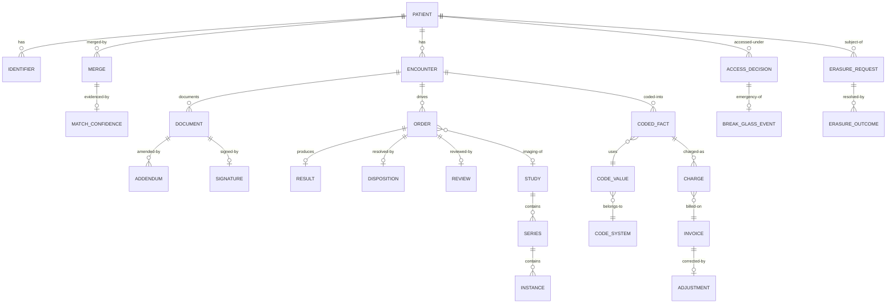

# 05 · Logical Data Model

> Logical model for the core entities. Physical modelling is a deployment
> concern; this file fixes the shape and the invariants.
>
> ⚠️ ASSUMPTION — the model is pack design. FHIR resource names are used as the
> pack's vocabulary; no FHIR release is claimed as normative.

## Entities

```
PATIENT (party & identity)                     -- BR-04, BR-05, ADR-0001
  patient_id        PK
  identifiers[], demographics, state
  -- state includes a duplicateFlag; an ambiguity is a state, not an error

IDENTIFIER (party & identity)
  identifier_id     PK, patient_ref FK → PATIENT, kind, value

MERGE (party & identity)                       -- BR-05
  merge_id          PK
  from_patient_ref  FK → PATIENT
  to_patient_ref    FK → PATIENT
  rule_id, rule_version, confidence, performed_ts, reversed_ts?
  match_confidence_ref FK → MATCH_CONFIDENCE NOT NULL
  -- a merge below the confidence threshold MUST NOT exist (constraint 1)

MATCH_CONFIDENCE (party & identity)             -- BR-06
  match_confidence_id PK, merge_ref, score, threshold_ref, decided_by
  threshold_ref      FK → MATCH_THRESHOLD
  -- the threshold is a revisable policy, never retroactive (constraint 2)

MATCH_THRESHOLD (party & identity)             -- BR-06
  threshold_id      PK, value, effective_from, changed_by, changed_ts
  -- changing it requires an explicit attributed act (FR-005)

ENCOUNTER (encounter)
  encounter_id      PK, patient_ref FK → PATIENT, care_context_ref, attending_ref

DOCUMENT (clinical record)                     -- BR-07, BR-08, ADR-0002
  document_id       PK, encounter_ref, kind
  author_ref        NOT NULL       -- who wrote it (authorship)
  authored_ts
  state             draft | signed | retracted
  -- no UPDATE grant once state = signed (constraint 3)

SIGNATURE (clinical record)                     -- BR-07
  signature_id      PK, document_ref FK → DOCUMENT NOT NULL
  signer_ref        NOT NULL       -- may differ from author
  signed_ts, attestation
  -- a SEPARATE entity from authorship (constraint 3)

ADDENDUM (clinical record)                      -- BR-07
  addendum_id       PK
  document_ref      FK → DOCUMENT NOT NULL   -- the signed original
  author_ref        NOT NULL
  authored_ts
  references_original_ref FK → DOCUMENT

OBSERVATION / CONDITION / PROCEDURE (clinical record)
  *_id              PK, encounter_ref, code_value_ref, effective_ts
  -- DICOM referenced, not embedded (see IMAGING)

ORDER / RESULT / DISPOSITION / REVIEW (orders & results)   -- BR-09
  order_id          PK, encounter_ref, kind, placed_ts
  result_id         PK, order_ref, source_ref, source_version, resulted_ts
  disposition_id    PK, order_ref, kind, decided_by, ts
  review_id         PK, order_ref, reviewer_ref, ts
  -- an order is closed ⇔ result + disposition + review all exist
  -- (constraint 4: a "closed" state with a missing row is illegal)

STUDY / SERIES / INSTANCE (imaging)             -- BR-10, ADR-0003
  study_id          PK, order_ref FK → ORDER, patient_ref
  series_id         PK, study_id
  instance_id       PK, series_id, object_ref   -- the DICOM object reference
  -- objects are retained; derived indexes are never authoritative (constraint 5)

CODE_SYSTEM / CODE_VALUE / CODED_FACT (terminology)   -- BR-11, ADR-0004
  code_system_id    PK, name, version, effective_from
  code_value_id     PK, code_system_id, code, display
  coded_fact_id     PK, encounter_ref, kind, code_value_id
  coded_system_version  -- the version AT EMISSION (constraint 6)
  -- a coded fact without system + version is not exportable

MAPPING / MAPPING_VERSION (terminology)          -- BR-11
  mapping_id        PK, from_system_id, to_system_id
  mapping_version   PK, mapping_id, version, effective_from
  -- a change is a new version, never an in-place edit (constraint 6)

CHARGE / INVOICE / ADJUSTMENT (billing)          -- BR-12, ADR-0005
  charge_id         PK, encounter_ref, coded_fact_ref, amount, currency, ts
  invoice_id        PK, encounter_ref, lines[], total, issued_ts
  adjustment_id     PK, invoice_ref, amount, reason, approved_by, approved_ts
  -- a charge derives FROM a CodedFact; there is no reverse write path
  -- (constraint 7): no billing artefact may modify clinical content

ACCESS_DECISION / BREAK_GLASS_EVENT (access)    -- BR-13, BR-14, ADR-0006
  access_decision_id PK, patient_ref, accessor_ref, basis, outcome, ts
  -- basis is a care-relationship reference; a decision with no basis is illegal
  break_glass_id    PK, patient_ref, accessor_ref, justification, ts,
    review_ref, reviewed_ts?
  -- review_ref is required (constraint 8)

RETENTION_CLASS / ERASURE_REQUEST / ERASURE_OUTCOME (retention)  -- BR-15, BR-16, ADR-0007
  retention_class_id PK, data_class, declared_window NOT NULL
  erasure_request_id PK, subject_ref, received_ts, scope
  erasure_outcome_id PK
  request_ref       FK → ERASURE_REQUEST NOT NULL
  destination       record | cache | log | derived | imaging | backup
  state             completed | limitation
  completed_ts?
  -- one row per destination (constraint 9)
```

## Keys and cardinalities



## Integrity constraints the model must enforce

| # | Constraint | Enforces |
|---|---|---|
| 1 | No `MERGE` may exist whose `MATCH_CONFIDENCE.score` is below the threshold in force at `performed_ts` | BR-04, FR-001 |
| 2 | A `MATCH_THRESHOLD` change is an attributed event; resolved merges are never retroactively re-evaluated against a new threshold | BR-06, FR-005 |
| 3 | `DOCUMENT` has no UPDATE grant once `state = 'signed'`; `SIGNATURE` is a separate entity from `author_ref` | BR-07, FR-007, FR-008, NFR-001 |
| 4 | An order may not enter a `closed` state without a `RESULT`, `DISPOSITION` **and** `REVIEW` row | BR-09, FR-010, NFR-005 |
| 5 | `INSTANCE.object_ref` must resolve; a study whose objects were discarded is illegal | BR-10, FR-013, NFR-008 |
| 6 | `CODED_FACT.coded_system_version` is NOT NULL; a `MAPPING` change creates a new `MAPPING_VERSION` and never edits stored facts | BR-11, FR-015, FR-016, NFR-007 |
| 7 | No billing artefact (`CHARGE`, `INVOICE`, `ADJUSTMENT`) may modify `DOCUMENT`, `OBSERVATION`, `CONDITION`, `PROCEDURE` or `CODED_FACT` | BR-12, FR-017–FR-019, NFR-010 |
| 8 | A `BREAK_GLASS_EVENT` requires a `justification` and resolves to a `review_ref`; an unreviewed event past its window is a defect | BR-14, FR-022, NFR-012 |
| 9 | Every `ERASURE_REQUEST` has an `ERASURE_OUTCOME` row per declared destination, and a `limitation` is never written as `completed` | BR-16, FR-026, NFR-014 |
| 10 | `RETENTION_CLASS.declared_window` is NOT NULL per class; there is no global row | BR-15, FR-024 |

> Constraints 3, 4, 5, 6, 7, 9 and 10 are **enforced in the store**, not in
> application code. An edited signed document, an order closed without its
> review, a discarded imaging object, a coded fact without its version, a
> billing write into the clinical record, a missing erasure outcome, or a global
> retention row is a defect regardless of what application discipline promises —
> and each is a sev-1 signal in `04-architecture/observability.md`.