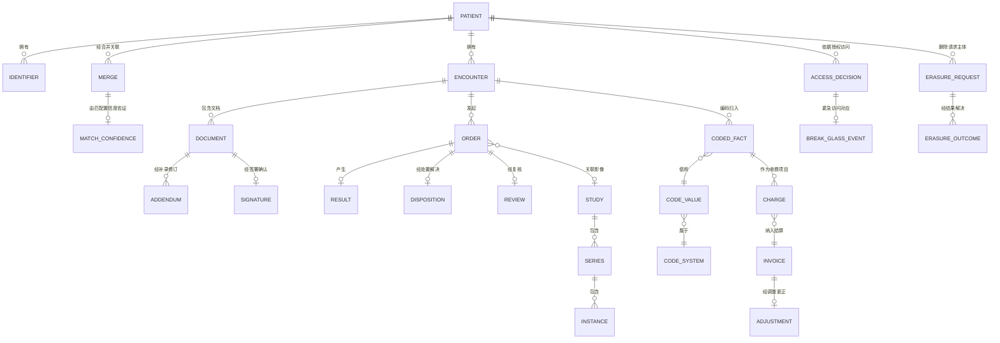

# 05 · 逻辑数据模型

> 核心实体的逻辑模型。物理建模属于部署层面的关注事项；
> 本文件确定实体形态及其不变量。
>
> ⚠️ ASSUMPTION — 该模型属于方案包设计。FHIR 资源名称用作本方案包的
> 词汇；不主张任何 FHIR 发布版本具有规范效力。

## 实体

```
PATIENT (主体与身份)                     -- BR-04, BR-05, ADR-0001
  patient_id        PK
  identifiers[], demographics, state
  -- state 包含 duplicateFlag；歧义是一种状态，而不是错误

IDENTIFIER (主体与身份)
  identifier_id     PK, patient_ref FK → PATIENT, kind, value

MERGE (主体与身份)                       -- BR-05
  merge_id          PK
  from_patient_ref  FK → PATIENT
  to_patient_ref    FK → PATIENT
  rule_id, rule_version, confidence, performed_ts, reversed_ts?
  match_confidence_ref FK → MATCH_CONFIDENCE NOT NULL
  -- 低于匹配置信度阈值的合并不得存在（约束 1）

MATCH_CONFIDENCE (主体与身份)             -- BR-06
  match_confidence_id PK, merge_ref, score, threshold_ref, decided_by
  threshold_ref      FK → MATCH_THRESHOLD
  -- 阈值是一项可修订的策略，但绝不追溯适用（约束 2）

MATCH_THRESHOLD (主体与身份)             -- BR-06
  threshold_id      PK, value, effective_from, changed_by, changed_ts
  -- 更改阈值需要有明确责任归属的操作（FR-005）

ENCOUNTER (就诊)
  encounter_id      PK, patient_ref FK → PATIENT, care_context_ref, attending_ref

DOCUMENT (临床病历)                     -- BR-07, BR-08, ADR-0002
  document_id       PK, encounter_ref, kind
  author_ref        NOT NULL       -- 谁撰写了该文书（署名）
  authored_ts
  state             draft | signed | retracted
  -- state = signed 后不再授予 UPDATE 权限（约束 3）

SIGNATURE (临床病历)                     -- BR-07
  signature_id      PK, document_ref FK → DOCUMENT NOT NULL
  signer_ref        NOT NULL       -- 可以与作者不同
  signed_ts, attestation
  -- 是与署名相互独立的实体（约束 3）

ADDENDUM (临床病历)                      -- BR-07
  addendum_id       PK
  document_ref      FK → DOCUMENT NOT NULL   -- 已签署的原始文档
  author_ref        NOT NULL
  authored_ts
  references_original_ref FK → DOCUMENT

OBSERVATION / CONDITION / PROCEDURE (临床病历)
  *_id              PK, encounter_ref, code_value_ref, effective_ts
  -- DICOM 采用引用方式，而非嵌入方式（请参阅 IMAGING）

ORDER / RESULT / DISPOSITION / REVIEW (申请与结果)   -- BR-09
  order_id          PK, encounter_ref, kind, placed_ts
  result_id         PK, order_ref, source_ref, source_version, resulted_ts
  disposition_id    PK, order_ref, kind, decided_by, ts
  review_id         PK, order_ref, reviewer_ref, ts
  -- 申请处于 closed 状态 ⇔ result + disposition + review 全部存在
  -- （约束 4：缺少任一对应行的 "closed" 状态均属非法）

STUDY / SERIES / INSTANCE (影像)             -- BR-10, ADR-0003
  study_id          PK, order_ref FK → ORDER, patient_ref
  series_id         PK, study_id
  instance_id       PK, series_id, object_ref   -- DICOM 对象引用
  -- 对象须保留；派生索引绝非权威来源（约束 5）

CODE_SYSTEM / CODE_VALUE / CODED_FACT (术语)   -- BR-11, ADR-0004
  code_system_id    PK, name, version, effective_from
  code_value_id     PK, code_system_id, code, display
  coded_fact_id     PK, encounter_ref, kind, code_value_id
  coded_system_version  -- 记录产生时的版本（约束 6）
  -- 缺少编码体系与版本的已编码事实不可导出

MAPPING / MAPPING_VERSION (术语)          -- BR-11
  mapping_id        PK, from_system_id, to_system_id
  mapping_version   PK, mapping_id, version, effective_from
  -- 变更应创建新版本，绝不原地编辑（约束 6）

CHARGE / INVOICE / ADJUSTMENT (收费/结算)          -- BR-12, ADR-0005
  charge_id         PK, encounter_ref, coded_fact_ref, amount, currency, ts
  invoice_id        PK, encounter_ref, lines[], total, issued_ts
  adjustment_id     PK, invoice_ref, amount, reason, approved_by, approved_ts
  -- 收费项目派生自 CodedFact；不存在反向写入路径
  -- （约束 7）：任何收费/结算工件都不得修改临床内容

ACCESS_DECISION / BREAK_GLASS_EVENT (访问)    -- BR-13, BR-14, ADR-0006
  access_decision_id PK, patient_ref, accessor_ref, basis, outcome, ts
  -- basis 是诊疗关系引用；无依据的决策均属非法
  break_glass_id    PK, patient_ref, accessor_ref, justification, ts,
    review_ref, reviewed_ts?
  -- review_ref 为必填（约束 8）

RETENTION_CLASS / ERASURE_REQUEST / ERASURE_OUTCOME (保留期)  -- BR-15, BR-16, ADR-0007
  retention_class_id PK, data_class, declared_window NOT NULL
  erasure_request_id PK, subject_ref, received_ts, scope
  erasure_outcome_id PK
  request_ref       FK → ERASURE_REQUEST NOT NULL
  destination       record | cache | log | derived | imaging | backup
  state             completed | limitation
  completed_ts?
  -- 每个目标一行（约束 9）
```

## 键与基数



## 模型必须强制执行的完整性约束

| # | 约束 | 落实 |
|---|---|---|
| 1 | 不得存在 `MATCH_CONFIDENCE.score` 低于 `performed_ts` 时生效阈值的 `MERGE` | BR-04, FR-001 |
| 2 | `MATCH_THRESHOLD` 的变更必须是一具有明确责任归属的事件；已处理的合并绝不依据新阈值追溯重新评估 | BR-06, FR-005 |
| 3 | `DOCUMENT` 在 `state = 'signed'` 后不再授予 UPDATE 权限；`SIGNATURE` 是独立于 `author_ref` 的实体 | BR-07, FR-007, FR-008, NFR-001 |
| 4 | 申请在没有 `RESULT`、`DISPOSITION` **并且** `REVIEW` 行的情况下，不得进入 `closed` 状态 | BR-09, FR-010, NFR-005 |
| 5 | `INSTANCE.object_ref` 必须能够解析；对象已被丢弃的检查均属非法 | BR-10, FR-013, NFR-008 |
| 6 | `CODED_FACT.coded_system_version` 为 NOT NULL；`MAPPING` 变更会创建新的 `MAPPING_VERSION`，绝不编辑已存储事实 | BR-11, FR-015, FR-016, NFR-007 |
| 7 | 任何收费/结算工件（`CHARGE`、`INVOICE`、`ADJUSTMENT`）都不得修改 `DOCUMENT`、`OBSERVATION`、`CONDITION`、`PROCEDURE` 或 `CODED_FACT` | BR-12, FR-017–FR-019, NFR-010 |
| 8 | `BREAK_GLASS_EVENT` 必须有 `justification`，并指向 `review_ref`；超过其规定窗口仍未复核的事件属于缺陷 | BR-14, FR-022, NFR-012 |
| 9 | 每个 `ERASURE_REQUEST` 针对每个已声明目标均须有一条 `ERASURE_OUTCOME` 行，且 `limitation` 绝不能写为 `completed` | BR-16, FR-026, NFR-014 |
| 10 | `RETENTION_CLASS.declared_window` 对每个类别均为 NOT NULL；不存在全局行 | BR-15, FR-024 |

> 约束 3、4、5、6、7、9 和 10 是**由存储层强制执行**的，而非
> 应用程序代码。已签署文书被编辑、申请未经复核即关闭、影像对象被丢弃、
> 已编码事实缺少版本、向临床病历写入收费数据、删除结果缺失或存在全局
> 保留期行，无论应用程序层面的规范作出何种承诺，均构成缺陷——
> 且每一项都是 `04-architecture/observability.md` 中的 `sev-1` 信号。