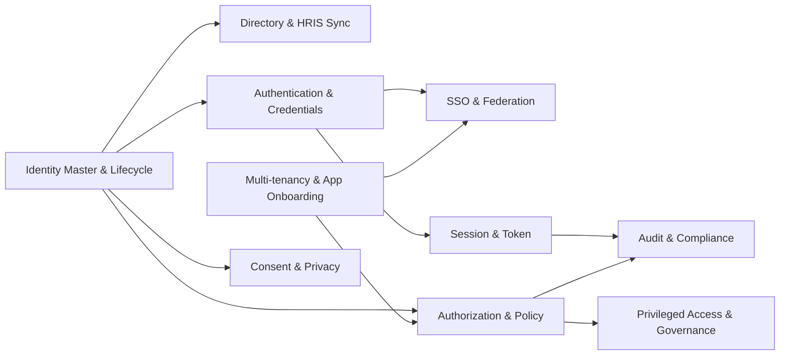

# 01-business / Capability Map

Level-1 capabilities (numbered `01..10`); level-2 under each. Capabilities are
stable "what" — organization/process independent.

## 1. Identity master & lifecycle (01)

- 01.1 Subject/identity record model (workforce, customer, partner, service)
- 01.2 Lifecycle state model (invited/provisioned/active/suspended/disabled)
- 01.3 Identity uniqueness & correlation (source keys, authoritative owner)
- 01.4 Account ↔ identity mapping (multiple accounts per identity; per-target)
- 01.5 Profile attributes & authoritative-source precedence
- 01.6 Joiner/Mover/Leaver (JML) event intake & application
- 01.7 Group / organization / org-unit modeling (org chart, cost center)
- 01.8 Self-service profile management & delegated administration

## 2. Directory & HRIS synchronization (02)

- 02.1 HRIS connector & event/feed intake (authoritative workforce source)
- 02.2 Directory (LDAP/AD-style) integration: bind, search, sync
- 02.3 Authoritative-source mapping & conflict resolution rules
- 02.4 Scheduled full sync + incremental/delta reconciliation
- 02.5 Orphan detection & reconciliation reports
- 02.6 Attribute transformation & normalization

## 3. Authentication & credentials (03)

- 03.1 Credential enrollment & binding to a subject
- 03.2 Password policy & storage (hashing, salting, pepper, breach-list check)
- 03.3 MFA: TOTP, push/passcode, recovery codes
- 03.4 Passwordless: WebAuthn/FIDO2 security keys & passkeys
- 03.5 Authenticator lifecycle (enroll, rename, revoke, reset, recovery)
- 03.6 Risk-based authentication & step-up (AAL escalation)
- 03.7 Credential throttling, lockout & anomaly detection
- 03.8 Break-glass credential & emergency access

## 4. SSO & federation (04)

- 04.1 OIDC provider (authorize, token, userinfo, discovery, JWKS)
- 04.2 OAuth 2.0 authorization server (clients, grants, scopes, PKCE)
- 04.3 SAML 2.0 IdP (metadata, assertions, bindings, signing)
- 04.4 Application/service-provider (RP/SP) registration & trust config
- 04.5 Federated identity linking & attribute mapping (no local password)
- 04.6 Upstream IdP federation (broker; social/partner/enterprise IdP)
- 04.7 Token signing key & certificate lifecycle (JWKS/metadata rotation)

## 5. Authorization & policy (05)

- 05.1 Role-based access control (RBAC): roles, permissions, assignments
- 05.2 Role/permission catalog & scopes (application, org, domain)
- 05.3 Attribute-based policy (ABAC): policy authoring, PDP evaluation
- 05.4 Policy decision point (PDP) with decision explanation
- 05.5 PEP integration contract (per-request decision & report)
- 05.6 Policy information points (attribute sources: HR, risk, resource)
- 05.7 Entitlement/assignment model (direct, role-derived, group-derived)
- 05.8 Segregation-of-duties (SoD) rule engine (static & dynamic)

## 6. Privileged access & governance (06)

- 06.1 Access request catalog & request workflow (catalog, justification)
- 06.2 Approval workflow (multi-level, resource owner, risk-based)
- 06.3 Provisioning/grant execution & time-boxed assignment
- 06.4 Just-in-time (JIT) elevation & auto-revocation
- 06.5 Access review / certification campaigns (periodic, event-driven)
- 06.6 Access remediation (revoke, downgrade, flagged item handling)
- 06.7 Break-glass / emergency access with post-hoc review
- 06.8 SoD conflict investigation & mitigation workflow

## 7. Session & token (07)

- 07.1 Session establishment & binding (device, IP, context)
- 07.2 Access token issuance (short-lived) & refresh token rotation
- 07.3 Token validation contract for resource services (PEP)
- 07.4 Single logout / session termination propagation (front/back-channel)
- 07.5 Global revocation (user, session, token, app) & kill switch
- 07.6 Session visibility & administrative termination

## 8. Audit & compliance (08)

- 08.1 Authentication event capture (success/failure, factors, risk)
- 08.2 Authorization decision logging (subject/action/resource/basis/result)
- 08.3 Administrative/change audit (who changed what, before/after)
- 08.4 Immutable, tamper-evident audit store
- 08.5 Audit query/export & evidence packages (review, SoD, consent)
- 08.6 SIEM/telemetry streaming & retention policy enforcement

## 9. Multi-tenancy & application onboarding (09)

- 09.1 Realm/tenant model & isolation boundaries
- 09.2 Application/tenant registration & self-service onboarding
- 09.3 Per-realm branding, credential policy & token audience
- 09.4 Client credentials & secrets management (rotation)
- 09.5 Consumption/entitlement metering (per realm/app)

## 10. Consent & privacy (10)

- 10.1 Consent capture (purpose, scope, version, timestamp)
- 10.2 Consent recall/withdrawal & effect propagation
- 10.3 Privacy preference & policy-version management
- 10.4 Data-subject request (access/erasure) support hooks
- 10.5 Identity data minimization & retention/erasure policy
