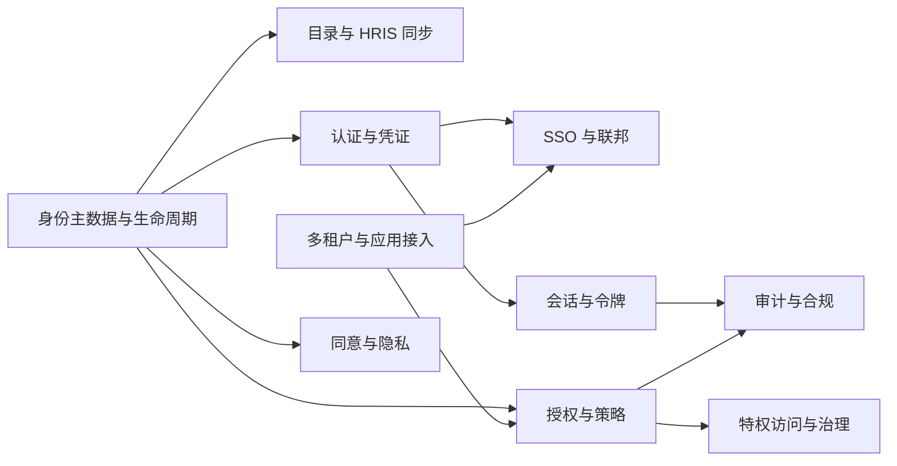

# 01-business / 能力地图

一级能力（编号为 `01..10`）；每项一级能力下设二级能力。能力描述稳定的“做什么”，不依赖组织或流程。

## 1. 身份主数据与生命周期 (01)

- 01.1 主体/身份记录模型（员工、客户、合作伙伴、服务）
- 01.2 生命周期状态模型（已邀请/已完成供给/活跃/暂停/禁用）
- 01.3 身份唯一性与关联（源键、权威所有者）
- 01.4 账号 ↔ 身份映射（每个身份对应多个账号；按目标系统）
- 01.5 档案属性与权威来源优先级
- 01.6 入职—调岗—离职（JML）事件接入与应用
- 01.7 组/组织/组织单元建模（组织结构图、成本中心）
- 01.8 自助档案管理与委派管理

## 2. 目录与 HRIS 同步 (02)

- 02.1 HRIS 连接器与事件/数据馈送接入（权威员工来源）
- 02.2 目录（LDAP/AD 式）集成：绑定、搜索、同步
- 02.3 权威来源映射与冲突解决规则
- 02.4 定时全量同步 + 增量/差异对账
- 02.5 孤儿账号检测与对账报告
- 02.6 属性转换与规范化

## 3. 认证与凭证 (03)

- 03.1 凭证注册与主体绑定
- 03.2 密码策略与存储（哈希、加盐、pepper 值、泄露名单检查）
- 03.3 多因素认证（MFA）：基于时间的一次性口令（TOTP）、推送/口令、恢复代码
- 03.4 无密码：WebAuthn/FIDO2 安全密钥与通行密钥
- 03.5 认证器生命周期（注册、重命名、吊销、重置、恢复）
- 03.6 风险自适应认证与升台阶认证（提升 AAL 认证保障级别）
- 03.7 凭证节流、锁定与异常检测
- 03.8 应急访问凭证与紧急访问

## 4. SSO 与联邦 (04)

- 04.1 OIDC 身份提供方（授权、令牌、UserInfo、发现、JWKS）
- 04.2 OAuth 2.0 授权服务器（客户端、授权类型、范围、PKCE）
- 04.3 SAML 2.0 身份提供方（IdP，元数据、断言、绑定、签名）
- 04.4 应用/依赖方（RP）/服务提供方（SP）注册与信任配置
- 04.5 联邦身份关联与属性映射（无本地密码）
- 04.6 上游身份提供方（IdP）联邦（代理；社交/合作伙伴/企业身份提供方）
- 04.7 令牌签名密钥与证书生命周期（JWKS/元数据轮换）

## 5. 授权与策略 (05)

- 05.1 基于角色的访问控制（RBAC）：角色、权限、授予/指派
- 05.2 角色/权限目录与范围（应用、组织、域）
- 05.3 基于属性的访问控制（ABAC）：策略编写、PDP 评估
- 05.4 策略决策点（PDP）与决策说明
- 05.5 策略执行点（PEP）集成契约（逐请求决策与报告）
- 05.6 策略信息点（属性来源：HR、风险、资源）
- 05.7 权限项/授予/指派模型（直接、角色派生、组派生）
- 05.8 职责分离（SoD）规则引擎（静态与动态）

## 6. 特权访问与治理 (06)

- 06.1 访问申请目录与申请工作流（目录、申请理由）
- 06.2 审批工作流（多级、资源所有者、基于风险）
- 06.3 供给/授权执行与限时有效的指派
- 06.4 即时授权（JIT）与自动吊销
- 06.5 访问评审/认证活动（周期性、事件驱动）
- 06.6 访问整改（吊销、降级、标记项处理）
- 06.7 应急访问/紧急访问与事后评审
- 06.8 SoD 冲突调查与缓解工作流

## 7. 会话与令牌 (07)

- 07.1 会话建立与绑定（设备、IP、上下文）
- 07.2 访问令牌签发（短期）与刷新令牌轮换
- 07.3 面向资源服务的令牌验证契约（PEP）
- 07.4 单点登出/会话终止传播（前向/后向通道）
- 07.5 全局吊销（用户、会话、令牌、应用）与紧急停止开关
- 07.6 会话可见性与管理员终止

## 8. 审计与合规 (08)

- 08.1 认证事件捕获（成功/失败、因子、风险）
- 08.2 授权决策日志记录（主体/操作/资源/依据/结果）
- 08.3 管理操作/变更审计（谁更改了什么、变更前/后）
- 08.4 不可变、防篡改的审计存储
- 08.5 审计查询/导出与证据包（评审、SoD、同意）
- 08.6 SIEM/遥测数据流式传输与保留期策略执行

## 9. 多租户与应用接入 (09)

- 09.1 域/租户模型与租户隔离边界
- 09.2 应用/租户注册与自助接入
- 09.3 各域品牌、凭证策略与令牌受众
- 09.4 客户端凭证与密钥管理（轮换）
- 09.5 用量/权限项计量（按域/应用）

## 10. 同意与隐私 (10)

- 10.1 同意采集（目的、范围、版本、时间戳）
- 10.2 同意撤回/撤销及影响传播
- 10.3 隐私偏好与策略版本管理
- 10.4 数据主体请求（访问/删除）支持扩展点
- 10.5 身份数据最小化与保留期/删除策略