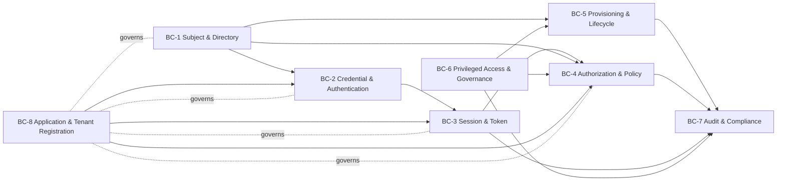

# 03-domain / Domain Model

Bounded contexts (DDD), aggregates, key entities, relationships and
invariants. IDs `BC-*`; aggregate roots named in **bold**.

## 1. Bounded contexts



| BC | Responsibility | Upstream/downstream |
|---|---|---|
| **BC-1 Subject & Directory** | identities (workforce/customer/partner/service), org units/groups, account mapping, attribute precedence | supplies all; ← HRIS/directory |
| **BC-2 Credential & Authentication** | credentials, authenticators, risk/step-up, proofing | ← BC-1; → BC-3 |
| **BC-3 Session & Token** | sessions, access/refresh tokens, grants, revocation | ← BC-2; → BC-4, PEPs |
| **BC-4 Authorization & Policy** | roles/permissions, policies, PDP decisions, obligations | ← BC-1/BC-3; → PEPs, BC-7 |
| **BC-5 Provisioning & Lifecycle** | JML, target connections (SCIM/directory), reconciliation | ← BC-1; → targets, BC-7 |
| **BC-6 Privileged Access & Governance** | requests/approvals, JIT elevation, reviews, SoD workflow | ↔ BC-4/BC-5; → BC-7 |
| **BC-7 Audit & Compliance** | append-only audit, decision records, evidence export | subscribes to all |
| **BC-8 Application & Tenant Registration** | realms/tenants, apps (RP/SP), clients, key/credential config | governs all (reference data) |

> The **decision boundary**: only BC-4 decides authorization; resource
> services (PEPs) only enforce and report. Only BC-2 authenticates. This
> separation is load-bearing (ADR-0001/ADR-0003) — no context may bypass it.

## 2. Core aggregates & entities

- **Identity (Subject)** *(BC-1 root)* — the person/thing; `type`
  (workforce/customer/partner/service), authoritative source key, realm,
  lifecycle state, profile attributes with source precedence.
- **Account** — a per-target representation of an identity (target system,
  external id, status); many accounts ↔ one identity (01.4).
- **OrgUnit / Group** — hierarchy (org chart, cost center) and arbitrary
  groups; membership is a first-class, auditable relation (01.7).
- **Credential / Authenticator** *(BC-2 root)* — password hash (peppered),
  TOTP secret, WebAuthn public-key credential, recovery codes; each carries
  an assurance level and lifecycle state.
- **AuthenticationAttempt** — an authentication transaction: factors used,
  risk signals, decision, result (an audit-grade fact).
- **Session** *(BC-3 root)* — established interaction context; assurance
  level, freshness, device/context binding, expiry, revocation state.
- **Grant / AuthorizationCode / Token** — OIDC/OAuth artefacts: the
  authorization grant, the issued tokens (ID/access/refresh) and their
  metadata (audience, scope, expiry, family).
- **RefreshTokenFamily** — the rotation lineage enabling reuse detection and
  family-wide revocation (BR-01).
- **Role / Permission** — named permission set scoped to an application and
  optionally an org/domain (05.1/05.2).
- **Assignment / Entitlement** — the binding of an entitlement to a subject
  (direct, role-derived, group-derived) with provenance and optional expiry
  (05.7); the unit reviewed and certified.
- **Policy / PolicySet** *(BC-4 root)* — versioned ABAC rules and combining
  algorithm; **Decision** = the PDP result (permit/deny, obligations,
  rationale) — an audit-grade fact.
- **AttributeSource (PIP)** — external attribute providers (HR, risk,
  resource metadata) consulted during evaluation (05.6).
- **ProvisioningConnection** *(BC-5 root)* — a target (SCIM/directory)
  including endpoint, credentials, mapping, schedule and health state.
- **ProvisioningOperation** — an idempotent create/update/disable operation
  with its idempotency key and result.
- **AccessRequest / Approval** *(BC-6 root)* — a request for entitlements
  with justification, risk, approvals and resulting grant.
- **ElevationGrant** — a time-boxed privileged assignment with window,
  approver, and auto-revocation state (JIT).
- **ReviewCampaign / ReviewItem** — a certification campaign and its items
  (subject ↔ entitlement decisions) (06.5).
- **Application / Client / Realm( Tenant )** *(BC-8 root)* — registered
  RP/SP, OAuth client with secrets, and the isolation domain they live in.
- **Consent** — immutable consent/withdrawal tuple (subject, purpose, scope,
  policy version, method) (10.1/10.2).
- **AuditEvent / AuthDecision** *(BC-7 root)* — append-only records (see §4).

## 3. Relationships (cardinality, key)

- Identity 1—* Account; Identity 1—* Credential/Authenticator; Identity 1—*
  Session; Identity *—* Group (membership); OrgUnit 1—* OrgUnit (tree).
- Identity 1—* Assignment *—1 Role/Permission/Entitlement.
- Session 0..1—* Grant; Grant 1—* Token; Token 1..*—1 RefreshTokenFamily
  (access tokens rotate within a family).
- Policy 1—* Decision; Decision *—1 {Subject, Resource, Action} + context.
- AccessRequest 1—* Approval; AccessRequest 0..1—1 Assignment;
  ElevationGrant → Assignment (time-boxed).
- ReviewCampaign 1—* ReviewItem *—1 Assignment.
- Realm 1—* {Identity, Application, Client, Policy, AuditEvent}; Application
  1—* Client; Application *—* Role/Permission.
- ProvisioningConnection 1—* ProvisioningOperation *—1 Identity/Account.
- AuditEvent —0..1→ (any) via `subject_ref`/`object_ref`; append-only.

## 4. Audit as an append-only fact layer (core pattern)

Authentication events, authorization decisions and administrative changes
are immutable facts (ADR-0001/0003, BR-09). They are **not** mutable entity
tables: corrections and follow-ups are new records.

Event/record families (non-exhaustive), each carrying actor/subject,
object, realm, timestamp (occurred vs recorded), correlation id and outcome:

`identity-created`, `identity-state-changed`, `account-provisioned`,
`authenticator-enrolled/revoked`, `authentication-succeeded/failed`,
`step-up-performed`, `session-created/terminated`, `token-issued/refreshed/
revoked`, `authorization-decided` (permit/deny + basis), `policy-published`,
`role/assignment-changed`, `access-requested/approved/rejected`,
`elevation-granted/expired`, `review-item-decided`, `consent-granted/
withdrawn`, `client-secret-rotated`.

```
Decision(t) = evaluate(Subject, Resource, Action, Context, PolicyVersion)
  -> { effect, obligations, rationale, policy_version, evaluated_at }
```

## 5. Invariants (domain rules enforced in aggregate)

1. An identity has exactly one realm and one authoritative source; account
   mapping never creates a second identity for the same correlation key
   (FR-002, BR-07).
2. A disabled/leaver identity cannot authenticate and holds no active
   session or un-expired refresh token (FR-003/FR-021, BR-13).
3. Only BC-4 produces a permit/deny; a PEP cannot alter an effect
   (ADR-0003, BR-14).
4. Every permit decision is reconstructable from the audit trail with its
   policy version and attribute inputs (BR-09, CTL-05).
5. A time-boxed assignment (request, elevation) auto-expires at its window
   end without operator action (BR-05).
6. Federated identities store no local password; password-auth applies only
   to locally-managed identities (BR-15, BR-10).
7. A token is valid only within its realm/audience; cross-realm acceptance is
   impossible (BR-07).

> ⚠️ ASSUMPTION: authentication events and authorization decisions are
> modeled as separate append-only streams because their volumes differ by
> orders of magnitude; a shared correlation id links a session's logins to
> its subsequent decisions without requiring one unified store.
