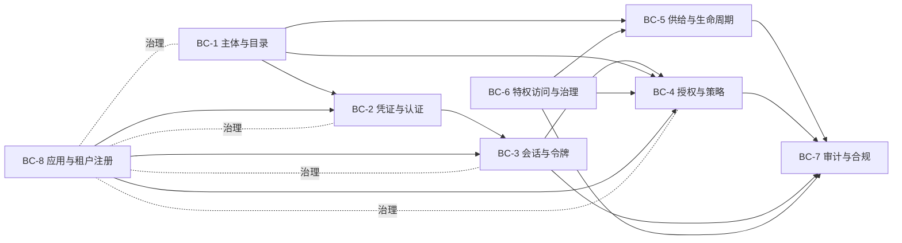

# 03-domain / 领域模型

有界上下文（DDD）、聚合、关键实体、关系和不变量。ID 为 `BC-*`；聚合根以**粗体**标示。

## 1. 有界上下文



| BC | 职责 | 上游/下游 |
|---|---|---|
| **BC-1 主体与目录** | 身份（员工/客户/合作伙伴/服务）、组织单元/群组、账号映射、属性优先级 | 供给全部；← HRIS/目录 |
| **BC-2 凭证与认证** | 凭证、认证器、风险/升台阶认证、身份核验 | ← BC-1；→ BC-3 |
| **BC-3 会话与令牌** | 会话、访问/刷新令牌、授权授予、注销/吊销 | ← BC-2；→ BC-4、策略执行点（PEP） |
| **BC-4 授权与策略** | 角色/权限、策略、PDP 决策、义务 | ← BC-1/BC-3；→ 策略执行点（PEP）、BC-7 |
| **BC-5 供给与生命周期** | 入职—调岗—离职（JML）、目标连接（SCIM/目录）、对账 | ← BC-1；→ 目标、BC-7 |
| **BC-6 特权访问与治理** | 请求/审批、JIT（即时授权）提权、访问评审、职责分离（SoD）工作流 | ↔ BC-4/BC-5；→ BC-7 |
| **BC-7 审计与合规** | 只可追加审计、决策记录、证据导出 | 订阅全部 |
| **BC-8 应用与租户注册** | 域/租户、应用（依赖方/服务提供方，RP/SP）、客户端、密钥/凭证配置 | 治理全部（参考数据） |

> **决策边界**：只有 BC-4 决定授权；资源服务（策略执行点，PEP）只负责执行和报告。只有 BC-2 负责认证。这一隔离至关重要（ADR-0001/ADR-0003）——任何上下文都不得绕过它。

## 2. 核心聚合与实体

- **身份/主体** *(BC-1 聚合根)* — 人员/对象；`type`（员工/客户/合作伙伴/服务）、权威来源键、域、生命周期状态、带来源优先级的档案属性。
- **账号** — 身份在每个目标系统中的表示（目标系统、外部 ID、状态）；多个账号 ↔ 一个身份（01.4）。
- **组织单元/群组** — 层级结构（组织架构图、成本中心）和任意群组；成员关系是一等、可审计的关系（01.7）。
- **凭证/认证器** *(BC-2 聚合根)* — 加 pepper 的密码哈希、TOTP 密钥、WebAuthn 公钥凭证、恢复码；每个都带有认证保障级别和生命周期状态。
- **认证尝试** — 一次认证事务：使用的因子、风险信号、决策、结果（审计级事实）。
- **会话** *(BC-3 聚合根)* — 已建立的交互上下文；认证保障级别、新鲜度、设备/上下文绑定、到期时间、吊销状态。
- **授权授予/授权码/令牌** — OIDC/OAuth 构件：授权授予、已签发的令牌（身份/访问/刷新令牌）及其元数据（受众、范围、到期时间、令牌族）。
- **刷新令牌族** — 用于支持重用检测和全族吊销的轮换血缘（BR-01）。
- **角色/权限** — 命名的权限集合，作用域限定于某个应用，并可选限定于某个组织/域（05.1/05.2）。
- **授予/权限项** — 将权限项绑定到主体的关系（直接、角色派生、群组派生），包含来源性质和可选的到期时间（05.7）；这是接受评审与认证的单元。
- **策略/策略集** *(BC-4 聚合根)* — 带版本的 ABAC 规则和组合算法；**决策** = PDP 结果（允许/拒绝、义务、理由）——审计级事实。
- **属性源（PIP，策略信息点）** — 评估期间查询的外部属性提供方（HR、风险、资源元数据）（05.6）。
- **供给连接** *(BC-5 聚合根)* — 目标（SCIM/目录），包括端点、凭证、映射、调度计划和健康状态。
- **供给操作** — 幂等的创建/更新/禁用操作，带有幂等键和结果。
- **访问请求/审批** *(BC-6 聚合根)* — 对权限项的请求，包含理由、风险、审批以及最终产生的授予。
- **提权授予** — 限时特权授予，包含有效窗口、审批人和自动吊销状态（JIT，即时授权）。
- **评审活动/评审项** — 一次访问认证活动及其条目（主体 ↔ 权限项决策）（06.5）。
- **应用/客户端/域（租户）** *(BC-8 聚合根)* — 已注册的 RP（依赖方）/SP（服务提供方）、含密钥的 OAuth 客户端，以及它们所在的租户隔离域。
- **同意** — 不可变的同意/撤回元组（主体、目的、范围、策略版本、方法）（10.1/10.2）。
- **审计事件/认证决策** *(BC-7 聚合根)* — 只可追加的记录（见 §4）。

## 3. 关系（基数、关键）

- 身份 1—* 账号；身份 1—* 凭证/认证器；身份 1—* 会话；身份 *—* 群组（成员关系）；组织单元 1—* 组织单元（树）。
- 身份 1—* 授予 *—1 角色/权限/权限项。
- 会话 0..1—* 授权授予；授权授予 1—* 令牌；令牌 1..*—1 刷新令牌族（访问令牌在一个族内轮换）。
- 策略 1—* 决策；决策 *—1 {主体, 资源, 操作} + 上下文。
- 访问请求 1—* 审批；访问请求 0..1—1 授予；提权授予 → 授予（限时）。
- 评审活动 1—* 评审项 *—1 授予。
- 域 1—* {身份, 应用, 客户端, 策略, 审计事件}；应用 1—* 客户端；应用 *—* 角色/权限。
- 供给连接 1—* 供给操作 *—1 身份/账号。
- 审计事件 —0..1→（任意对象），经由 `subject_ref`/`object_ref` 关联；只可追加。

## 4. 作为只可追加事实层的审计（核心模式）

认证事件、授权决策和管理变更都是不可变事实（ADR-0001/0003, BR-09）。它们**不是**可变的实体表：更正和后续操作都是新记录。

事件/记录族（非穷尽），每条记录都携带操作者/主体、对象、域、时间戳（发生时间与记录时间）、关联 ID 和结果：

`identity-created`, `identity-state-changed`, `account-provisioned`,
`authenticator-enrolled/revoked`, `authentication-succeeded/failed`,
`step-up-performed`, `session-created/terminated`, `token-issued/refreshed/
revoked`, `authorization-decided`（允许/拒绝 + 依据）, `policy-published`,
`role/assignment-changed`, `access-requested/approved/rejected`,
`elevation-granted/expired`, `review-item-decided`, `consent-granted/
withdrawn`, `client-secret-rotated`.

```
Decision(t) = evaluate(Subject, Resource, Action, Context, PolicyVersion)
  -> { effect, obligations, rationale, policy_version, evaluated_at }
```

## 5. 不变量（在聚合中强制执行的领域规则）

1. 一个身份恰好具有一个域和一个权威来源；账号映射绝不会针对同一关联键创建第二个身份（FR-002, BR-07）。
2. 已禁用/离职的身份无法进行认证，且不持有任何活动会话或未到期刷新令牌（FR-003/FR-021, BR-13）。
3. 只有 BC-4 产生允许/拒绝；PEP 不能更改效果（ADR-0003, BR-14）。
4. 每个允许决策都可根据审计轨迹、其策略版本和属性输入进行重建（BR-09, CTL-05）。
5. 限时授予（请求、提权）无需操作员干预，即在有效窗口结束时自动到期（BR-05）。
6. 联邦身份不存储本地密码；密码认证仅适用于本地管理的身份（BR-15, BR-10）。
7. 令牌仅在其域/受众范围内有效；跨域接受是不可能的（BR-07）。

> ⚠️ ASSUMPTION: 认证事件和授权决策被建模为彼此独立且只可追加的流，因为二者的数据量相差多个数量级；共享的关联 ID 可将会话的登录记录与其后续决策关联起来，而无需使用单一统一存储。