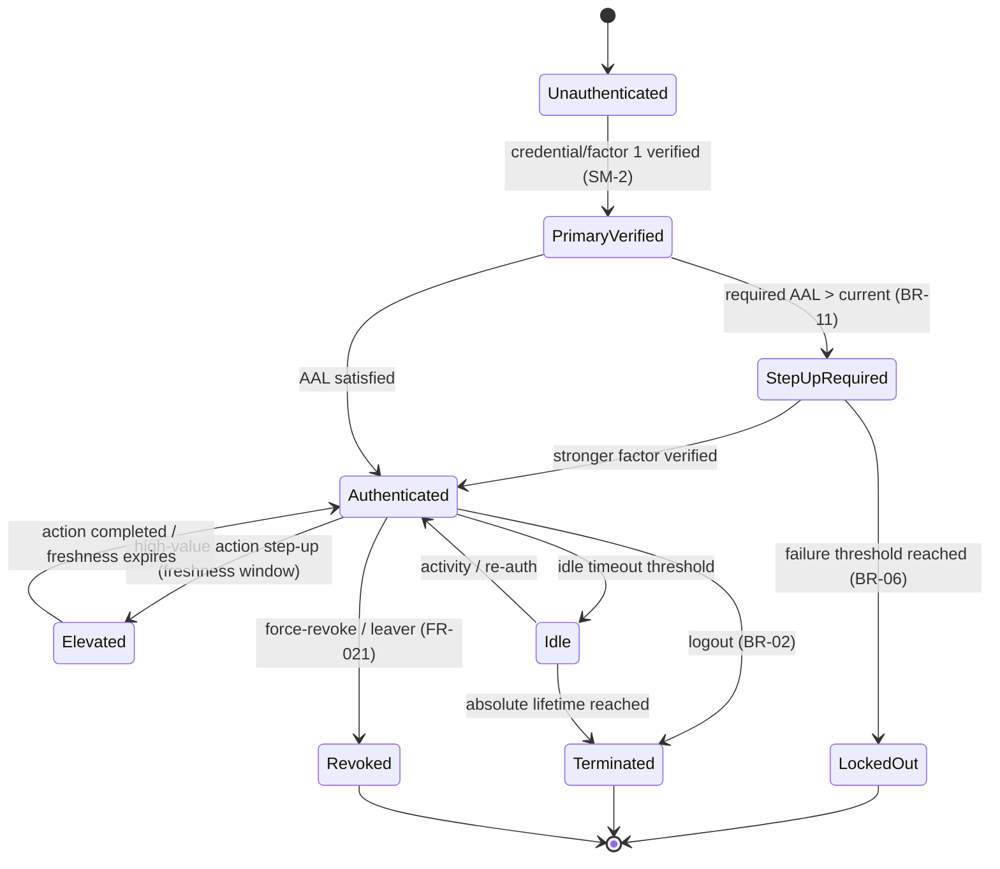
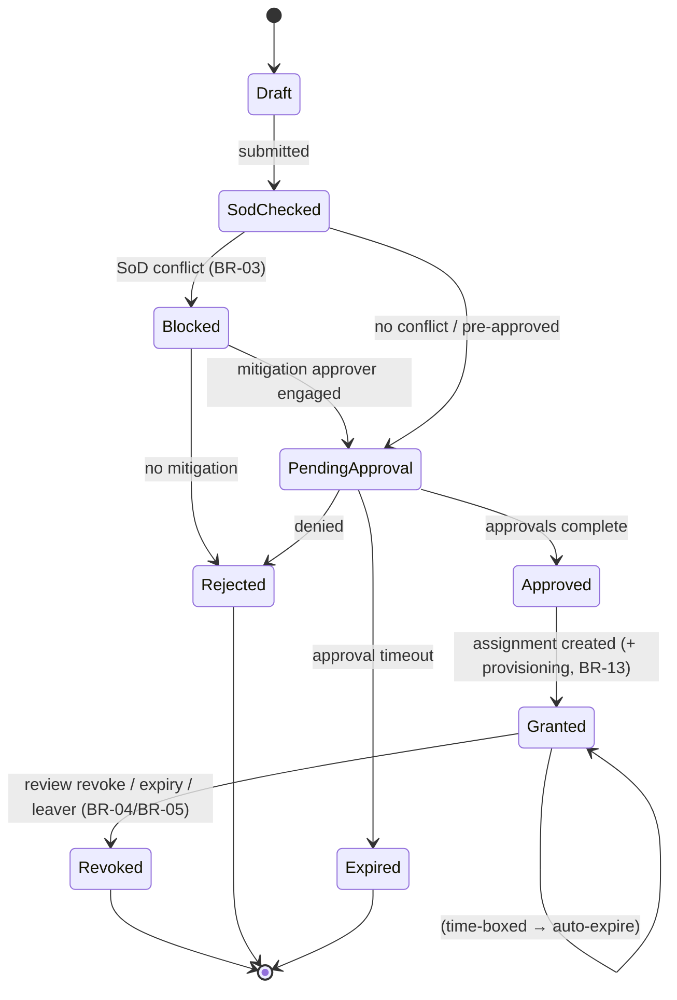
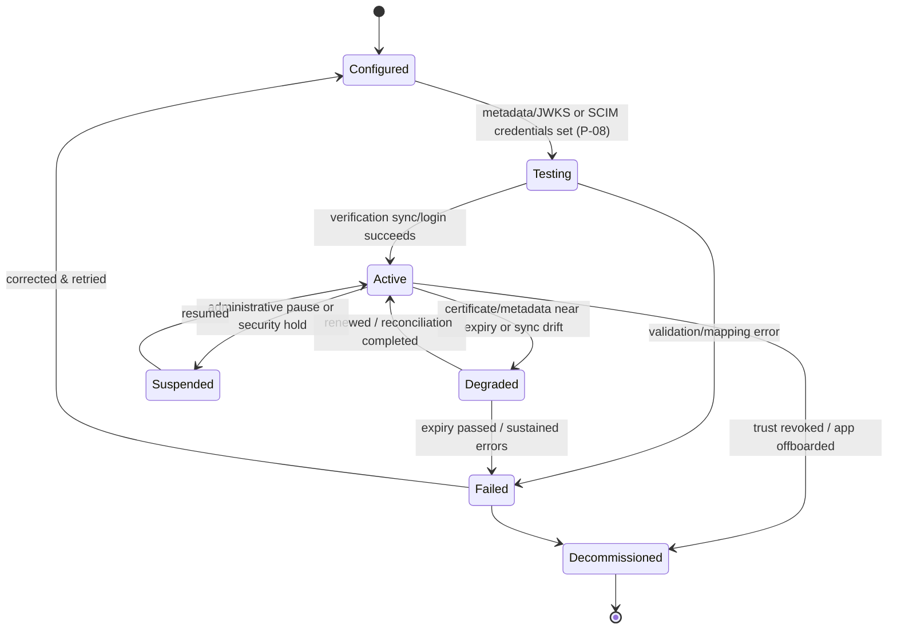

# 03-domain / State Machines

State machines for the load-bearing lifecycle objects. IDs `SM-1..SM-5`.
(Full coverage of all key objects is an L3 obligation; these anchor the
design early.)

## SM-1 Identity / account lifecycle

```mermaid
stateDiagram-v2
  [*] --> Invited: identity created (HRIS/manual/self-register)
  Invited --> Provisioned: accounts created on targets
  Provisioned --> Active: first successful authentication
  Active --> Suspended: risk hold / compliance / temporary leave
  Suspended --> Active: hold released
  Active --> Mover: org/role change (P-01)
  Mover --> Active: new mappings applied (stale entitlements removed)
  Active --> Leaver: termination / offboarding (P-02)
  Suspended --> Leaver: termination while held
  Leaver --> Disabled: all sessions & tokens revoked; targets disabled
  Disabled --> Purged: retention/erasure policy (BR-09/BR-12)
  Purged --> [*]
```



Invariant: a `Leaver`/`Disabled` identity cannot authenticate or hold a
valid refresh token (domain-model §5.2, BR-13).

## SM-2 Authentication session



Note the distinction between `Authenticated` (AAL satisfied) and `Elevated`
(transient higher assurance for a high-value action). Both terminate at the
absolute session lifetime regardless of activity (BR-02).

## SM-3 Access request → approval → grant



## SM-4 Privileged (JIT) elevation

```mermaid
stateDiagram-v2
  [*] --> Requested
  Requested --> SodChecked: submitted with reason
  SodChecked --> Rejected: SoD conflict / denied
  SodChecked --> PendingApproval
  PendingApproval --> Active: approved; window starts (BR-05)
  PendingApproval --> Rejected
  Active --> Active: actions within window (session context captured)
  Active --> Expired: window end reached (auto-revoke)
  Active --> Revoked: manual/SOC revoke (FR-021)
  Requested --> BreakGlass: emergency path (P-07)
  BreakGlass --> Active: immediate; post-hoc review required
  Active --> UnderReview: privileged actions logged → review
  UnderReview --> Closed: post-hoc review complete (≤ 24 h)
  Expired --> [*]
  Revoked --> [*]
  Rejected --> [*]
  Closed --> [*]
```

Invariant: no path yields a **standing** privileged assignment; every
`Active` state is bounded and ends in `Expired`/`Revoked` (BR-05).

## SM-5 Federation trust / provisioning connection



Invariant: an `Active` connection provisions idempotently and never revives a
deprovisioned account without explicit administrator reconciliation (BR-13);
a `Failed`/`Decommissioned` trust cannot issue or accept tokens (BR-07).
