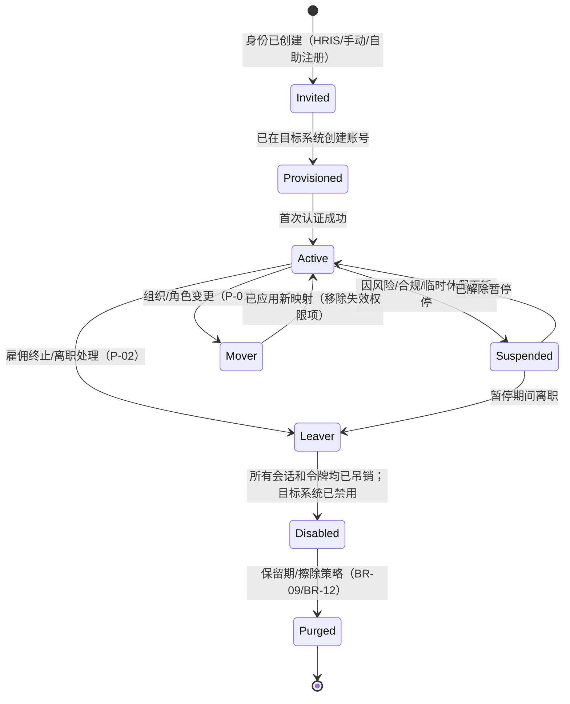
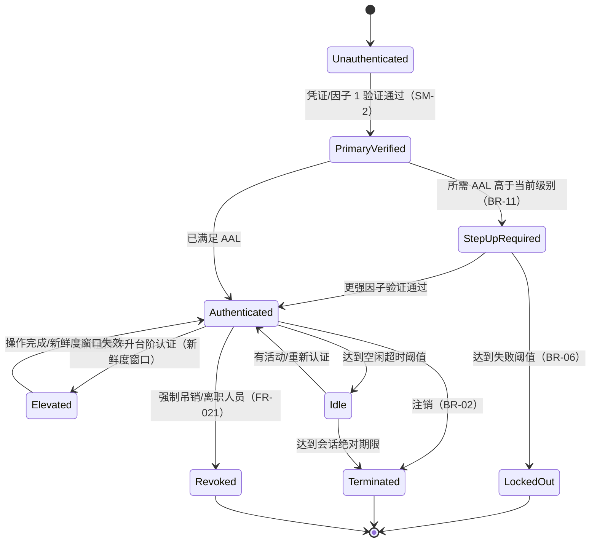
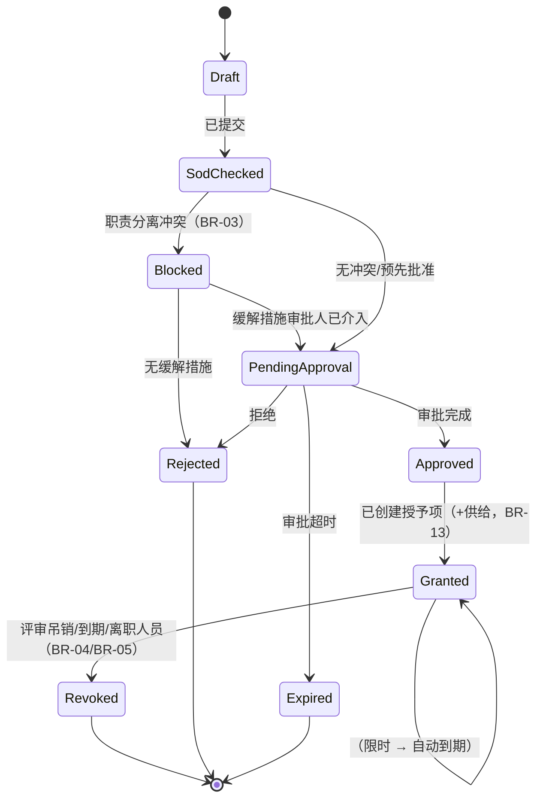
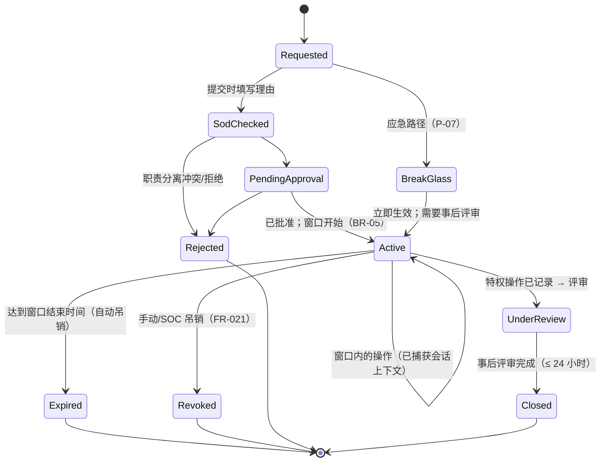
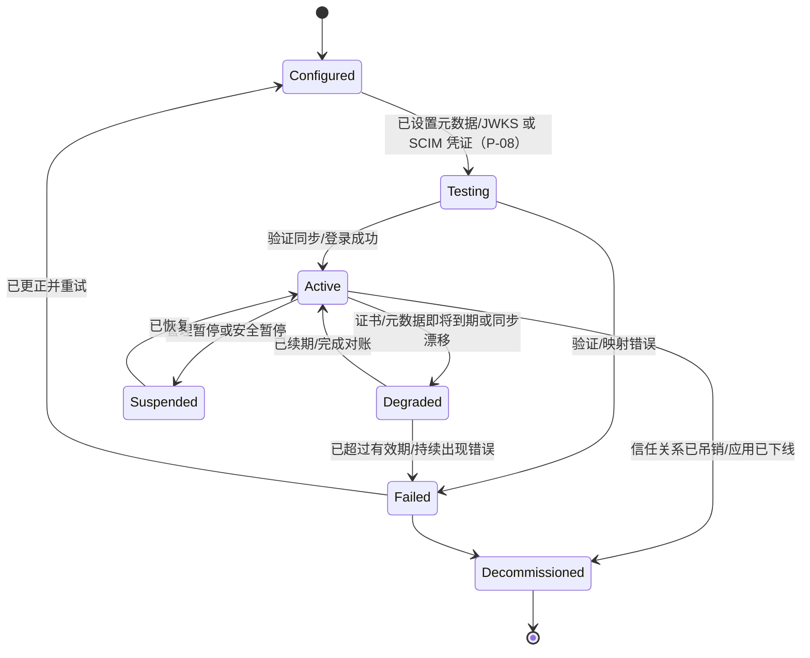

# 03-domain / 状态机

关键生命周期对象的状态机。ID 为 `SM-1..SM-5`。（覆盖所有关键对象是 L3 义务；这些状态机为早期设计提供锚点。）

## SM-1 身份/账号生命周期

不变量：处于 `Leaver`/`Disabled` 状态的身份无法完成认证或持有有效的刷新令牌（domain-model §5.2、BR-13）。

## SM-2 认证会话

请注意 `Authenticated`（已满足 AAL）与 `Elevated`（针对高价值操作的临时更高保障级别）之间的区别。无论是否发生活动，两者都会在会话绝对期限到达时终止（BR-02）。

## SM-3 访问请求 → 审批 → 授予

## SM-4 特权（即时授权）提权

不变量：任何路径都不会产生**长期有效**的特权授予；每个 `Active` 状态都有时间上限，且最终进入 `Expired`/`Revoked`（BR-05）。

## SM-5 联邦信任/供给连接

不变量：`Active` 连接以幂等方式执行供给操作，且未经管理员明确对账，绝不会重新启用已解供给的账号（BR-13）；处于 `Failed`/`Decommissioned` 状态的信任关系无法签发或接受令牌（BR-07）。