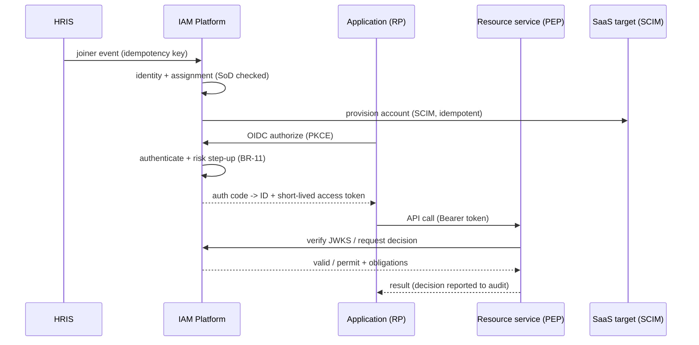

# 04-architecture / Integration

Upstream/downstream systems, protocols, data exchange and sequencing.
Concrete payload schemas are in `06-contracts/`; this chapter fixes
boundaries, semantics and (at L3) flow parameters.

> Frequencies and payload shapes marked `(A)` below are pack defaults —
> deployment profiles replace them. All flows are at-least-once with
> idempotent consumers per §3.

## 1. Integration inventory

| # | Counterparty | Direction | Content | Typical protocol (neutral options) |
|---|---|---|---|---|
| I-1 | HRIS | in | hire/move/leave events, worker attributes | SCIM 2.0 (RFC 7644), REST/event feed, batch file |
| I-2 | Directory (LDAP/AD-style) | in/out | identities, groups, membership, bind/search | LDAP(S); depending on archetype it is source or target |
| I-3 | Applications / RPs / SPs | in/out | authN requests, tokens/assertions, logout | OIDC, OAuth 2.0, SAML 2.0 |
| I-4 | Resource services / APIs (PEPs) | in | decision requests, token verification (JWKS) | JSON/HTTP decision API; JWKS/introspection |
| I-5 | SaaS & internal provisioning targets | out | account create/update/disable, group membership | SCIM 2.0; directory protocol; vendor API |
| I-6 | Upstream / partner IdP | in | federated login, attribute/claim exchange | OIDC/SAML federation (broker) |
| I-7 | SIEM / SOC | out | authN events, decisions, admin changes, risk signals | syslog/CEF/JSON stream, webhook |
| I-8 | MDM / device / PKI | in/out | device posture, certificate status | MDM API; certificate/PKI protocol |
| I-9 | Notification / SMS / email | out | MFA codes, security notices, consent receipts | SMTP/SMS gateway/API |
| I-10 | Key management / HSM | in/out | signing keys, secret storage, rotation | KMS/HSM API (PKCS#11/KMIP-style) |
| I-11 | ITSM / ticketing | in/out | access requests (origin), provisioning status | REST/webhook |
| I-12 | Consent/analytics consumers | out | consent state, entitlement snapshots | API/feed (realm-scoped) |

## 2. Boundary semantics (load-bearing)

### 2.1 Authentication vs. authorization boundary (ADR-0001)

- The IdP authenticates and **issues** tokens/assertions. The PDP
  **decides** authorization. PEPs **enforce** and **report**. These are
  three distinct roles; no single component merges them.
- A resource service MUST validate a token (issuer, audience, expiry,
  signature via JWKS/`kid`, realm) before acting; it MUST NOT accept a
  token minted elsewhere (BR-07).

### 2.2 Token passing & validation

- Access tokens are presented as `Authorization: Bearer` per RFC 6750;
  validation is local-signature (JWKS) by default, introspective when a
  resource needs immediate revocation semantics.
- Tokens are **audience-scoped** to a resource/realm; a token for app A is
  not accepted by app B. Scopes express delegated authority, not roles.
- No credential, secret or upstream password ever flows to a resource
  service; only verifiable tokens/claims (BR-15).

### 2.3 Logout / revocation propagation

- Logout at the IdP propagates via OIDC front-channel/back-channel logout
  (or SAML SLO); server-side session is invalidated immediately.
- Self-contained tokens already issued expire at BR-01 TTL at the latest;
  for tighter bounds, resource services use introspection or short TTLs
  (BR-02). Global revocation (subject/session/token/app) is a single
  authoritative action.

### 2.4 Provisioning idempotency & precedence (BR-13)

- Every provisioning operation carries an idempotency key; redelivery and
  out-of-order events converge to the latest authoritative state.
- Deprovisioning wins over a concurrent enable/joiner signal until explicit
  administrator reconciliation; a routine sync never revives a leaver.
- Item-level mapping errors are quarantined and surfaced, never silently
  dropped; connection health follows SM-5.

### 2.5 HRIS boundary — authoritative existence, IAM owns access

- HRIS owns **who exists** (employment state, org). IAM owns **what they
  may access** (accounts, entitlements, sessions).
- IAM consults HR attributes as a PIP input to decisions; it does not
  re-derive employment state. A termination is authoritative for revoking
  access (P-02), but IAM does not own the HR record.

## 3. Event exchange & reliability

- **Outbox pattern**: lifecycle/governance transactions commit state and
  events together; a relay publishes audit/lifecycle events at-least-once,
  ordered per subject.
- **Idempotency keys** on all inbound HRIS/directory/ITSM events and on
  token refresh (NFR-011); dedupe by `(source, event_id, target, op)`.
- **Correlation**: a correlation id links a session's authentication events
  to its subsequent authorization decisions for audit (BC-7).
- Poison/dead-letter handling raises to an operations queue and, for
  provisioning, to a reconciliation report (FR-004) — never silent drop.

## 4. Data flow (typical federated SSO + downstream SCIM)

## 5. Master data governance

- Worker master generally authored in HRIS and consumed; IAM extends with
  access-specific attributes (accounts, entitlements) locally.
- Roles/permissions and policies are IAM-authoritative and versioned;
  effective-dated so in-flight decisions record the version used (BR-14).
- Application/realm registration (BC-8) is the onboarding record that binds
  a client to its realm, audience and policies.

> ⚠️ ASSUMPTION: a canonical identity/attribute model (anti-corruption
> layer) normalizes HRIS/directory/vendor schemas; specific field mappings
> are L3/variant. A dedicated "migration/coexistence" mode (dual-running
> old and new IdP) is assumed but not specified here.

## 6. Data-flow parameters (L3)

| Flow | Transport | Payload essence | Frequency `(A)` | Idempotency key | Failure semantics |
|---|---|---|---|---|---|
| F-01 HRIS → IAM (I-1) | SCIM 2.0 / REST feed / batch | JML events + worker attrs; no access decisions derived from live HR beyond revocation (§2.5) | near-real-time on event; nightly file fallback | `(source, event_id, target, op)` | unknown mapping → quarantine + report, never silent (FR-004) |
| F-02 Directory sync (I-2) | LDAPS / SCIM | delta + full reconciliation, group membership | delta `≤ 15 min`, full nightly | per-entry change id | orphans/conflicts reported; no overwrite-on-conflict |
| F-03 SSO & tokens (I-3/I-6) | OIDC / OAuth 2.0 / SAML 2.0 | auth requests, codes, ID/access tokens, assertions, SLO | per login; token TTL per BR-01 | `nonce` / assertion ID replay protection | failed RP observation bounded by access-token TTL (BR-02) |
| F-04 Decisions (I-4) | JSON/HTTP `/pdp/v1` + JWKS | decision requests; verification local-first | introspect on demand; JWKS cached per key-rotation window | request correlation id | PDP unreachable → fail closed (NFR-008) |
| F-05 Provisioning egress (I-5) | SCIM 2.0 / vendor API / directory | account create/update/disable, groups | on lifecycle event; reconciliation sweep hourly | same key as F-01 (BR-13) | target error → retry + DLQ → reconciliation report, never silent drop |
| F-06 SOC stream (I-7) | syslog/CEF/JSON stream / webhook | authN events, decisions, admin changes, risk | streaming, ≤ 5 s end-to-end lag target `(A)` | event id | outbox at-least-once; consumer dedupe; lag alerts per observability.md |

Key-management (I-10), notification (I-9) and MDM (I-8) flows follow the
same idempotency/audit rules; their cadence is per-operation, not periodic.
