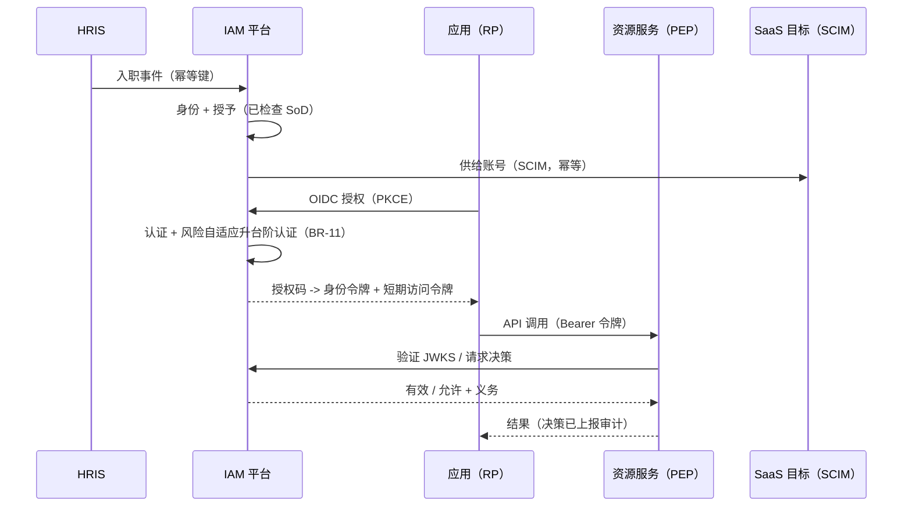

# 04-architecture / 集成

上游/下游系统、协议、数据交换和时序。具体载荷模式位于 `06-contracts/`；本章确定边界、语义以及（L3）层面的流参数。

> 下列标记为 `(A)` 的频率和载荷形态是方案包默认值——部署配置文件会替换这些默认值。所有流均采用至少一次传递，并按 §3 使用具备幂等性的消费者。

## 1. 集成清单

| # | 对端系统 | 方向 | 内容 | 典型协议（中立选项） |
|---|---|---|---|---|
| I-1 | HRIS | 入站 | 入职/调岗/离职事件、人员属性 | SCIM 2.0 (RFC 7644)、REST/事件馈送、批处理文件 |
| I-2 | 目录（LDAP/AD 风格） | 入站/出站 | 身份、群组、成员关系、绑定/搜索 | LDAP(S)；依据架构类型，它可能是源系统或目标系统 |
| I-3 | 应用/依赖方/服务提供方 | 入站/出站 | 认证请求、令牌/断言、登出 | OIDC、OAuth 2.0、SAML 2.0 |
| I-4 | 资源服务/API（PEP） | 入站 | 决策请求、令牌验证（JWKS） | JSON/HTTP 决策 API；JWKS/内省 |
| I-5 | SaaS 和内部供给目标 | 出站 | 账号创建/更新/禁用、群组成员关系 | SCIM 2.0；目录协议；厂商 API |
| I-6 | 上游/合作伙伴身份提供方 | 入站 | 联邦登录、属性/声明交换 | OIDC/SAML 联邦（代理） |
| I-7 | SIEM / SOC | 出站 | 认证事件、决策、管理员变更、风险信号 | syslog/CEF/JSON 流、Webhook |
| I-8 | MDM/设备/PKI | 入站/出站 | 设备态势、证书状态 | MDM API；证书/PKI 协议 |
| I-9 | 通知/短信/电子邮件 | 出站 | MFA 代码、安全通知、同意回执 | SMTP/SMS 网关/API |
| I-10 | 密钥管理/HSM | 入站/出站 | 签名密钥、机密存储、轮换 | KMS/HSM API（PKCS#11/KMIP 风格） |
| I-11 | ITSM/工单 | 入站/出站 | 访问请求（来源）、供给状态 | REST/Webhook |
| I-12 | 同意/分析使用方 | 出站 | 同意状态、权限项快照 | API/馈送（按域限定） |

## 2. 边界语义（关键）

### 2.1 认证与授权边界（ADR-0001）

- 身份提供方负责认证并**签发**令牌/断言。策略决策点（PDP）**决定**授权。策略执行点（PEP）**执行并报告**。这是三个不同的角色；任何单个组件都不得将它们合并。
- 资源服务在采取操作前必须验证令牌（签发方、受众、过期时间、通过 JWKS/`kid` 验证的签名、域）；不得接受在其他位置签发的令牌（BR-07）。

### 2.2 令牌传递与验证

- 访问令牌按照 RFC 6750 以 `Authorization: Bearer` 形式提交；默认进行本地签名验证（JWKS），当资源需要即时吊销语义时进行内省。
- 令牌按受众限定到特定资源/域；为应用 A 签发的令牌不会由应用 B 接受。范围表示委托授权，而非角色。
- 任何凭证、机密或上游密码都绝不流向资源服务；只会传递可验证的令牌/声明（BR-15）。

### 2.3 登出/吊销传播

- 身份提供方处的登出通过 OIDC 前通道/后通道登出（或 SAML 单点登出）传播；服务器端会话立即失效。
- 已签发的自包含令牌最迟在 BR-01 的 TTL 到期时失效；如需更严格的边界，资源服务使用内省或较短 TTL（BR-02）。全局吊销（主体/会话/令牌/应用）是一项单一且权威的操作。

### 2.4 供给幂等性与优先级（BR-13）

- 每次供给操作都携带幂等键；重新投递和乱序事件会收敛到最新权威状态。
- 在管理员明确执行对账之前，解供给优先于并发的启用/入职信号；例行同步绝不恢复离职人员的访问权限。
- 项级映射错误会被隔离并报告，绝不静默丢弃；连接健康状况遵循 SM-5。

### 2.5 HRIS 边界——存在性由权威系统确定，访问权限归 IAM 所有

- HRIS 拥有**谁存在**（任职状态、组织结构）。身份与访问管理（IAM）拥有**他们可以访问什么**（账号、权限项、会话）。
- IAM 将 HR 属性作为决策的 PIP 输入进行查询；它不重新推导任职状态。离职事件是撤销访问权限的权威依据（P-02），但 IAM 不拥有 HR 记录。

## 3. 事件交换与可靠性

- **发件箱模式**：生命周期/治理事务将状态和事件一并提交；中继器以至少一次方式发布审计/生命周期事件，并按主体保持顺序。
- 所有入站 HRIS/目录/ITSM 事件以及令牌刷新均使用**幂等键**（NFR-011）；按 `(source, event_id, target, op)` 去重。
- **关联**：关联 ID 将一个会话的认证事件与其后续授权决策关联起来，以供审计（BC-7）。
- 毒消息/死信处理会将其升级到运维队列；对于供给，还会进入对账报告（FR-004）——绝不静默丢弃。

## 4. 数据流（典型联邦 SSO + 下游 SCIM）

## 5. 主数据治理

- 人员主数据通常在 HRIS 中编制并由 IAM 消费；IAM 在本地扩展访问相关属性（账号、权限项）。
- 角色/权限和策略以 IAM 为权威来源并进行版本管理；按生效日期管理，使进行中的决策能够记录所使用的版本（BR-14）。
- 应用/域注册（BC-8）是一份接入记录，将客户端绑定到其域、受众和策略。

> ⚠️ ASSUMPTION: 规范化身份/属性模型（防腐层）将 HRIS/目录/厂商的数据模式标准化；具体字段映射属于 L3/变体。这里假定存在专用的“迁移/共存”模式（旧身份提供方与新身份提供方双轨运行），但未作具体规定。

## 6. 数据流参数（L3）

| 流 | 传输方式 | 载荷要点 | 频率 `(A)` | 幂等键 | 失败语义 |
|---|---|---|---|---|---|
| F-01 HRIS → IAM (I-1) | SCIM 2.0 / REST 馈送 / 批处理 | JML 事件 + 人员属性；除撤销访问权限外，不从实时 HR 数据推导访问决策（§2.5） | 事件发生时近实时；每夜文件回退 | `(source, event_id, target, op)` | 映射关系未知 → 隔离 + 报告，绝不静默丢弃（FR-004） |
| F-02 目录同步（I-2） | LDAPS / SCIM | 增量 + 完整对账、群组成员关系 | 增量 `≤ 15 min`，每夜完整同步 | 每条目变更 ID | 报告孤儿账号/冲突；冲突时不得覆盖 |
| F-03 SSO 与令牌（I-3/I-6） | OIDC / OAuth 2.0 / SAML 2.0 | 认证请求、授权码、身份令牌/访问令牌、断言、单点登出 | 每次登录；令牌 TTL 依据 BR-01 | `nonce` / 断言 ID 重放保护 | 依赖方对失败的观察受访问令牌 TTL 限制（BR-02） |
| F-04 决策（I-4） | JSON/HTTP `/pdp/v1` + JWKS | 决策请求；优先本地验证 | 按需内省；JWKS 按密钥轮换窗口缓存 | 请求关联 ID | PDP 不可达 → 拒绝访问（NFR-008） |
| F-05 供给出站流量（I-5） | SCIM 2.0 / 厂商 API / 目录 | 账号创建/更新/禁用、群组 | 生命周期事件发生时；每小时对账扫描 | 与 F-01 相同的键（BR-13） | 目标系统错误 → 重试 + DLQ → 对账报告，绝不静默丢弃 |
| F-06 SOC 流（I-7） | syslog/CEF/JSON 流 / Webhook | 认证事件、决策、管理员变更、风险信号 | 流式传输，端到端延迟目标 `≤ 5 s` `(A)` | 事件 ID | 发件箱至少一次传递；使用方去重；依据 observability.md 发出延迟告警 |

密钥管理（I-10）、通知（I-9）和 MDM（I-8）流遵循相同的幂等性/审计规则；其执行节奏取决于具体操作，而非周期性执行。