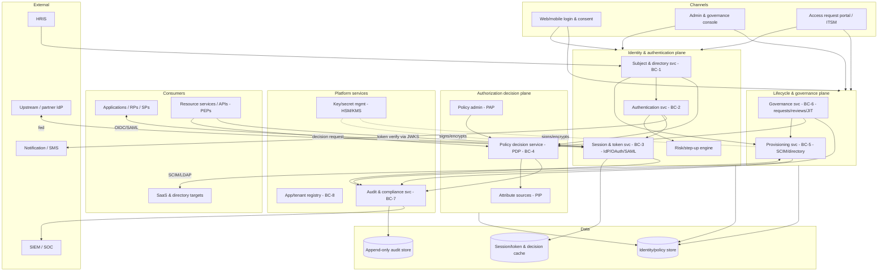
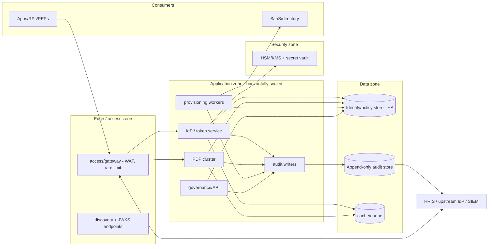

# 04-architecture / Overview

Vendor-neutral component, logical and deployment views. The three-plane
separation (identity/authentication plane, authorization-decision plane,
lifecycle plane) is the defining structure (ADR-0001).

## 1. Logical component view

## 2. Key structural decisions

- **Authentication ≠ authorization (ADR-0001/ADR-0003)**: the IdP
  authenticates and issues tokens; the PDP decides; PEPs enforce. No
  component both authenticates and embeds business authorization logic.
- **IdP is the only token issuer**: all tokens are signed by the identity
  plane; resource services verify, never mint. Keys live in an HSM/KMS and
  rotate via JWKS/metadata (BR-01/NFR-012).
- **PDP is the only decision maker**: PEPs request decisions (optionally
  batched/cached with bounded TTL) and report results; fail-closed on PDP
  unavailability for permit-requiring actions (BR-14/NFR-008).
- **Provisioning is idempotent and outward-facing**: SCIM/directory
  operations are replay-safe; deprovisioning precedence is enforced
  (BR-13/FR-003).
- **Audit is a cross-cutting append-only plane**: every plane emits to
  BC-7; audit storage is separate, immutable and streamed to SIEM
  (BR-09/NFR-009).
- **Realm/tenant is the isolation axis**: identity, policy, token audience
  and audit are all realm-scoped (BR-07/ADR-0004).

## 3. Deployment view (logical, vendor-neutral)

- **Stateless scaling**: token issuance, PDP and verification scale
  horizontally; session/decision caches are shared and bounded. The
  identity/policy store and audit store are the state anchors.
- **Availability posture**: the verification path (JWKS + local check) is
  the most heavily exercised and is served from cache/edge to meet
  NFR-002/NFR-006; the PDP is fail-closed but highly available (NFR-004).
- **Multi-region**: replication for availability; realm/data-residency
  topology (which realm lives where) is deployment/variant policy.
- Specific products (IdP products, PDP engines, HSMs) belong in `variants/`.

## 4. Consistency model

- **Strong consistency** for credential verification, session/token state
  transitions (issue/refresh/revoke) and assignment changes that gate
  security decisions.
- **Eventual consistency** for attribute propagation to the PDP
  (`PIP` caches), analytics/SIEM, and provisioning to targets — with bounded
  staleness and explicit invalidation on change (BR-14).
- **Revocation latency is bounded** by the access-token TTL (BR-01/BR-02):
  self-contained tokens are valid until expiry; introspection-based PEPs
  observe revocation immediately.

## 5. Scalability & multi-domain

- Realm-scoped sharding where feasible (hot data is per realm); global
  reference data (applications, roles) replicated.
- Read-heavy verification scales independently from write-heavy lifecycle
  and governance paths.
- Multi-domain interop happens through explicit federation/SCIM connections
  (SM-5), never by co-mutating another domain's identity store.
