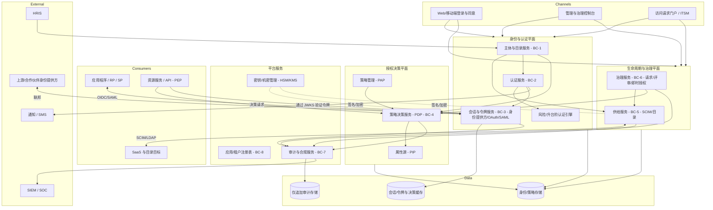
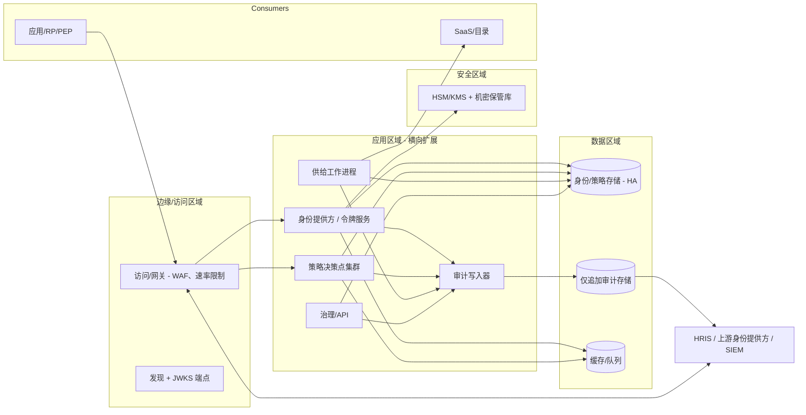

# 04-architecture / 概述

厂商中立的组件、逻辑和部署视图。三平面
分离（身份/认证平面、授权决策平面、
生命周期平面）是定义性结构（ADR-0001）。

## 1. 逻辑组件视图

## 2. 关键结构决策

- **认证 ≠ 授权（ADR-0001/ADR-0003）**：身份提供方
  负责认证并签发令牌；策略决策点负责决策；策略执行点负责执行。不存在
  同时承担认证并嵌入业务授权逻辑的组件。
- **身份提供方是唯一的令牌签发方**：所有令牌均由身份与认证平面
  签名；资源服务仅负责验证，绝不签发。密钥存储在 HSM/KMS 中，
  并通过 JWKS/元数据进行轮换（BR-01/NFR-012）。
- **策略决策点是唯一的决策制定方**：策略执行点请求决策（可选择
  批量处理或缓存，并采用有界 TTL），并报告结果；对于需要许可的操作，
  策略决策点不可用时采用失败即拒绝（BR-14/NFR-008）。
- **供给具备幂等性且面向外部系统**：SCIM/目录
  操作可安全重放；强制执行解供给优先级
  （BR-13/FR-003）。
- **审计是横切各平面的仅追加平面**：每个平面都向
  BC-7 发出数据；审计存储彼此独立、不可变，并流式传输至 SIEM
  （BR-09/NFR-009）。
- **域/租户是隔离轴**：身份、策略、令牌受众群体
  和审计均限定在相应域范围内（BR-07/ADR-0004）。

## 3. 部署视图（逻辑、厂商中立）

- **无状态扩展**：令牌签发、策略决策点和验证均可
  横向扩展；会话/决策缓存为共享缓存且容量有界。
  身份/策略存储和审计存储是状态锚点。
- **可用性设计**：验证路径（JWKS + 本地校验）
  是调用最频繁的路径，并由缓存/边缘节点提供服务，以满足
  NFR-002/NFR-006；策略决策点采用失败即拒绝，同时保持高可用（NFR-004）。
- **多区域**：为可用性进行复制；域/数据驻留
  拓扑（各域部署所在位置）属于部署/变体策略。
- 特定产品（身份提供方产品、策略决策点引擎、HSM）应归入 `variants/`。

## 4. 一致性模型

- **强一致性**：凭证验证、会话/令牌状态转换
  （签发/刷新/吊销），以及用于为安全决策设置闸门的授予/指派变更。
- **最终一致性**：属性向策略决策点的传播
  （`PIP` 缓存）、分析/SIEM，以及向目标系统的供给——陈旧程度有界，
  并在变更时执行显式失效处理（BR-14）。
- **吊销延迟有界**，其上限由访问令牌 TTL 决定（BR-01/BR-02）：
  自包含令牌在到期前均有效；基于内省的策略执行点
  会立即观察到吊销。

## 5. 可扩展性与多域

- 在可行情况下按域分片（热数据按域组织）；全局参考数据
  （应用、角色）进行复制。
- 读密集型验证可独立于写密集型生命周期
  和治理路径进行扩展。
- 多域互操作通过显式联邦/SCIM 连接实现
  （SM-5），绝不通过共同修改其他域的身份存储来实现。