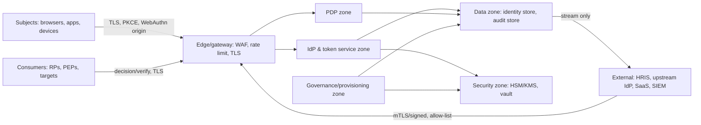

# 04-architecture / Security

Trust boundaries, authentication/authorization and key controls. Traces to
NFR-012/NFR-013 and CTL-01..CTL-07.

## 1. Trust boundaries

- The **IdP is the single trust anchor**: only it mints tokens/assertions.
  Its signing keys live in the security zone (HSM/KMS) and never leave it.
- External systems reach only the edge with per-system credentials and
  message validation; they never reach the data zone directly.
- Consumers call the decision/verification APIs; the **PDP is the only
  authority** to permit, and its response is signed/attributable.

## 2. Token, JWKS & key rotation

- **Short-lived access tokens** (BR-01): self-contained JWTs signed with
  `RS256`/`ES256`-class algorithms (RFC 8725 rules: not `alg:none`, explicit
  `iss/aud/exp`, no algorithm confusion). Validation accepts only the
  expected algorithms.
- **Refresh token rotation** with reuse detection: presenting a retired
  refresh token invalidates the entire token family (BR-01).
- **JWKS/metadata rotation**: signing keys rotate on a schedule; the JWKS
  publishes overlapping `kid`s for `≥ 2×` the rotation interval so
  consumers never see an unverifiable token; retirement is orderly.
- **SAML** assertions are signed (and encrypted where required); metadata
  certificates are rotated with overlap. Key generation/use is confined to
  the security zone (NFR-012).

## 3. Replay & token-leakage protection

- **PKCE** is mandatory for public clients; authorization `state` and OIDC
  `nonce` prevent CSRF and replay (FR-009/FR-010).
- Authorization codes are single-use and short-lived; token endpoint
  requires client authentication (or PKCE binding) and exact redirect-URI
  match.
- Bearer tokens are **audience- and realm-scoped**; a stolen token is
  usable only for its bound resource and only until expiry, and is
  revocable (BR-07/BR-01).
- Sessions are bound to context (device/refresh binding); anomaly detection
  and forced revocation (FR-021) limit stolen-session impact; step-up
  (BR-11) protects high-value actions.
- All token/session over non-TLS is prohibited; cookies are `HttpOnly`,
  `Secure`, `SameSite`-appropriate.

## 4. Credential storage & authentication strength

- Passwords: memory-hard salted hash + pepper (pepper in HSM/KMS);
  breach-list check on set/change; no forced composition/rotation
  (BR-10/NFR-012).
- TOTP seeds stored encrypted; recovery codes single-use and hashed;
  WebAuthn stores only the **public key** credential (private key never
  leaves the authenticator — WebAuthn/FIDO2).
- **Federated identities store no local password** (BR-15); local password
  auth is available only as an explicit, policy-governed fallback for
  workforce realms.
- Constant-time verification; uniform error responses to prevent
  user-enumeration and timing attacks (BR-06).

## 5. Authorization, elevation & SoD

- **Deny-overrides** with fail-closed behavior when the PDP is unreachable
  (BR-14/NFR-008); every decision carries obligations and a rationale for
  audit (FR-017).
- SoD blocks toxic combinations at grant time and at review (BR-03), and
  separation of functions prevents self-approval (policy author ≠ approver,
  admin cannot approve own elevation) (BR-08).
- **No standing privilege**: JIT elevation is time-boxed with auto-revoke;
  break-glass is audited and post-hoc reviewed (BR-05/SM-4).

## 6. Audit integrity & multi-tenant isolation

- Audit records are append-only and **tamper-evident** (hash chain or
  equivalent); application roles cannot update/delete them; SIEM receives a
  stream, not a mutable copy (BR-09/NFR-009/CTL-05).
- **Realm isolation is enforced server-side** at every data access and
  token acceptance: a token issued in realm A is rejected in realm B; admin
  scope is limited to granted realms (BR-07/NFR-013).
- Workforce and customer trust domains are separated by default (different
  credential policy, token audience, retention/consent rules) (ADR-0004).

## 7. Security of integration & administration

- Input validation on all OIDC/OAuth/SAML/SCIM/decision inputs; malformed
  or oversized messages rejected; rate/size limits at the edge.
- Client secrets and connection credentials are vault-owned and rotatable
  without downtime; no secrets in source/config in the repository
  (NFR-012).
- Administrative console is a privileged surface: step-up required,
  actions audited, session-bounded, and (per policy) reachable only from
  the management zone.

> ⚠️ ASSUMPTION: algorithms (e.g. `RS256`, `ES256`, SHA-256, Argon2id-class
> hashing) are the pack's stated defaults; FIPS/商密 mandates and their
> exact suites are variant/deployment policy (see compliance §variant).
