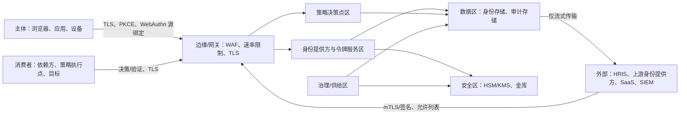

# 04-architecture / 安全

信任边界、认证/授权与密钥控制。追溯至
NFR-012/NFR-013 和 CTL-01..CTL-07。

## 1. 信任边界

- **身份提供方（IdP）是唯一信任锚点**：只有它签发令牌/断言。
  其签名密钥保存在安全区（HSM/KMS）中，绝不离开该区域。
- 外部系统只能使用各系统专属的凭证并通过消息验证后访问边缘；
  绝不直接访问数据区。
- 消费者调用决策/验证 API；**策略决策点（PDP）是唯一有权作出允许决定的权威**，
  其响应经过签名且可归责。

## 2. 令牌、JWKS 与密钥轮换

- **短期访问令牌**（BR-01）：使用 `RS256`/`ES256` 类算法签名的
  自包含 JWT（RFC 8725 规则：不得使用 `alg:none`，必须显式包含
  `iss/aud/exp`，不得发生算法混淆）。验证仅接受预期算法。
- **刷新令牌轮换**并检测重复使用：提交已退役的刷新令牌会使
  整个令牌族失效（BR-01）。
- **JWKS/元数据轮换**：签名密钥按计划轮换；JWKS 发布重叠的 `kid` 值，
  重叠期至少为轮换间隔的 `≥ 2×`，从而确保消费者不会看到
  无法验证的令牌；退役按序进行。
- **SAML** 断言均需签名（在需要时加密）；元数据证书采用重叠期轮换。
  密钥生成和使用仅限于安全区（NFR-012）。

## 3. 重放与令牌泄露防护

- **PKCE** 对公共客户端强制必用；授权 `state` 和 OIDC
  `nonce` 可防止 CSRF 和重放（FR-009/FR-010）。
- 授权码为一次性且短期有效；令牌端点要求进行客户端认证
  （或 PKCE 绑定），并要求重定向 URI 精确匹配。
- 持有者令牌**按受众和域限定作用域**；被盗令牌仅可用于其
  绑定的资源，且仅在到期前有效，并可被吊销（BR-07/BR-01）。
- 会话与上下文绑定（设备/刷新令牌绑定）；异常检测和
  强制吊销（FR-021）限制被盗会话造成的影响；升台阶认证
  （BR-11）保护高价值操作。
- 禁止通过非 TLS 连接传输令牌/会话；Cookie 应采用 `HttpOnly`、
  `Secure` 以及适合场景的 `SameSite` 设置。

## 4. 凭证存储与认证强度

- 密码：使用抗内存硬度的加盐哈希 + pepper（pepper 存放于 HSM/KMS）；
  设置/更改密码时检查泄露列表；不强制要求密码组成规则/轮换
  （BR-10/NFR-012）。
- TOTP 种子经加密存储；恢复码为一次性使用并以哈希形式存储；
  WebAuthn 仅存储**公钥**凭证（私钥绝不离开认证器——WebAuthn/FIDO2）。
- **联邦身份不存储本地密码**（BR-15）；本地密码认证仅作为
  员工身份管理域中明确启用且受策略治理的回退方案提供。
- 采用恒定时间验证；返回统一错误响应，以防用户枚举和时序攻击
  （BR-06）。

## 5. 授权、提权与职责分离

- 采用**拒绝优先**策略，并在 PDP 不可达时采用失败关闭行为
  （BR-14/NFR-008）；每项决策均携带义务及供审计使用的理由说明
  （FR-017）。
- 职责分离（SoD）在授予时和评审时阻止有害组合（BR-03）；
  职能分离可防止自我审批（策略作者 ≠ 审批者，管理员不能批准自己的提权）
  （BR-08）。
- **不保留常设权限**：即时授权（JIT）提权设有时限并自动吊销；
  应急访问会被审计并事后评审（BR-05/SM-4）。

## 6. 审计完整性与多租户隔离

- 审计记录为仅追加且具备**防篡改**能力（哈希链或
  等效机制）；应用角色不得更新/删除这些记录；SIEM 接收的是
  数据流，而非可变副本（BR-09/NFR-009/CTL-05）。
- **域隔离在服务器端强制执行**，并应用于每次数据访问和令牌接受：
  在域 A 中签发的令牌会被域 B 拒绝；管理员作用域仅限于已授予的域
  （BR-07/NFR-013）。
- 默认情况下，员工身份管理与客户身份管理的信任域相互分离
  （凭证策略、令牌受众、保留期/同意规则各不相同）（ADR-0004）。

## 7. 集成与管理的安全性

- 对所有 OIDC/OAuth/SAML/SCIM/决策输入进行输入验证；拒绝格式错误
  或过大的消息；在边缘设置速率/大小限制。
- 客户端密钥和连接凭证归金库所有，并且可在不停机的情况下轮换；
  代码库中的源码/配置不得包含任何机密（NFR-012）。
- 管理控制台属于特权界面：要求升台阶认证，操作须审计，
  受会话边界约束，并且（依据策略）只能从管理区访问。

> ⚠️ ASSUMPTION: 算法（例如 `RS256`、`ES256`、SHA-256、Argon2id 类哈希）
> 是本方案包声明的默认值；FIPS/商密要求及其具体算法套件属于
> 变体/部署策略（参见合规性 §variant）。