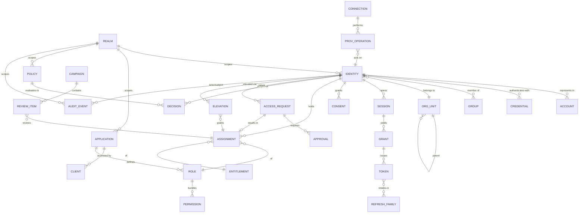

# 05-data / Logical Data Model

Logical entities, key attributes, relationships and cardinalities. Physical
DDL/partitioning is L3/variant. Audit and decision records (ADR-0001/0003)
are an append-only source of truth; other tables are aggregates/projections.

## 1. Entity relationship overview

## 2. Core entities (logical fields)

### Realm / Application / Client (BC-8)
- **REALM**(realm_id, realm_type [workforce/ciam/partner/service],
  tenant_key, display_name, credential_policy_ref, token_audience,
  consent_policy_ref, retention_policy_ref, status)
- **APPLICATION**(app_id, realm_id, name, type [oidc-rp/saml-sp/api/resource],
  client_id, redirect_uris, allowed_scopes, token_audience, status)
- **CLIENT**(client_id, app_id, client_type [confidential/public],
  secret_ref (vault), grant_types, pkce_required, status)

### Identity / Account / Credential (BC-1/BC-2)
- **IDENTITY**(identity_id, realm_id, identity_type
  [workforce/customer/partner/service], authoritative_source, source_key,
  lifecycle_state (SM-1), org_unit_id?, display_name, email?, attributes
  (extensible, source-precedence), is_federated, created/updated_at)
- **ACCOUNT**(account_id, identity_id, target_system, external_id, status,
  connection_id, last_synced_at) — many accounts ↔ one identity
- **CREDENTIAL / AUTHENTICATOR**(credential_id, identity_id, type
  [password/totp/webauthn/recovery], aal, secret_ref (hash/encrypted seed/
  public key), state [pending/active/revoked], created/last_used_at)

### Org / Group
- **ORG_UNIT**(org_unit_id, realm_id, parent_id, name, type
  [division/dept/cost-center], source_ref, status)
- **GROUP**(group_id, realm_id, name, type [security/distribution/role-mapped],
  source_ref, status)
- **MEMBERSHIP**(membership_id, group_id, identity_id, source
  [manual/derived/synced], valid_from/to)

### Session / Token / Grant (BC-3)
- **SESSION**(session_id, identity_id, realm_id, assurance_level,
  uat (acr/auth_time), device_ref, source_ip, started_at, expires_at,
  absolute_expires_at, state (SM-2), revocation_reason?)
- **GRANT**(grant_id, session_id, client_id, app_id, scopes, audience,
  auth_code_ref, grant_type [authorization_code/refresh], issued_at)
- **TOKEN**(token_id, grant_id, token_type [access/id/refresh], jti,
  audience, scopes, issued_at, expires_at, family_id, state
  [active/used/revoked/retired])
- **REFRESH_FAMILY**(family_id, grant_id, current_token_id, reuse_detected,
  created_at)

### Consent

- **CONSENT**(consent_id, identity_id, realm_id, purpose, scope,
  policy_version, state [granted/withdrawn], method, granted_at,
  withdrawn_at?) — immutable tuples; withdrawal is a new record

### Role / Permission / Assignment / Policy (BC-4)
- **ROLE**(role_id, realm_id, app_id, name, description, role_type
  [business/technical/privileged], status)
- **PERMISSION**(permission_id, app_id, action, resource_type, description)
- **ROLE_PERMISSION**(role_id, permission_id)
- **ENTITLEMENT**(entitlement_id, app_id, role_id?, resource_scope, description)
- **ASSIGNMENT**(assignment_id, identity_id, entitlement_id?, role_id?,
  org_scope?, source [direct/request/review/elevation/mapping],
  provenance_ref, valid_from, expires_at?, state
  [active/expired/revoked], revoked_by?)
- **POLICY**(policy_id, realm_id, app_id?, version, effect_default
  [deny-overrides], rules (structured), status [draft/published/retired],
  published_at, author_id, approver_id)
- **DECISION**(decision_id, subject_id, resource, action, context_hash,
  effect [permit/deny], obligations, policy_id, policy_version, pep_id,
  decided_at) — append-only

### Provisioning (BC-5)
- **CONNECTION**(connection_id, realm_id, target_type [scim/ldap/app],
  base_url, credential_ref (vault), mapping_ref, schedule,
  health_state (SM-5))
- **PROV_OPERATION**(operation_id, connection_id, identity_id?/account_id?,
  op_type [create/update/disable/delete], idempotency_key, payload_ref,
  status [pending/success/failed/quarantined], attempts, last_error?,
  occurred_at)

### Governance (BC-6)
- **ACCESS_REQUEST**(request_id, requester_id, entitlement_id, justification,
  requested_duration, risk_tier, sod_state, status (SM-3), created_at)
- **APPROVAL**(approval_id, request_id, approver_id, decision
  [approve/deny/mitigate], reason, decided_at)
- **ELEVATION**(elevation_id, identity_id, privileged_role_id, approved_by,
  window_start, window_end, state (SM-4), reason, break_glass, review_due_at)
- **CAMPAIGN**(campaign_id, realm_id, scope, period, due_at, status
  [open/closed], created_by)
- **REVIEW_ITEM**(item_id, campaign_id, assignment_id, reviewer_id, decision
  [certify/revoke/undecided], decided_at, risk_context)

### Audit (BC-7)
- **AUDIT_EVENT**(event_id [ordered/immutable], realm_id, event_type,
  actor_id?, subject_id?, object_type, object_id, outcome, context
  (source_ip, device, method, risk), detail_ref, occurred_at, recorded_at,
  correlation_id, prev_hash)
- **AUTH_DECISION** = a projection/view over AUDIT_EVENT
  (`authorization-decided`) exposing {subject, action, resource, effect,
  policy_version, obligations, pep_id} for decision audit queries.

## 3. Relationships & integrity notes

- Every row is **realm-scoped**; queries and tokens are rejected when the
  realm does not match (BR-07/NFR-013).
- **ASSIGNMENT** is the single join enabling "who has access to what" and is
  the unit reviewed/certified (BC-6); provenance (`source`,
  `provenance_ref`) makes grants traceable to their origin (CTL-01).
- **DECISION** and **AUDIT_EVENT** are append-only; corrections are new
  records (BR-09); `AUTH_DECISION` is a read projection for auditors.
- **TOKEN.family_id** → REFRESH_FAMILY enables reuse detection and
  family-wide revocation (BR-01).
- **PROV_OPERATION.idempotency_key** dedupes replay; out-of-order events
  converge to latest authoritative state (BR-13).

## 4. Retention & partitioning (logical)

- **AUDIT_EVENT / DECISION** partitioned by realm + time; hot window online
  then archive; never deleted within retention (BR-09); tamper-evident
  (hash chain) verified periodically.
- **CONSENT** retained as immutable history (grant + withdrawal records);
  personal-data erasure anonymizes identity PII while preserving audit and
  consent facts (BR-12).
- **SESSION/TOKEN** short-lived; expired/revoked entries purged after the
  revocation-latency window (BR-01/BR-02).
- Identity PII minimized and purged per realm policy; account/lifecycle
  facts retained as audit evidence.

## 5. Integrity constraints (normative)

Constraints the model must enforce. They are numbered and stable, and each
names the `BR-`/`FR-` identifiers it enforces.

The closing sentence records which of them are enforced **in the store** rather
than in application code. That is a claim the pack makes about itself, not a
verified property — application discipline is exactly what a later change
bypasses, which is why the distinction is drawn rather than left implied.

| # | Constraint | Enforces |
|---|---|---|
| 1 | `AUDIT_EVENT` and `DECISION` are append-only: no UPDATE or DELETE grant exists, and a correction is a new attributed event | BR-09, ADR-0001, ADR-0003 |
| 2 | A refresh token is one-time-use; presenting an already-retired one revokes the **entire** `REFRESH_FAMILY` | BR-01 |
| 3 | `TOKEN.lifetime` may not exceed the ceiling configured for the resource; an unbounded access token is illegal | BR-01 |
| 4 | Session termination is authoritative at the IdP: an RP that misses the logout notification must still fail on the next token validation | BR-02 |
| 5 | Every `ROLE_GRANT` is checked against the SoD conflict set at write time; a conflicting pair without a recorded compensating control is rejected | BR-03, BR-08 |
| 6 | An unreviewed grant is revoked at the overdue boundary; it is never silently extended by the passage of the review period | BR-04 |
| 7 | `ELEVATION.expires_at` is NOT NULL and auto-revoke fires at expiry; an open-ended elevation is illegal | BR-05 |
| 8 | Credential lockout is scoped to (subject, credential) — a global counter locks out every subject in the realm at once | BR-06, BR-07 |
| 9 | Every row reachable by a query resolves a `REALM`; a cross-realm read is impossible rather than filtered after the fact | BR-07, ADR-0004 |
| 10 | Processing a personal-data purpose requires a `CONSENT` state covering it; an absent state means not permitted | BR-12 |
| 11 | Provisioning is idempotent on its target key, and for the same subject a deprovisioning beats a provisioning regardless of arrival order | BR-13 |
| 12 | A `DECISION` records the policy version that produced it; a decision whose policy version does not resolve is illegal | BR-14, ADR-0003 |
| 13 | A federated subject has no local password row — a password on a federated account is a second credential to breach and reconcile | BR-15 |
| 14 | An action requiring AAL *n* rejects a session authenticated below it; the failure is a step-up challenge, never a downgrade | BR-11 |
| 15 | Credential parameters (algorithm, cost, rotation) match the current policy version; a row predating a policy change fails validation until re-hashed | BR-10 |

> Constraints 1, 5, 7, 9, 10, 11 and 13 are **enforced in the store**, not in
> application code. An editable audit trail, an SoD conflict, an open-ended
> elevation, a cross-realm read, an unconsented purpose, a racing provision, or
> a local password on a federated account is a defect regardless of what
> application discipline promises — a credential is a boundary, and a
> constraint applied after the query has answered is not one.
