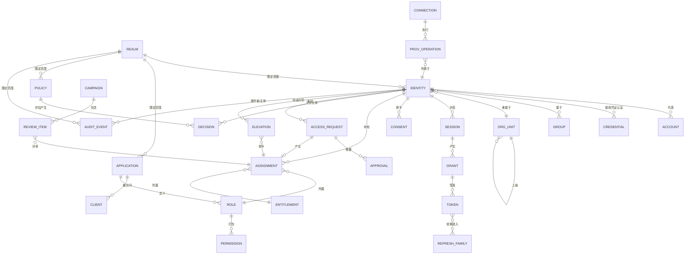

# 05-data / 逻辑数据模型

逻辑实体、关键属性、关系及其基数。物理 DDL/分区划分属于 L3/变体。审计与决策记录（ADR-0001/0003）是仅追加的事实来源；其他表则是聚合/投影。

## 1. 实体关系概览

## 2. 核心实体（逻辑字段）

### 域/租户 / 应用 / 客户端 (BC-8)
- **REALM**(realm_id, realm_type [workforce/ciam/partner/service],
  tenant_key, display_name, credential_policy_ref, token_audience,
  consent_policy_ref, retention_policy_ref, status)
- **APPLICATION**(app_id, realm_id, name, type [oidc-rp/saml-sp/api/resource],
  client_id, redirect_uris, allowed_scopes, token_audience, status)
- **CLIENT**(client_id, app_id, client_type [confidential/public],
  secret_ref (保管库), grant_types, pkce_required, status)

### 身份/主体 / 账号 / 凭证 (BC-1/BC-2)
- **IDENTITY**(identity_id, realm_id, identity_type
  [workforce/customer/partner/service], authoritative_source, source_key,
  lifecycle_state (SM-1), org_unit_id?, display_name, email?, attributes
  (可扩展、来源优先), is_federated, created/updated_at)
- **ACCOUNT**(account_id, identity_id, target_system, external_id, status,
  connection_id, last_synced_at) — 多个账号 ↔ 一个身份
- **CREDENTIAL / AUTHENTICATOR**(credential_id, identity_id, type
  [password/totp/webauthn/recovery], aal, secret_ref (哈希值/加密种子/公钥),
  state [pending/active/revoked], created/last_used_at)

### 组织 / 组
- **ORG_UNIT**(org_unit_id, realm_id, parent_id, name, type
  [division/dept/cost-center], source_ref, status)
- **GROUP**(group_id, realm_id, name, type [security/distribution/role-mapped],
  source_ref, status)
- **MEMBERSHIP**(membership_id, group_id, identity_id, source
  [manual/derived/synced], valid_from/to)

### 会话 / 令牌 / 授权 (BC-3)
- **SESSION**(session_id, identity_id, realm_id, assurance_level,
  uat (acr/auth_time), device_ref, source_ip, started_at, expires_at,
  absolute_expires_at, state (SM-2), revocation_reason?)
- **GRANT**(grant_id, session_id, client_id, app_id, scopes, audience,
  auth_code_ref, grant_type [authorization_code/refresh], issued_at)
- **TOKEN**(token_id, grant_id, token_type [access/id/refresh], jti,
  audience, scopes, issued_at, expires_at, family_id, state
  [active/used/revoked/retired])
- **REFRESH_FAMILY**(family_id, grant_id, current_token_id, reuse_detected,
  created_at)

### 同意

- **CONSENT**(consent_id, identity_id, realm_id, purpose, scope,
  policy_version, state [granted/withdrawn], method, granted_at,
  withdrawn_at?) — 不可变元组；撤回操作会创建新记录

### 角色 / 权限 / 授予/指派 / 策略 (BC-4)
- **ROLE**(role_id, realm_id, app_id, name, description, role_type
  [business/technical/privileged], status)
- **PERMISSION**(permission_id, app_id, action, resource_type, description)
- **ROLE_PERMISSION**(role_id, permission_id)
- **ENTITLEMENT**(entitlement_id, app_id, role_id?, resource_scope, description)
- **ASSIGNMENT**(assignment_id, identity_id, entitlement_id?, role_id?,
  org_scope?, source [direct/request/review/elevation/mapping],
  provenance_ref, valid_from, expires_at?, state
  [active/expired/revoked], revoked_by?)
- **POLICY**(policy_id, realm_id, app_id?, version, effect_default
  [deny-overrides], rules (结构化), status [draft/published/retired],
  published_at, author_id, approver_id)
- **DECISION**(decision_id, subject_id, resource, action, context_hash,
  effect [permit/deny], obligations, policy_id, policy_version, pep_id,
  decided_at) — 仅追加

### 供给 (BC-5)
- **CONNECTION**(connection_id, realm_id, target_type [scim/ldap/app],
  base_url, credential_ref (保管库), mapping_ref, schedule,
  health_state (SM-5))
- **PROV_OPERATION**(operation_id, connection_id, identity_id?/account_id?,
  op_type [create/update/disable/delete], idempotency_key, payload_ref,
  status [pending/success/failed/quarantined], attempts, last_error?,
  occurred_at)

### 治理 (BC-6)
- **ACCESS_REQUEST**(request_id, requester_id, entitlement_id, justification,
  requested_duration, risk_tier, sod_state, status (SM-3), created_at)
- **APPROVAL**(approval_id, request_id, approver_id, decision
  [approve/deny/mitigate], reason, decided_at)
- **ELEVATION**(elevation_id, identity_id, privileged_role_id, approved_by,
  window_start, window_end, state (SM-4), reason, break_glass, review_due_at)
- **CAMPAIGN**(campaign_id, realm_id, scope, period, due_at, status
  [open/closed], created_by)
- **REVIEW_ITEM**(item_id, campaign_id, assignment_id, reviewer_id, decision
  [certify/revoke/undecided], decided_at, risk_context)

### 审计 (BC-7)
- **AUDIT_EVENT**(event_id [ordered/immutable], realm_id, event_type,
  actor_id?, subject_id?, object_type, object_id, outcome, context
  (source_ip, device, method, risk), detail_ref, occurred_at, recorded_at,
  correlation_id, prev_hash)
- **AUTH_DECISION** = 对 AUDIT_EVENT 的投影/视图
  (`authorization-decided`)，用于决策审计查询，公开 {subject, action, resource, effect,
  policy_version, obligations, pep_id}。

## 3. 关系与完整性说明

- 每一行都**受域范围限定**；域不匹配时，查询请求和令牌均会被拒绝
  （BR-07/NFR-013）。
- **ASSIGNMENT** 是实现“谁可以访问什么”的唯一联接，也是接受评审/认证的
  单元（BC-6）；来源性质（`source`、`provenance_ref`）使各项授权可追溯至其
  来源（CTL-01）。
- **DECISION** 和 **AUDIT_EVENT** 均为仅追加；更正操作会创建新记录
  （BR-09）；`AUTH_DECISION` 是供审计人员使用的读取投影。
- **TOKEN.family_id** → REFRESH_FAMILY 支持重用检测和整个令牌族的吊销
  （BR-01）。
- **PROV_OPERATION.idempotency_key** 对重放进行去重；乱序事件最终收敛到
  最新权威状态（BR-13）。

## 4. 保留期与分区划分（逻辑）

- **AUDIT_EVENT / DECISION** 按域 + 时间分区；热数据窗口先在线存储，随后
  归档；在保留期内绝不删除（BR-09）；定期验证其防篡改能力（哈希链）。
- **CONSENT** 作为不可变历史保留（授予 + 撤回记录）；个人数据擦除操作会
  对身份 PII 进行匿名化，同时保留审计与同意事实（BR-12）。
- **SESSION/TOKEN** 生命周期较短；过期/已吊销条目在吊销延迟窗口之后清除
  （BR-01/BR-02）。
- 按域策略最小化并清除身份 PII；账号/生命周期事实作为审计证据保留。

## 5. 完整性约束（规范性）

模型必须强制执行以下约束。这些约束均有稳定编号，且每条都列明其所落实的
`BR-`/`FR-` 标识符。

末句说明了其中哪些约束是在**存储层**中而不是在应用程序代码中强制执行的。
这是本方案包对自身作出的声明，而不是一项经验证的属性——应用程序的约束遵循
恰恰可能被后续变更绕过，因此这里明确区分二者，而不是将其留作隐含前提。

| # | 约束 | 落实的要求 |
|---|---|---|
| 1 | `AUDIT_EVENT` 和 `DECISION` 均为仅追加：不存在 UPDATE 或 DELETE 权限授予，且更正操作会创建带归因信息的新事件 | BR-09, ADR-0001, ADR-0003 |
| 2 | 刷新令牌只能使用一次；提交已退役的刷新令牌会吊销**整个** `REFRESH_FAMILY` | BR-01 |
| 3 | `TOKEN.lifetime` 不得超过为资源配置的上限；无期限访问令牌是非法的 | BR-01 |
| 4 | 会话终止以 IdP 为准：即使 RP 遗漏注销通知，下一次令牌验证仍必须失败 | BR-02 |
| 5 | 每个 `ROLE_GRANT` 都必须在写入时对照 SoD 冲突集进行检查；未记录补偿性控制措施的冲突组合会被拒绝 | BR-03, BR-08 |
| 6 | 未经评审的授权会在逾期边界处被吊销；评审期的经过绝不会使其被静默延长 | BR-04 |
| 7 | `ELEVATION.expires_at` 必须为 NOT NULL，且自动吊销会在到期时触发；无期限的升阶授权是非法的 | BR-05 |
| 8 | 凭证锁定以（主体、凭证）为范围——全局计数器会一次性锁定域内的所有主体 | BR-06, BR-07 |
| 9 | 查询可到达的每一行都必须解析到一个 `REALM`；跨域读取是不可能发生的，而不是在事后被过滤掉 | BR-07, ADR-0004 |
| 10 | 处理个人数据的目的必须存在覆盖该目的的 `CONSENT` 状态；状态缺失即表示不允许处理 | BR-12 |
| 11 | 供给操作在目标键上必须幂等；对于同一主体，无论到达顺序如何，解供给均优先于供给 | BR-13 |
| 12 | `DECISION` 必须记录产生该决策的策略版本；无法解析其策略版本的决策是非法的 | BR-14, ADR-0003 |
| 13 | 联邦主体没有本地密码行——联邦账号上的密码会成为第二项可能遭到攻破且需要对账的凭证 | BR-15 |
| 14 | 要求 AAL *n* 的操作必须拒绝认证保障级别低于该级别的会话；失败结果应为升台阶认证质询，绝不能降级 | BR-11 |
| 15 | 凭证参数（算法、成本、轮换）必须与当前策略版本一致；早于策略变更的行在重新哈希处理前均无法通过验证 | BR-10 |

> 约束 1、5、7、9、10、11 和 13 是在**存储层**而非应用程序代码中**强制执行**的。可编辑的审计轨迹、SoD 冲突、无期限的升阶授权、跨域读取、未获同意的处理目的、供给竞态，或联邦账号上的本地密码，无论应用程序的约束遵循作出何种承诺，均属于缺陷——凭证就是边界，而在查询已经返回之后才施加的约束并非边界。