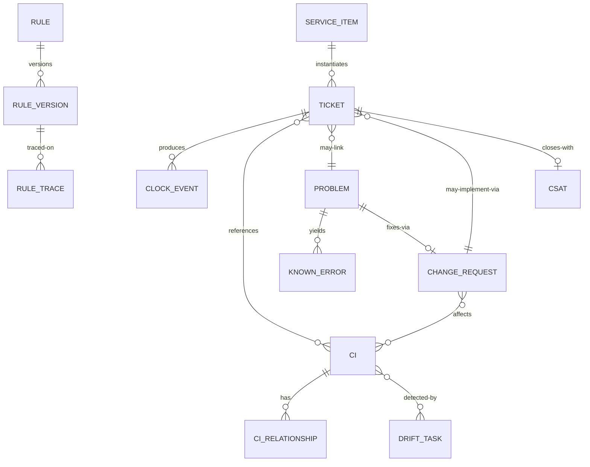

# 03 · Domain Model

> ⚠️ ASSUMPTION — bounded contexts and invariants are pack design.
> ISO/IEC 20000-1:2018 cl. 8.6 defines process *outcomes*, not this
> decomposition; see [`../SOURCES.md` §4](../SOURCES.md).

## Bounded contexts

| Context | Responsibility | Owns |
|---|---|---|
| **Catalog & Portal** | Published offerings, entitlement, announcements | ServiceItem, Offering, Announcement, KbArticle |
| **Ticketing** | Unified ticket core, priority, SLA clocks, worklog | Ticket, PriorityRule, SlaClock(event), Worklog, Escalation |
| **Problem** | Recurrence, RCA, known errors | Problem, KnownError, TicketLink |
| **Change** | RFC lifecycle, CAB, risk | ChangeRequest, CabDecision, ChangeWindow |
| **Configuration** | CI truth & dependencies | Ci, CiRelationship, CiStateHistory, DriftTask |
| **Automation** | Versioned rules, ingestion | Rule, RuleVersion, ChannelMessage, RuleTrace |
| **Reporting** | Read-model projections | SlaReport, MttrReport, CsatReport, CmdbHealth |

Reporting is **derived from the event log** (ADR-0002); it never mutates
source records.

## Core aggregates & invariants

### Ticket (aggregate root)
```
Ticket: id, type (incident|request), category, impact, urgency, priority,
lifecycle: state (SM-S1), requesterRef, entitlementScope,
slaRefs: [responseClock, resolutionClock], links: {cis[], problem?, change?,
knownError?}, channel, provenance
└── invariants
    • one record per work item; merges keep provenance (BR-01)
    • priority only via matrix; overrides recorded as events (BR-03)
    • clock changes only via clock events with reasons (BR-04, NFR-002)
    • history append-only; reopen appends, never rewrites (BR-07, BR-15)
    • visibility from entitlement scope + classification (BR-11)
```

### SlaClock (event-sourced, no mutable state)
```
ClockEvent: clockId, ticketRef, kind (start|pause|resume|stop|breach|warn),
ts, reason?, calendarRef
└── invariants
    • current position = fold(events) — bit-for-bit reproducible (NFR-002)
    • calendar is effective-dated; old folds use old calendars (BR-05)
```

### ChangeRequest
```
RFC: id, riskClass (standard|normal|emergency), affectedCis[], backoutPlan,
cabRef?, window, implementation {who, when, verify}, outcome, reviewRef?
└── invariants
    • risk class routes the workflow; emergency → post-review mandatory (BR-09)
    • implemented requires CI refs resolvable, not deleted (BR-10)
    • production fix requires RFC ref from problem (BR-08)
```

### Ci
```
Ci: id, type, state (planned|building|active|retired), attributes,
relationships: [{to, type, effectiveRange}]
└── invariants
    • referenced CIs retire, never hard-delete (BR-10)
    • state history retained (effective-dated view for reports)
```

### Rule / RuleVersion
```
Rule: id, purpose (route|priority|notify|webhook), versions[], activeVersion
RuleTrace: ticketRef, ruleId, version, input summary, actions taken
└── invariants
    • evaluation deterministic; every application stamped on ticket (BR-14)
    • activeVersion change never rewrites past RuleTraces
```

## Relationships (logical)


