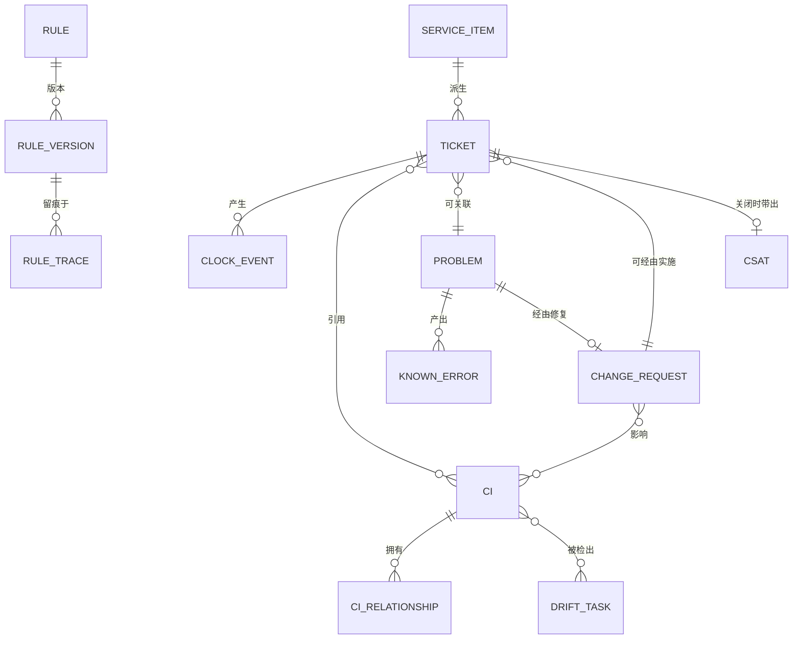

# 03 · 领域模型

> ⚠️ ASSUMPTION — 限界上下文与不变量属于方案包设计。
> ISO/IEC 20000-1:2018 第 8.6 条定义的是流程*结果*，而非这一分解；见
> [`../SOURCES.md` §4](../SOURCES.md)。

## 限界上下文

| 上下文 | 职责 | 拥有的类型 |
|---|---|---|
| **目录与门户** | 已发布的服务项、权限约束、公告 | ServiceItem, Offering, Announcement, KbArticle |
| **工单** | 统一工单内核、优先级、SLA 时钟、工作日志 | Ticket, PriorityRule, SlaClock(event), Worklog, Escalation |
| **问题** | 复发、根因分析、已知错误 | Problem, KnownError, TicketLink |
| **变更** | RFC 生命周期、CAB、风险 | ChangeRequest, CabDecision, ChangeWindow |
| **配置** | CI 的真相与依赖关系 | Ci, CiRelationship, CiStateHistory, DriftTask |
| **自动化** | 带版本的规则、接入 | Rule, RuleVersion, ChannelMessage, RuleTrace |
| **报表** | 读模型投影 | SlaReport, MttrReport, CsatReport, CmdbHealth |

报表是**从事件日志推导出来的**（ADR-0002）；它绝不修改源记录。

## 核心聚合与不变量

### Ticket（聚合根）
```
Ticket: id, type (incident|request), category, impact, urgency, priority,
lifecycle: state (SM-S1), requesterRef, entitlementScope,
slaRefs: [responseClock, resolutionClock], links: {cis[], problem?, change?,
knownError?}, channel, provenance
└── 不变量
    • 每个工作项一条记录；合并保留来源（BR-01）
    • 优先级只经矩阵得出；覆盖以事件记录（BR-03）
    • 时钟变更只能通过带理由的时钟事件进行（BR-04、NFR-002）
    • 历史仅可追加；重开是追加，绝不改写（BR-07、BR-15）
    • 可见性由权限范围 + 分级决定（BR-11）
```

### SlaClock（事件溯源，无可变状态）
```
ClockEvent: clockId, ticketRef, kind (start|pause|resume|stop|breach|warn),
ts, reason?, calendarRef
└── 不变量
    • 当前位置 = fold(events) — 可逐位复现（NFR-002）
    • 日历带生效日期；旧的折叠结果使用旧日历（BR-05）
```

### ChangeRequest
```
RFC: id, riskClass (standard|normal|emergency), affectedCis[], backoutPlan,
cabRef?, window, implementation {who, when, verify}, outcome, reviewRef?
└── 不变量
    • 风险分级决定流程路由；紧急 → 强制实施后复核（BR-09）
    • 标记为已实施要求 CI 引用可解析、而非被删除（BR-10）
    • 生产修复需要来自问题的 RFC 引用（BR-08）
```

### Ci
```
Ci: id, type, state (planned|building|active|retired), attributes,
relationships: [{to, type, effectiveRange}]
└── 不变量
    • 被引用的 CI 只退役，绝不硬删除（BR-10）
    • 状态历史保留（为报表提供带生效日期的视图）
```

### Rule / RuleVersion
```
Rule: id, purpose (route|priority|notify|webhook), versions[], activeVersion
RuleTrace: ticketRef, ruleId, version, input summary, actions taken
└── 不变量
    • 评估是确定性的；每次应用都在工单上打标（BR-14）
    • activeVersion 的变更绝不改写过去的 RuleTrace
```

## 关系（逻辑）


