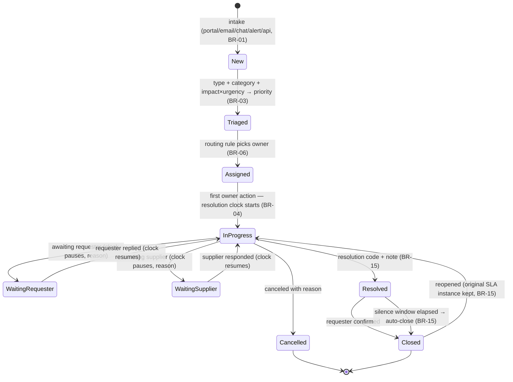
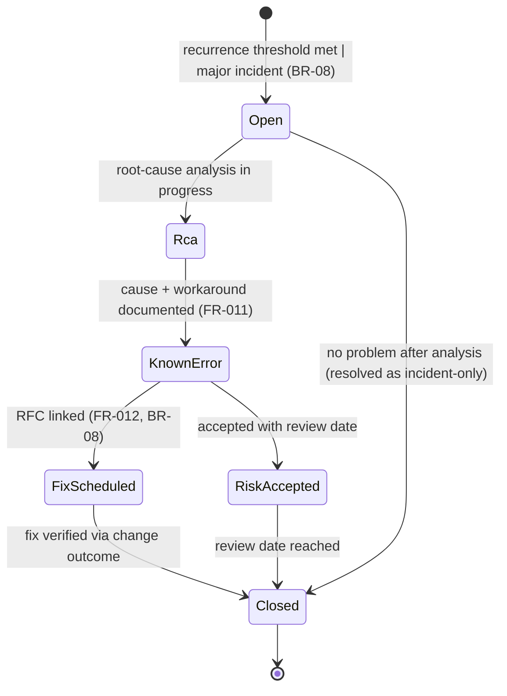
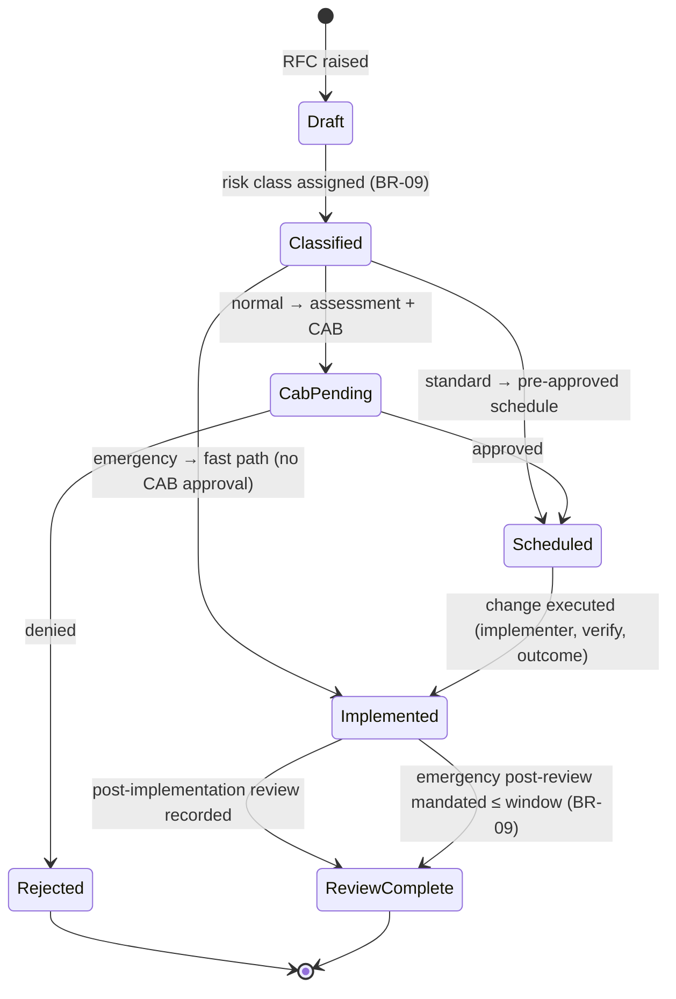

# 03 · State Machines

> ⚠️ ASSUMPTION — states and transitions are pack design; the cited clauses
> (ISO/IEC 20000-1 cl. 8.6) require the *outcomes*, not these lifecycles
> (see [`../SOURCES.md`](../SOURCES.md) §4).

IDs `SM-S1..SM-S3` (S = service desk). The `S` prefix is deliberate: other
packs in this library already use the bare `SM-n` and `SM-Tn` families, so a
service-desk machine must not collide with them when referenced across packs.
Full coverage of every key object is an L3 obligation; these anchor the
design at L2.

## SM-S1 Ticket (incident / service request)

Invariants: priority changes are events (BR-03); clock transitions are events
(BR-04, NFR-002); history is append-only (BR-07); a reopen never rewrites the
closed record (BR-15).

## SM-S2 Problem

Invariant: closing a fix requires an RFC reference (BR-08, FR-012).

## SM-S3 Change request

Invariant: the emergency path is the only one bypassing CAB approval and it
always terminates in `ReviewComplete` (BR-09).
