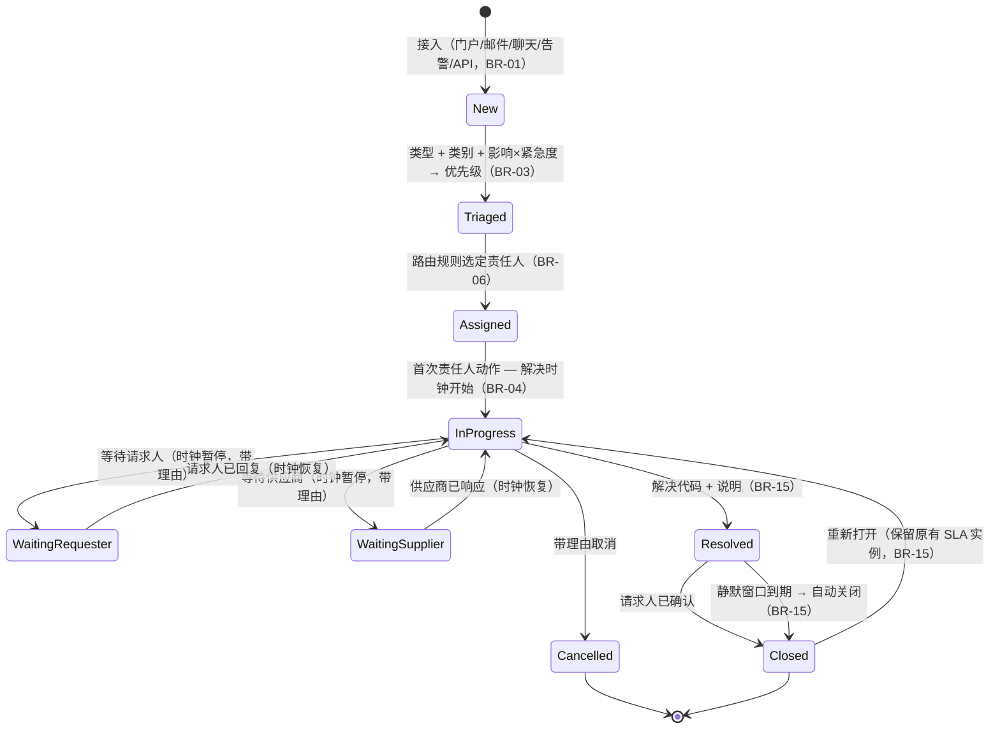
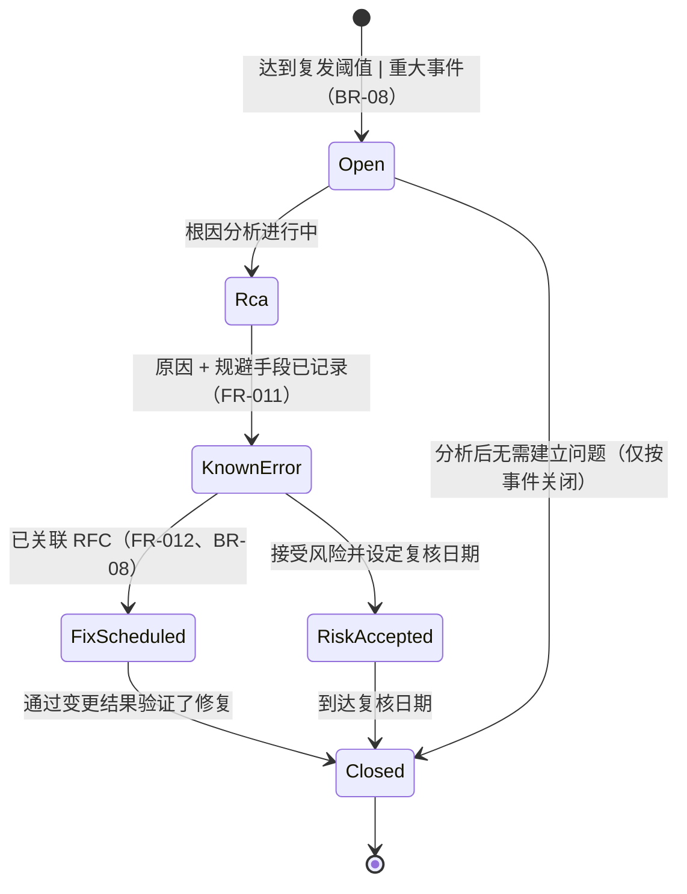
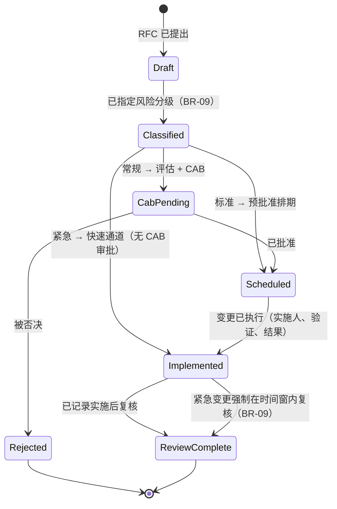

# 03 · 状态机

> ⚠️ ASSUMPTION — 状态与迁移属于方案包设计；所引用的条款
> （ISO/IEC 20000-1 第 8.6 条）要求的是*结果*，而非这些生命周期
> （见 [`../SOURCES.md`](../SOURCES.md) 第 4 节）。

ID 为 `SM-S1..SM-S3`（S = 服务台）。`S` 前缀是刻意选的：本库中的其他方案包
已经使用裸的 `SM-n` 与 `SM-Tn` 系列，因此服务台状态机在跨方案包引用时不能与
它们冲突。覆盖每个关键对象是 L3 的义务；这些状态机在 L2 阶段锚定设计。

## SM-S1 工单（事件 / 服务请求）

不变量：优先级变更即事件（BR-03）；时钟迁移即事件（BR-04、NFR-002）；历史仅可
追加（BR-07）；重开绝不改写已关闭的记录（BR-15）。

## SM-S2 问题

不变量：关闭一个修复需要 RFC 引用（BR-08、FR-012）。

## SM-S3 变更申请

不变量：紧急路径是唯一绕过 CAB 审批的路径，且它总是以 `ReviewComplete` 收尾
（BR-09）。
