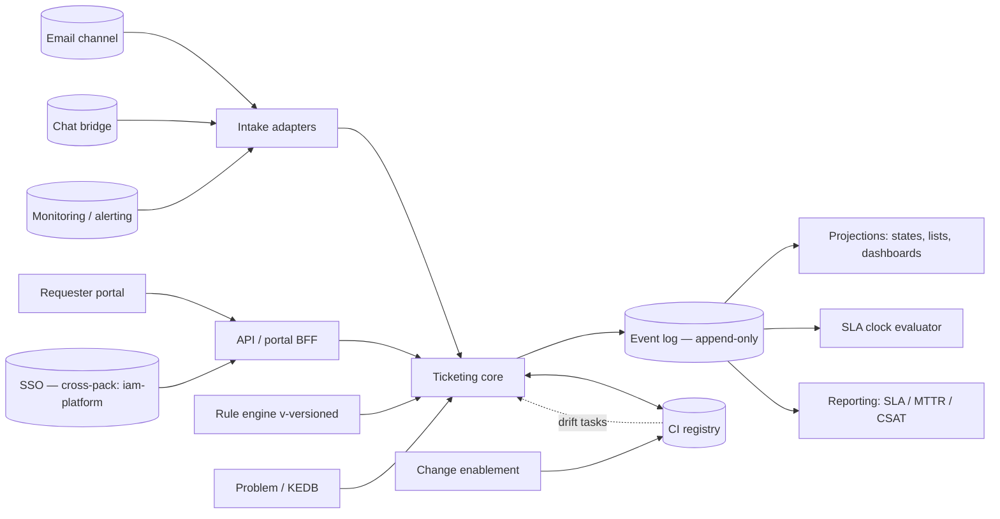

# 04 · Architecture Overview

> ⚠️ ASSUMPTION — component decomposition and topology are pack design;
> ADRs carry the load-bearing decisions.

## Component view

## Key structural rules

- **One backbone (ADR-0001):** every channel lands in Ticketing; adapters
  never resolve work themselves.
- **Clocks and reports are folds (ADR-0002):** no mutable SLA state; the
  event log is the only source for time and history claims.
- **Determinism before intelligence (ADR-0003):** rules with stamped
  versions; AI proposals enter through the same trace contract.
- **Registry-first CMDB (ADR-0004):** feeds advise and open drift tasks;
  they never silently rewrite CI truth.

## Deployment view (reference)

| Element | Notes |
|---|---|
| Portal/BFF + API | stateless; SSO via `iam-platform` (OIDC) |
| Channel adapters | one process/queue per channel; quarantine + replay (NFR-007) |
| Event log + projections | relational core + append-only history table (or log store); rebuildable projections |
| Rule engine | in-process evaluation with versioned rule store; dry-run mode |
| Reporting | read replicas / warehouse export; never writes back |
| Search | KB & ticket search index derived from projections |

> Topology is illustrative; pack stance is `stack-agnostic`.
