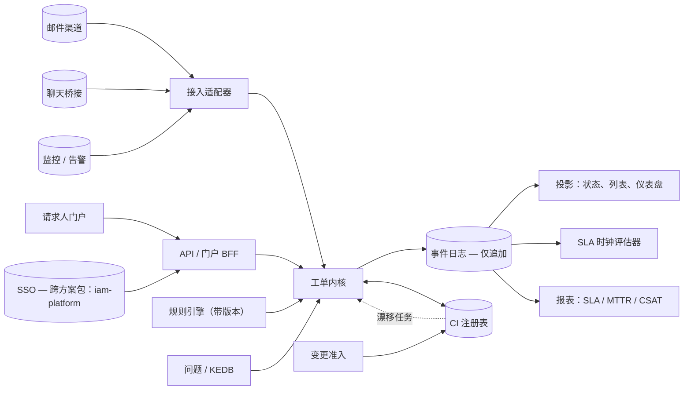

# 04 · 架构概览

> ⚠️ ASSUMPTION — 组件分解与拓扑属于方案包设计；承重的决策由 ADR 承载。

## 组件视图

## 关键结构规则

- **单一主干（ADR-0001）：** 每个渠道都汇入工单内核；适配器绝不自行解决工作。
- **时钟与报表是折叠（ADR-0002）：** 没有可变的 SLA 状态；事件日志是关于时间与
  历史的一切论断的唯一来源。
- **先确定性、后智能（ADR-0003）：** 规则带版本戳；AI 建议通过同一套追溯契约进入。
- **注册表优先的 CMDB（ADR-0004）：** 数据馈送只给出建议并开启漂移任务；它们
  绝不静默改写 CI 的真相。

## 部署视图（参考）

| 要素 | 说明 |
|---|---|
| 门户/BFF + API | 无状态；SSO 由 `iam-platform` 提供（OIDC） |
| 渠道适配器 | 每个渠道一个进程/队列；隔离 + 重放（NFR-007） |
| 事件日志 + 投影 | 关系型内核 + 仅追加历史表（或日志存储）；投影可重建 |
| 规则引擎 | 进程内评估，配合带版本的规则存储；试运行模式 |
| 报表 | 只读副本 / 数仓导出；绝不回写 |
| 检索 | 由投影派生的知识库与工单检索索引 |

> 拓扑仅作示意；本方案包的立场是 `stack-agnostic`。
